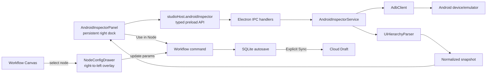

# A2MaTeX Studio — Mô tả tính năng Android UI Inspector

> **Trạng thái:** Phase 0/1 hoàn thành; Studio Phase 2 đã triển khai, chờ Catalog/Runtime contract<br>
> **Ngày đối chiếu:** 2026-11-08<br>
> **Phạm vi:** Studio Electron/React, Android qua ADB, workflow authoring và ranh giới với Runtime<br>
> **Xác minh:** lint, typecheck, 95 automated tests, desktop build và PNG Blob decode trên
> `emulator-5554`; packaging smoke test đa nền tảng chưa thực hiện

## 1. Mục đích của tài liệu

Tài liệu này vừa mô tả Android UI Inspector theo cấu trúc A2MaTeX Studio, vừa ghi nhận implementation
đến phần Studio của Phase 2. Runtime resolution trong Phase 3 và việc Catalog backend phát selector
marker vẫn chưa có, không được hiểu là capability end-to-end đã hoàn thành.

### 1.1. Mốc đã bàn giao

- **Phase 0:** dùng ADB ngoài ứng dụng qua `A2MATEX_ADB_PATH`, fallback `adb` trong `PATH`; screenshot
  truyền bằng `Uint8Array`; timeout toàn capture 20 giây; giới hạn PNG 20 MiB, XML 5 MiB và 20.000
  hierarchy node.
- **Phase 1:** right dock là Android Inspector; node parameters nằm trong drawer overlay; Electron Main
  enumerate/capture/parse snapshot; renderer hit-test, highlight, hiển thị candidate/detail và copy raw
  resource ID.
- **Studio Phase 2:** `AndroidSelectorV1`, Catalog marker mapping, custom selector control, Copy
  Selector, Use in Node, deep validation và local persistence đã triển khai.
- **Chưa hoàn thành end-to-end:** Catalog hiện tại vẫn chỉ phát `android.tap(x,y)` và chưa có property
  mang marker `android-selector-v1`; Runtime chưa resolve selector.
- **Snapshot smoke test:** PNG thật từ `emulator-5554` đi qua Main → preload/context bridge → Blob và
  load thành công ở kích thước 1080×2424.

## 2. Tóm tắt tính năng

Android UI Inspector là công cụ hỗ trợ Publisher lấy selector của một thành phần trên màn hình Android
khi đang thiết kế workflow.

Luồng chính:

1. Studio liệt kê các Android device/emulator mà ADB nhìn thấy.
2. User chọn một device và chủ động nhấn **Inspect**.
3. Electron Main chụp một snapshot gồm ảnh PNG, accessibility hierarchy và thông tin màn hình.
4. Studio hiển thị ảnh tĩnh đúng tỷ lệ.
5. User click lên ảnh; Studio tìm tất cả hierarchy node có bounds chứa điểm click.
6. Các candidate được sắp xếp theo mức độ cụ thể, user có thể xem metadata và highlight từng node.
7. User có thể copy resource ID, copy selector hoặc áp selector vào workflow node tương thích.

Inspector là công cụ authoring dựa trên snapshot. Nó không phải live mirror, không tự polling, không
thao tác trực tiếp lên device và không bảo đảm selector tiếp tục đúng ở lần chạy sau.

## 3. Giá trị đối với user

- Giảm việc phải tự dùng `adb` hoặc đọc XML hierarchy bên ngoài Studio.
- Tránh nhập thủ công resource ID dài và dễ sai.
- Cho thấy đầy đủ các element chồng lấp tại cùng một điểm thay vì tự chọn một element không giải thích.
- Giữ selector trong workflow dưới dạng có cấu trúc để Studio và Runtime có thể validate thống nhất.
- Tách rõ dữ liệu quan sát ở design time với việc resolve UI hiện tại ở execution time.

## 4. Phạm vi MVP

MVP bao gồm:

- Liệt kê device từ ADB, gồm serial, model và trạng thái.
- Chụp thủ công screenshot PNG, UI hierarchy và display metadata.
- Hiển thị screenshot giữ nguyên aspect ratio.
- Chuyển đổi tọa độ click từ viewport sang pixel gốc của screenshot.
- Hit-test toàn bộ node có bounds chứa điểm click.
- Hiển thị candidate list, highlight và metadata của element được chọn.
- Copy resource ID chính xác như hierarchy trả về.
- Báo lỗi có hướng xử lý cho ADB, device và hierarchy dump.
- Không lưu screenshot/XML vào project hoặc database mặc định.

Phần tích hợp selector với workflow chỉ được xem là hoàn thành khi có contract thống nhất giữa Node
Catalog, Studio và Runtime. Không nên coi việc ghi một object vào `node.config` là đủ để hoàn thành tính
năng end-to-end.

Ngoài phạm vi MVP:

- Video/live mirroring hoặc tự refresh theo timer.
- Hover để liên tục inspect element.
- Click/type lên device từ Inspector.
- Bảo đảm hierarchy đầy đủ cho game, Canvas, WebView hoặc custom rendering.
- Suy luận Z-order thật của Android.
- Tự tạo selector ổn định cho element không có resource ID.
- Resolve selector hoặc thực thi action trong Go Runtime.

## 5. Hiện trạng codebase sau Phase 1

| Năng lực             | Đã triển khai                                                                                                                              | Còn lại sau Phase 1                                                                            |
| -------------------- | ------------------------------------------------------------------------------------------------------------------------------------------ | ---------------------------------------------------------------------------------------------- |
| Workflow workspace   | Right dock hiển thị `AndroidInspectorPanel`; có Copy Selector và Use in Node qua một `node.updateParams` command                           | Action chỉ bật khi selected node có property được Catalog đánh dấu tương thích                 |
| Node editing         | `NodeConfigDrawer` có custom `AndroidSelectorControl`, không stringify object thành `[object Object]`                                      | Catalog hiện tại chưa cung cấp selector property để control xuất hiện trong workflow thực tế   |
| Inspector state      | Device, capture, snapshot, hit point và candidate state nằm cục bộ trong panel; không làm project dirty                                    | Nếu cần chia sẻ state ngoài panel ở Phase 2, tách store riêng thay vì đưa hết vào editor store |
| Workflow persistence | `AndroidSelectorV1` được deep-validate, update qua command, tăng một revision và local round-trip dưới dạng JSON                           | Cloud/Runtime contract test với backend thật vẫn cần thực hiện                                 |
| Node Catalog         | Mapper giữ `format` và raw nested schema; marker chuẩn là `android-selector-v1`                                                            | Catalog backend/cache hiện tại chưa phát marker; không suy luận từ category/tên field          |
| IPC/preload          | `window.studioHost.androidInspector.listDevices/capture` dùng typed `HostResult` và hai channel hẹp                                        | Phase 2 có thể dùng lại snapshot contract; không cần raw ADB API ở renderer                    |
| Electron Main        | Có process runner, ADB adapter, capture service, safe XML parser, limits, cleanup và typed error mapping                                   | Chính sách bundle ADB và smoke test đa nền tảng chưa có                                        |
| Runtime              | Nút Run trong workspace đang bị disable và ghi rõ runtime integration thuộc phase sau                                                      | Repo này chưa có selector resolver/executor để xác nhận behavior lúc chạy                      |
| Tests                | Có test geometry, ADB/parser/service/IPC, CSP Blob image, selector contract/mapper/validation, panel, drawer, revision và local round-trip | Chưa có E2E Catalog + Runtime thật hoặc packaging smoke test theo OS                           |

Kết luận: Inspector và selector authoring phía Studio đã tồn tại. Tuy nhiên, Use in Node sẽ chủ động bị
disable với catalog hiện tại; việc Copy Selector hoạt động không phải bằng chứng rằng Runtime đã có thể
resolve selector đó.

## 6. Các giả định cần kiểm tra

### 6.1. ADB đã có sẵn

Giả định rằng mọi máy user đã có ADB vẫn chưa được chứng minh. Phase 1 đã có ADB service nhưng không
bundle Android Platform Tools. Main process resolve `A2MATEX_ADB_PATH` trước, sau đó dùng `adb` trong
`PATH`; nếu không có sẽ trả `ADB_NOT_FOUND`.

Cần chốt một trong hai chính sách:

- Dùng `adb` do user cài và cấu hình path: gói app nhẹ hơn nhưng setup/error handling phức tạp hơn.
- Bundle platform-specific ADB: onboarding tốt hơn nhưng tăng kích thước, yêu cầu license, packaging,
  update và smoke test cho từng OS/architecture.

Đây là quyết định cho bản hiện tại, không phải quyết định packaging vĩnh viễn. Nếu release muốn bundle
ADB thì vẫn cần license, updater và smoke test riêng cho từng OS/architecture.

### 6.2. UIAutomator hierarchy phản ánh đầy đủ giao diện

Điều này không được bảo đảm. Resource ID có thể thiếu hoặc trùng; WebView, Canvas, game và custom view
có thể chỉ cung cấp hierarchy một phần. Screenshot và XML được chụp nối tiếp nên có thể lệch nhau nếu
màn hình thay đổi.

Vì vậy UI phải gọi danh sách là **Most specific first**, không gọi là Z-order; phải cho phép refresh và
hiển thị warning thay vì tạo bounds hoặc resource ID giả.

### 6.3. Screenshot và hierarchy dùng cùng hệ tọa độ

Không thể mặc định như vậy khi có rotation, display override, crop hoặc kích thước PNG khác `wm size`.
PNG dimensions là nguồn chính cho viewport. Phase 1 so sánh chúng với `wm size`; trường hợp chỉ hoán đổi
width/height được chấp nhận cho rotation. Với mismatch khác, snapshot vẫn trả ảnh nhưng bỏ hierarchy
nodes và cảnh báo rằng element inspection bị vô hiệu hóa, thay vì highlight theo phép biến đổi chưa
được chứng minh.

### 6.4. Mọi Android node đều nhận được selector

Node Catalog hiện chưa có semantic marker cho selector property. Suy luận bằng tên field như
`selector`, `resourceId` hoặc bằng category `ANDROID` là không đủ an toàn vì không phải Android node nào
cũng thao tác lên UI element.

Khuyến nghị: Catalog khai báo rõ property format/control, ví dụ `format: "android-selector-v1"` hoặc
editor hint tương đương. **Use in Node** chỉ bật khi node được chọn có đúng property contract đó.

### 6.5. Studio ghi selector thì Runtime sẽ chạy được

Repo hiện tại chưa có runtime integration và Go Runtime nằm ngoài phạm vi source đã đọc. Studio không
nên phát hành selector schema riêng rồi kỳ vọng Runtime tự hiểu. Contract cần được version hóa và có
fixture/contract test dùng chung giữa Catalog, Studio, Launcher và Runtime.

### 6.6. Electron Main chụp snapshot nên ảnh phải nằm ở đâu?

Việc Electron Main chụp snapshot xác định security/process boundary, nhưng về kỹ thuật không bắt buộc
ảnh phải nằm ở một vị trí UI cụ thể. Vị trí panel là quyết định UX đã được triển khai như sau:

- Khu vực Inspector bên phải hiện tại được thay bằng **Android UI Inspector**.
- Panel này giữ device controls, ảnh snapshot, candidate list và element detail; vẫn resizable và
  collapsible bằng `react-resizable-panels`.
- `NodeInspector.tsx` không còn chiếm panel cố định. Form tham số nhanh của node được chuyển thành
  **Node Config Drawer**.
- Khi chọn một node, drawer mở từ phải sang trái và nằm ngay bên trái Android UI Inspector.
- Drawer overlay lên canvas thay vì resize lại workspace, nhờ đó canvas không nhảy layout và snapshot
  vẫn luôn nhìn thấy.
- Click ra ngoài drawer, nhấn Escape hoặc Close sẽ thu drawer về bên phải nhưng không bỏ chọn node.

Giữ node selection sau khi drawer đóng là cần thiết: user có thể chọn node, đóng drawer, inspect ảnh và
dùng **Use in Node** cho node đó. Nếu đóng drawer đồng thời bỏ chọn node thì hành trình này sẽ bị gãy.

Drawer cấu hình nhanh này khác với full Node Detail được đề xuất trong
`workflow-editor-ux-update.md`. Quick drawer phục vụ điền tham số thường dùng; full Node Detail có thể
được mở bằng double-click khi phần Config/Description nâng cao được triển khai.

## 7. Trải nghiệm sử dụng

### 7.1. Mở Inspector và chọn device

Android UI Inspector có các control:

- **Android Device**: hiển thị `model — serial` và trạng thái.
- **Refresh devices**: chạy lại device enumeration.
- **Inspect**: chụp snapshot mới cho device đang chọn.

Chỉ device có trạng thái `device` mới được chọn để capture. Device `offline` hoặc `unauthorized` vẫn
được liệt kê để user hiểu nguyên nhân, nhưng action Inspect bị disable và có hướng dẫn tương ứng.

Không tự chuyển sang device khác khi device hiện tại mất kết nối.

### 7.2. Chụp snapshot

Khi user nhấn Inspect:

1. UI chuyển sang `capturing`, disable request trùng cho cùng device.
2. Electron Main xác thực device ID dựa trên danh sách vừa enumerate.
3. Main chụp screenshot, dump hierarchy và lấy screen metadata với timeout/size limit.
4. XML được parse thành node phẳng có `nodeId`, parent, depth, traversal index và bounds.
5. Renderer nhận snapshot đã normalize và hiển thị ảnh tĩnh.

UI hiển thị thời gian capture, device serial, kích thước screenshot và nhắc
**Refresh to inspect the current screen**.

Capture mới thành công sẽ thay snapshot cũ và xóa điểm click/candidate/highlight cũ. Capture mới thất
bại trên cùng device giữ snapshot thành công gần nhất nhưng đánh dấu **Outdated**. Đổi device sẽ xóa
ngay snapshot của device trước để tránh dùng nhầm selector.

### 7.3. Inspect một vị trí

Khi click bên trong phần ảnh thực sự được render:

1. Tọa độ được đổi về pixel gốc của PNG.
2. Studio tìm mọi node có bounds chứa điểm đó.
3. Node bounds lỗi hoặc có diện tích bằng 0 bị bỏ qua.
4. Candidate được sort: depth giảm dần, diện tích tăng dần, traversal index tăng dần.
5. Candidate đầu tiên được chọn mặc định và highlight.

User có thể chọn candidate khác mà không capture lại và không gọi ADB. Click vào letterbox hoặc ngoài
ảnh không tạo selection. Nếu không có candidate, hiển thị **No inspectable element at this position**.

### 7.4. Thông tin element

Panel detail tối thiểu hiển thị:

- Package name.
- Resource ID.
- Class name.
- Text.
- Content description.
- Bounds theo pixel gốc.
- Clickable và enabled.
- Depth hoặc node path.

Giá trị thiếu hiển thị `—`. Không tạo resource ID thay thế. Text/content description có thể chứa dữ
liệu riêng tư nên không được ghi vào production log.

### 7.5. Copy và Use in Node

- **Copy Resource ID**: chỉ bật khi resource ID tồn tại; copy raw string.
- **Copy Selector**: copy selector JSON theo schema đã version hóa.
- **Use in Node**: chỉ bật khi đang chọn một workflow node có property nhận đúng selector schema.

Sau Use in Node, update phải đi qua workflow command thay vì sửa React Flow state trực tiếp. Đây là
semantic edit: nó tăng working revision, đi qua local autosave và chỉ lên cloud khi user nhấn Sync theo
kiến trúc local-first hiện tại.

Device selection, snapshot, click point và highlight chỉ là transient editor state; chúng không tăng
working revision và không được autosave vào SQLite.

### 7.6. Chọn node và mở Node Config Drawer

- Single-click/chọn bất kỳ workflow node nào sẽ mở quick config drawer cho node đó.
- Drawer trượt từ phải sang trái, nằm ngay bên trái Android UI Inspector và không che snapshot.
- Nếu chọn node khác khi drawer đang mở, nội dung chuyển sang node mới mà không đóng/mở lại panel.
- Click bên ngoài, Escape hoặc nút Close thu drawer lại; selected node ID vẫn được giữ.
- Active field hoàn thành `blur`, validation và workflow command trước khi drawer đóng. Input không hợp
  lệ không được âm thầm ghi vào domain state.
- Với form nhanh hiện tại, các giá trị đã commit vẫn được giữ khi click-away; đóng drawer không phải là
  thao tác undo hoặc discard.
- Focus trở lại node đã chọn hoặc canvas sau khi đóng. Keyboard user phải có action tương đương
  click-away.
- Click **Use in Node** ở Android UI Inspector có thể làm drawer đóng vì là click bên ngoài, nhưng
  selector vẫn phải được áp vào node đang được chọn.

## 8. Mô hình trạng thái

```ts
type DeviceListState = 'idle' | 'loading' | 'ready' | 'error';
type CaptureState = 'idle' | 'capturing' | 'ready' | 'stale' | 'error';

type AndroidInspectorState = {
  devices: AndroidDevice[];
  deviceListState: DeviceListState;
  selectedDeviceId: string | null;
  captureState: CaptureState;
  snapshot: InspectorSnapshot | null;
  imagePoint: { x: number; y: number } | null;
  candidateNodeIds: string[];
  selectedNodeId: string | null;
  warning: string | null;
  error: InspectorError | null;
};
```

Trong Phase 1, state này nằm cục bộ trong `AndroidInspectorPanel`; panel luôn mounted khi right dock
collapse nên snapshot không bị mất chỉ vì thu panel. Blob URL được revoke khi snapshot đổi hoặc panel
unmount. Đổi device xóa snapshot ngay và response capture cũ bị bỏ qua bằng request generation guard.
Nếu Phase 2 cần truy cập Inspector state từ nhiều feature, nên tách store riêng thay vì đưa tất cả vào
`editor-store.ts`.

Node drawer dùng `nodeConfigDrawerOpen` và `selectedNodeId` trong `editor-store.ts`; đóng drawer chỉ đổi
`open = false`, không đặt `selectedNodeId = null`. Dữ liệu tham số vẫn thuộc workflow document và chỉ
thay đổi qua command.

## 9. Kiến trúc đã triển khai đến Phase 1



### 9.1. Module ownership

| Trách nhiệm                                                     | Vị trí hiện tại                                                                               |
| --------------------------------------------------------------- | --------------------------------------------------------------------------------------------- |
| Pure contracts, bounds parsing, hit-test và deterministic sort  | `src/domain/android-inspector/`                                                               |
| Application port, error codes và capture orchestration contract | `src/application/android-inspector/`                                                          |
| Renderer host interface                                         | `src/infrastructure/electron/studio-host-api.ts`                                              |
| Preload methods                                                 | `electron/preload/index.cts`                                                                  |
| IPC channel constants                                           | `electron/shared/channels.ts`                                                                 |
| Trusted sender/input validation handlers                        | `electron/main/ipc/register-android-inspector-handlers.ts`                                    |
| ADB process adapter và executable resolution                    | `electron/main/adapters/android/`                                                             |
| Capture orchestration/XML parsing                               | `electron/main/services/android-inspector/`                                                   |
| Composition                                                     | `electron/main/bootstrap.ts`                                                                  |
| UI, viewport, candidates và details trong right dock            | `src/presentation/features/android-inspector/`                                                |
| Quick node parameter drawer                                     | `src/presentation/features/workflow-editor/NodeConfigDrawer.tsx` bọc form `NodeInspector.tsx` |
| Panel replacement, drawer overlay và click-away                 | `src/presentation/pages/MainWorkflowPage.tsx`                                                 |
| Unit/component tests                                            | `tests/unit/domain/`, `tests/unit/electron/`, `tests/component/`                              |

Không tạo thêm global `window.a2matexInspector` như ví dụ trong spec gốc. Project hiện có một preload
surface là `window.studioHost`; mở rộng nó bằng namespace hẹp sẽ nhất quán và dễ audit hơn.

### 9.2. IPC surface

```ts
interface AndroidInspectorHostApi {
  listDevices(): Promise<HostResult<AndroidDevice[], AndroidInspectorErrorCode>>;
  capture(input: {
    deviceId: string;
  }): Promise<HostResult<InspectorSnapshot, AndroidInspectorErrorCode>>;
}
```

Channel đã dùng:

- `studio:android-inspector:list-devices`
- `studio:android-inspector:capture`

Renderer không được nhận raw shell API. Main phải dùng `spawn`/`execFile` với argument array, validate
sender, validate input và chỉ cho capture serial đang tồn tại trong device enumeration hợp lệ.

### 9.3. Snapshot contract

```ts
type InspectorBounds = {
  left: number;
  top: number;
  right: number;
  bottom: number;
};

type InspectorNode = {
  nodeId: string;
  parentId?: string;
  traversalIndex: number;
  depth: number;
  packageName?: string;
  resourceId?: string;
  className: string;
  text?: string;
  contentDescription?: string;
  bounds: InspectorBounds;
  clickable: boolean;
  enabled: boolean;
};

type InspectorSnapshot = {
  snapshotId: string;
  deviceId: string;
  capturedAt: string;
  screenshot: {
    mimeType: 'image/png';
    width: number;
    height: number;
    bytes: Uint8Array;
  };
  screen: {
    width?: number;
    height?: number;
    rotation?: number;
  };
  nodes: InspectorNode[];
  warnings: string[];
};
```

Phase 1 dùng binary bytes qua typed IPC với giới hạn dung lượng, tạo Blob URL ở Renderer và revoke khi
snapshot đổi/unmount. Nếu benchmark trên thiết bị thật cho thấy IPC copy quá tốn bộ nhớ, có thể chuyển
sang controlled local protocol ở phase sau thay vì mở quyền file tùy ý.

## 10. Capture và xử lý dữ liệu

Các lệnh tương đương cần được chạy với serial đã chọn:

```text
adb devices -l
adb -s <serial> exec-out screencap -p
adb -s <serial> shell wm size
adb -s <serial> shell uiautomator dump <unique-remote-path>
adb -s <serial> exec-out cat <unique-remote-path>
```

Yêu cầu bắt buộc:

- Không ghép command thành shell string.
- PNG luôn được đọc dưới dạng binary.
- Mỗi capture có timeout, cancellation và giới hạn PNG/XML/node count.
- Không cho hai capture cùng lúc trên cùng device; request cho device khác có thể chạy độc lập. Renderer
  dùng request generation guard để response cũ không ghi đè state sau khi user đổi device.
- Dùng remote path duy nhất nếu cần file trung gian và cleanup best effort.
- XML parser phải tắt DTD/external entity và không thực thi nội dung XML.
- Hierarchy fail nhưng screenshot thành công có thể trả partial snapshot với warning và `nodes: []`.
- Device disconnect giữa capture phải trả failure/partial rõ ràng, không báo snapshot hoàn chỉnh.

## 11. Coordinate mapping và hit-test

Với PNG `imageW × imageH` và viewport `viewW × viewH`:

```ts
const scale = Math.min(viewW / imageW, viewH / imageH);
const renderedW = imageW * scale;
const renderedH = imageH * scale;
const offsetX = (viewW - renderedW) / 2;
const offsetY = (viewH - renderedH) / 2;

const imageX = (pointerX - offsetX) / scale;
const imageY = (pointerY - offsetY) / scale;
```

`pointerX/Y` phải tương đối với viewport, không phải window. Click chỉ hợp lệ nếu nằm trong rectangle
`offsetX..offsetX + renderedW` và `offsetY..offsetY + renderedH`.

Hit-test dùng half-open rectangle:

```ts
left <= x && x < right && top <= y && y < bottom;
```

Sort candidate:

```ts
b.depth - a.depth || area(a.bounds) - area(b.bounds) || a.traversalIndex - b.traversalIndex;
```

Chỉ render overlay của candidate đang chọn. Không cần tạo một interactive DOM element cho mọi node
trong hierarchy.

## 12. Selector và workflow integration

### 12.1. Selector schema đề xuất

```ts
type AndroidSelectorV1 = {
  schemaVersion: 1;
  strategy: 'resourceId';
  value: string;
  packageName?: string;
};
```

`contentDescription` chỉ nên bổ sung khi Runtime và Catalog cùng hỗ trợ. Không đưa `snapshotId`,
`nodeId` hoặc bounds vào selector thực thi; các giá trị này chỉ có ý nghĩa trong snapshot hiện tại.

### 12.2. Contract Catalog cho Studio

Studio nhận selector-compatible property qua JSON Schema marker rõ ràng:

```json
{
  "target": {
    "type": "object",
    "format": "android-selector-v1",
    "properties": {
      "schemaVersion": { "type": "integer", "const": 1 },
      "strategy": { "type": "string", "const": "resourceId" },
      "value": { "type": "string", "minLength": 1 },
      "packageName": { "type": "string", "minLength": 1 }
    },
    "required": ["schemaVersion", "strategy", "value"],
    "additionalProperties": false
  }
}
```

Đã triển khai trong Studio:

- Mapper giữ `format`, nested raw schema và chọn custom `AndroidSelectorControl`.
- Deep validation cho version, strategy, non-empty value, optional package và unknown fields.
- Use in Node tìm target chỉ bằng marker, không suy luận từ category `ANDROID`, tên node hoặc tên field.
- Selector update dùng đúng một `node.updateParams`, tạo một semantic revision và đi qua autosave.
- Local save/reopen giữ nguyên selector object.

Catalog backend hiện tại chưa phát schema trên; `android.tap` vẫn nhận `x`/`y`. Vì vậy Use in Node bị
disable thay vì ghi một field mà Catalog và Runtime không hiểu.

### 12.3. Runtime boundary

Khi workflow chạy, Runtime phải dump hierarchy hiện tại và resolve lại selector. Resource ID trùng
không được âm thầm chọn match đầu tiên; kết quả cần phân biệt ít nhất:

- `ELEMENT_FOUND`
- `ELEMENT_NOT_FOUND`
- `AMBIGUOUS_SELECTOR`
- `ELEMENT_NOT_ACTIONABLE`
- `UI_DUMP_FAILED`
- `DEVICE_DISCONNECTED`
- `TIMEOUT`

Phase 1 Inspector có thể phát hành độc lập để copy resource ID. Phase 2 **Use in Node** không nên được
tuyên bố hoàn thành trước khi selector contract và runtime resolver có owner/test rõ ràng.

## 13. Error model

Error code tối thiểu:

```text
ADB_NOT_FOUND
ADB_START_FAILED
DEVICE_NOT_FOUND
DEVICE_OFFLINE
DEVICE_UNAUTHORIZED
CAPTURE_IN_PROGRESS
CAPTURE_TIMEOUT
SCREENSHOT_FAILED
SCREENSHOT_TOO_LARGE
HIERARCHY_DUMP_FAILED
HIERARCHY_TOO_LARGE
HIERARCHY_INVALID
COORDINATE_SPACE_MISMATCH
INSPECTOR_INTERNAL_ERROR
```

Mỗi `HostError` cần `code`, message an toàn cho user và `retryable`. Không trả raw command, local path,
full XML hoặc device content trong message/log.

Phase 1 trả lỗi typed khi toàn bộ operation không thể tiếp tục. Lỗi display metadata/hierarchy sau khi
đã có PNG được hạ thành warning và partial snapshot để user vẫn xem ảnh; các code hierarchy vẫn nằm
trong contract cho operation nghiêm ngặt hơn ở phase sau.

## 14. Bảo mật và quyền riêng tư

- Inspector không cần access token và không được truy cập auth credential.
- Renderer chỉ gọi operation hẹp qua preload; không có raw process/shell/file API.
- Validate trusted IPC sender giống các handler hiện có.
- Validate device ID bằng enumeration, không chỉ regex.
- Không persist screenshot, XML, text hoặc content description theo mặc định.
- Không đưa screenshot/XML/full element text vào telemetry.
- Blob URL phải được revoke khi snapshot bị thay hoặc component unmount.
- CSP chỉ cho phép `blob:` trong directive `img-src`; không mở `blob:` ở `default-src`, script hoặc
  connect source.
- Giới hạn kích thước payload trước khi parse/gửi IPC để tránh memory exhaustion.
- Nếu sau này có export snapshot, đó phải là action riêng, có vị trí lưu do user xác nhận.

## 15. Trạng thái triển khai theo phase

### Phase 0 — Contract cho Inspector độc lập: hoàn thành

- ADB policy: `A2MATEX_ADB_PATH` → `adb` trong `PATH`; chưa bundle ADB.
- IPC transport: `Uint8Array`; PNG tối đa 20 MiB, XML tối đa 5 MiB, hierarchy tối đa 20.000 node.
- Timeout: 10 giây cho từng process command, 20 giây cho toàn capture; remote XML cleanup best effort.
- Drawer: rộng 420 px, overlay canvas, animation 200 ms, đóng bằng click-away/Escape/Close và trả focus
  về workflow node nếu có.
- XML parser dùng `saxes`, reject DTD/entity và malformed XML; invalid/empty bounds bị bỏ kèm warning.

Catalog marker và `AndroidSelectorV1` được chuyển sang đầu Phase 2. Việc buộc hai quyết định đó vào
Phase 0 sẽ chặn một Inspector độc lập dù Phase 1 không ghi selector vào workflow.

### Phase 1 — Inspector độc lập: hoàn thành trong code

- [x] Thay right-side Inspector bằng Android UI Inspector, giữ resize/collapse.
- [x] Chuyển form node thành Node Config Drawer và tách drawer-open khỏi node selection.
- [x] Device enumeration, status và typed ADB/device errors.
- [x] Manual capture, PNG validation, hierarchy parser và normalized snapshot.
- [x] Screenshot viewport, coordinate mapping, deterministic hit-test và selected-node highlight.
- [x] Candidate list/detail và Copy Resource ID.
- [x] Timeout, per-device request deduplication, stale snapshot, partial hierarchy, remote cleanup và
      Blob URL cleanup.
- [x] Unit/component tests, lint, typecheck và desktop build.
- [x] Smoke test PNG thật trên `emulator-5554`: payload qua context bridge và `` load
      đúng 1080×2424.
- [ ] Packaging smoke test theo từng OS/architecture được hỗ trợ.

Phase này không sửa workflow data. Snapshot, point và inspected element đều là transient UI state.

### Phase 2 — Workflow selector authoring: Studio đã triển khai, integration còn chờ

- [x] `AndroidSelectorV1` và marker `format: "android-selector-v1"`.
- [x] Catalog mapper giữ marker/nested schema và custom selector control.
- [x] Copy Selector và Use in Node.
- [x] Deep validation và reject unknown selector fields.
- [x] Một workflow command, một semantic revision, autosave và local reopen round-trip.
- [x] Disable action cho node không có property tương thích.
- [ ] Catalog backend phát selector property cho node runtime thực sự hỗ trợ.
- [ ] Contract test với Cloud Draft backend và Runtime resolver thật.

### Phase 3 — Runtime resolution

- Resolver dùng hierarchy hiện tại.
- Zero/one/multiple match policy.
- Timeout/retry và structured execution errors.
- Contract/E2E test giữa Studio, Launcher và Go Runtime.

Tách Phase 1 khỏi Phase 2/3 đã giúp implementation không phụ thuộc Catalog/Runtime, đồng thời không tạo
ấn tượng sai rằng một resource ID được copy đã là selector có thể chạy.

## 16. Acceptance criteria

### 16.1. Bằng chứng xác minh hiện tại

| Nhóm                                                     | Trạng thái                               | Bằng chứng                                                                                                |
| -------------------------------------------------------- | ---------------------------------------- | --------------------------------------------------------------------------------------------------------- |
| Parser, bounds, coordinate mapping, hit-test/sort        | Đạt bằng automated test                  | `tests/unit/domain/android-inspector-geometry.test.ts`, `tests/unit/electron/ui-hierarchy-parser.test.ts` |
| ADB parsing/process, capture limits/errors/partial state | Đạt bằng automated test                  | `tests/unit/electron/adb-client.test.ts`, `tests/unit/electron/android-inspector-service.test.ts`         |
| IPC sender/input/error mapping                           | Đạt bằng automated test                  | `tests/unit/electron/android-inspector-ipc.test.ts`                                                       |
| CSP/Blob snapshot image                                  | Đạt bằng automated + emulator smoke test | CSP chỉ mở `blob:` cho `img-src`; PNG 1080×2424 load thành công trong Electron                            |
| Selector contract, Catalog mapper và deep validation     | Đạt bằng automated test                  | `tests/unit/domain/android-selector.test.ts`, `tests/unit/application/node-catalog-mapper.test.ts`        |
| Panel, Copy/Use Selector, stale response và Blob cleanup | Đạt bằng component test                  | `tests/component/android-inspector-panel.test.tsx`                                                        |
| Drawer/custom selector/click-away/Escape/blur commit     | Đạt bằng unit/component test             | `tests/unit/presentation/editor-store.test.ts`, `tests/component/node-config-drawer.test.tsx`             |
| Revision và local persistence                            | Đạt bằng automated test                  | `tests/unit/presentation/project-store.test.ts`                                                           |
| Repo regression                                          | Đạt                                      | ESLint, TypeScript typecheck, 95/95 tests và desktop build                                                |
| Catalog/Cloud/Runtime backend thật, packaging theo OS    | Chưa xác minh                            | Catalog hiện tại không có selector marker; Runtime resolver ngoài repo                                    |

Các tiêu chí dưới đây là release acceptance. Phần Studio đã được test độc lập; integration với
Catalog/Cloud/Runtime thật chưa được đánh dấu hoàn thành chỉ vì local build/test thành công.

### Inspector độc lập

- Panel Inspector bên phải hiện tại hiển thị Android UI Inspector thay cho empty/node-property state.
- Hai device kết nối được liệt kê đúng serial/model/status.
- Offline/unauthorized device không gây unhandled error và có hướng dẫn.
- Mỗi lần nhấn Inspect tạo đúng một capture; không có polling nền.
- Screenshot không bị stretch khi resize panel.
- Click trong letterbox không tạo selection.
- Click vào nested bounds hiển thị đầy đủ candidate theo thứ tự xác định.
- Chọn candidate khác chỉ đổi detail/highlight, không gọi ADB.
- Element không có resource ID hiển thị `—` và disable Copy Resource ID.
- Refresh thành công xóa selection cũ; refresh thất bại giữ snapshot cũ và đánh dấu stale.
- Hierarchy fail không tạo candidate giả và vẫn cho xem screenshot nếu screenshot hợp lệ.
- Đổi device xóa snapshot của device trước.
- Chọn node làm quick config drawer trượt từ phải sang trái và nằm bên trái Inspector, không che ảnh.
- Click ngoài drawer, Escape hoặc Close làm drawer thu lại nhưng không xóa selected node ID.
- Active field hoàn thành blur/validation/commit trước khi drawer đóng; invalid value không bị ghi ngầm.
- Chọn node khác khi drawer đang mở thay đúng nội dung mà không tạo history entry thừa.

### Workflow integration

- Use in Node chỉ bật với selector-compatible property do Catalog khai báo.
- Selector update đi qua workflow command và tạo đúng một semantic revision.
- Snapshot/click/highlight không làm project dirty.
- Selector round-trip qua SQLite, reopen, export/import và Cloud Draft không đổi dữ liệu.
- Runtime gặp duplicated resource ID trả ambiguity thay vì click tùy ý.

### Chất lượng kỹ thuật

- Parser, coordinate mapping, hit-test và sort có unit test bằng fixture.
- IPC handler test input validation, trusted sender và typed error mapping.
- Capture process có timeout/cancellation và không để child process treo.
- Test memory/cleanup xác nhận snapshot cũ và Blob URL được giải phóng.
- Desktop packaging smoke test xác nhận chính sách ADB trên mỗi OS được hỗ trợ.

## 17. Quyết định đã chốt và câu hỏi còn mở

### Quyết định đã chốt đến Phase 1

1. Giữ spec gốc làm behavior specification; dùng tài liệu này làm codebase integration guide.
2. Thay panel Inspector bên phải hiện tại bằng Android UI Inspector; chuyển quick node config thành
   drawer overlay nằm ngay bên trái panel này.
3. Mở rộng `window.studioHost`, không tạo preload global thứ hai.
4. Ship Inspector/copy resource ID trước; chỉ triển khai Use in Node sau khi có Catalog marker và
   selector contract.
5. Dùng binary screenshot payload có giới hạn; benchmark trên device thật trước khi cân nhắc local
   protocol.
6. Không persist snapshot; chỉ selector đã được user áp vào node mới là project data.
7. Dùng ADB ngoài app qua `A2MATEX_ADB_PATH`/`PATH`, timeout 20 giây và các limit đã ghi ở Phase 0.
8. Khi coordinate space không khớp, giữ screenshot nhưng không trả candidate để tránh highlight sai.

### Câu hỏi cần Product/Architecture/Runtime chốt

1. Release sau có bundle ADB hay tiếp tục yêu cầu user cấu hình?
2. OS/architecture nào phải được hỗ trợ và smoke-test ở release đầu?
3. Catalog backend sẽ phát `format: "android-selector-v1"` cho node/version nào và từ runtime version
   nào?
4. Khi resource ID trùng, Runtime chỉ báo ambiguity hay hỗ trợ composite selector ngay?
5. Runtime/Launcher owner nào chịu trách nhiệm contract test và error mapping?
6. Cloud Draft/backend fixture nào được dùng để chứng minh selector round-trip end-to-end?
