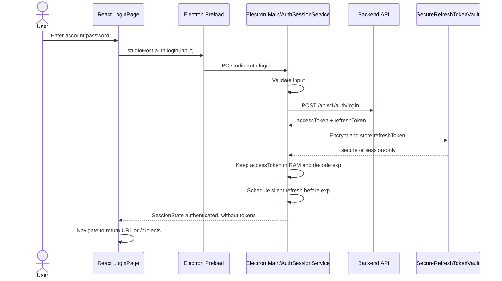
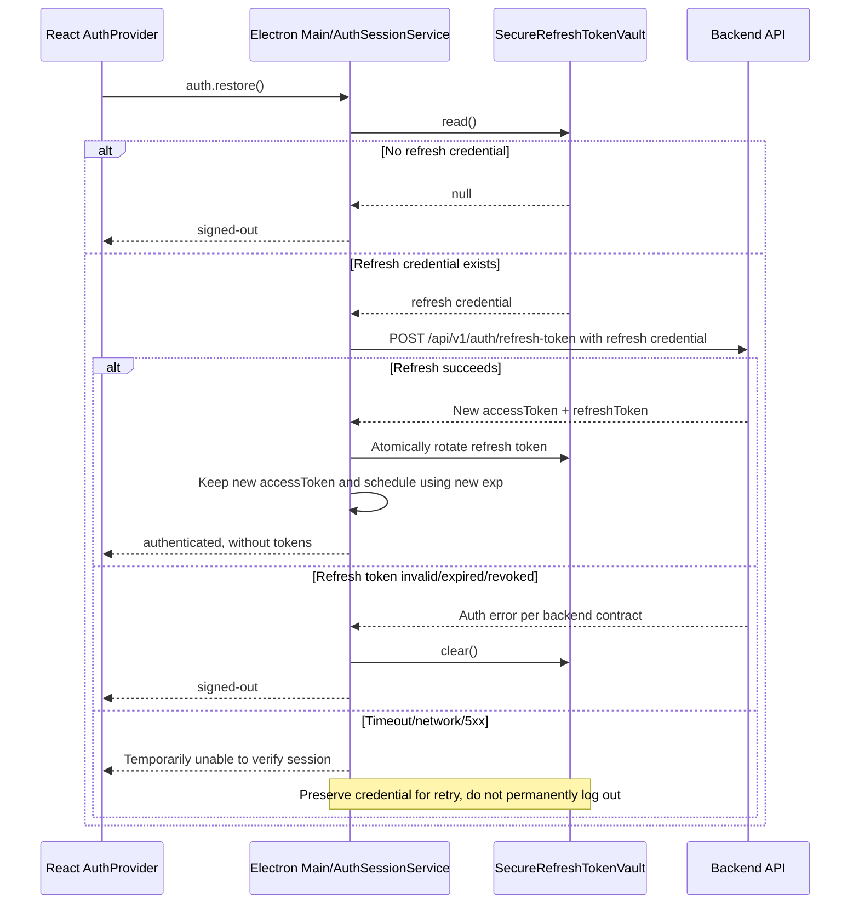

# Authentication Flow

This document describes the authentication flow of A2MateX Studio on Electron, including login, session restoration after restarting the application, access token refresh, and logout.

## 1. Objectives

- Users only need to enter their account/password on the initial login or when the refresh token is no longer valid.
- A session can be restored using the refresh token even after the application has been completely closed and reopened.
- The access token exists only in the memory of the Electron main process.
- Electron main decodes the access token's `exp` claim to proactively perform a silent refresh before the token expires.
- The refresh token is encrypted using Electron `safeStorage` before being written to disk.
- The renderer never receives the access token, refresh token, or `Authorization` header.
- Multiple concurrent requests encountering an expired access token trigger only one refresh request.
- Logout always terminates the local session, even if the logout API fails due to a network error.

## 2. API Contract

### 2.1. Login

```http
POST /api/v1/auth/login
Content-Type: application/json
```

```json
{
  "account": "user@example.com",
  "password": "password"
}
```

Successful response:

```json
{
  "data": {
    "accessToken": "<access-token>",
    "refreshToken": "<refresh-token>"
  },
  "statusCode": 200
}
```

The `accessToken` is a JWT containing an `exp` claim expressed as Unix time (in seconds). The client decodes the payload to schedule refreshes; decoded claims must not be used for authorization decisions or as a substitute for backend token validation.

### 2.2. Refresh Token

API documentation: [`POST /api/v1/auth/refresh-token`](https://api.a2matex.com/api/v1/docs#/Auth/AuthController_refreshToken)

```http
POST /api/v1/auth/refresh-token
Content-Type: application/json
```

OpenAPI declares `refreshToken` as an optional field. Electron main sends the refresh credential decrypted from the secure vault in the request body:

```json
{
  "refreshToken": "<current-refresh-token>"
}
```

The refresh token exists only in Electron main while constructing the request; it must not pass through the renderer, logs, or diagnostics.

Successful response:

```json
{
  "data": {
    "accessToken": "<new-access-token>",
    "refreshToken": "<new-refresh-token>"
  },
  "statusCode": 200
}
```

The backend returns a new refresh token, and the old token becomes invalid immediately after rotation. The client must have only one refresh request in flight and must atomically replace the old token in the secure vault as soon as a valid response is received, before allowing authenticated requests to resume.

### 2.3. Logout

API documentation: [`POST /api/v1/auth/logout`](https://api.a2matex.com/api/v1/docs#/Auth/AuthController_logout)

```http
POST /api/v1/auth/logout
Authorization: Bearer <access-token>
Content-Type: application/json
```

Request body:

```json
{}
```

Successful response:

```json
{
  "data": {
    "message": "Success"
  },
  "statusCode": 201
}
```

Logout requires a valid access token and revokes only the account's current session/device. Even if the API returns an error, times out, or is unreachable, the client must clear the local session and credentials.

## 3. Token Storage

| Data          | Location                                    | Lifetime                             |
| ------------- | ------------------------------------------- | ------------------------------------ |
| Password      | Temporary login form state                  | Cleared immediately after submission |
| Access token  | Electron main process RAM                   | Until logout/application shutdown    |
| Refresh token | File encrypted using Electron `safeStorage` | Across application restarts          |
| UI session    | React `AuthProvider`, without tokens        | Renderer lifecycle                   |
| Credential    | `<userData>/credentials/auth-session.json`  | Until logout/token invalidation      |

Do not store tokens in `localStorage`, `sessionStorage`, Zustand, project files, catalog caches, logs, or diagnostics.

## 4. Login Flow



If secure storage is unavailable, the refresh token must not be written to disk in plaintext. The session is marked `session-only`, and the user must log in again after closing the application.

## 5. Session Restoration on Application Startup



During restoration, the UI remains in the `restoring` state and must not redirect prematurely to `/login`. Display the login screen only when no credential exists or the backend confirms that the refresh token is no longer valid.

## 6. Access Token Expiration During Use

Every API requiring authentication must obtain the access token through a token coordinator in Electron main. The coordinator decodes the JWT payload and reads the `exp` claim to determine the expiration time:

```text
expiresAt = exp * 1000
refreshAt = expiresAt - refreshSkewMs
```

`refreshSkewMs` should be a configurable safety margin, defaulting to 60 seconds. Client-side JWT decoding is used only for scheduling; the client does not verify the signature or use the payload to make authorization decisions.

```text
Receive access token
  → decode exp and set a timer for refreshAt
  → at refreshAt: silently refresh using the refresh credential
  → receive and rotate the new token pair
  → decode the new exp and reset the timer

Before each authenticated request
  → access token is still valid: send the request
  → access token has expired/is about to expire: wait for silent refresh, then send with the new token
  → if the request unexpectedly returns 401: silently refresh and retry exactly once
```

Mandatory principles:

- Refresh must be single-flight so the same refresh credential is not used concurrently.
- The old refresh token becomes invalid immediately after rotation; no request may retain or retry with the old token.
- Access token expiration is a normal flow: do not display an error, change routes, or require the user to log in again.
- During silent refresh, new authenticated requests wait on the same refresh promise instead of continuing to send the old access token.
- Each request may be retried at most once to avoid infinite loops.
- Do not trigger refresh when the login or refresh-token request itself returns an authentication error.
- Transition to `signed-out` only when no refresh credential exists or the backend confirms the refresh credential is expired, invalid, or revoked.
- Timeouts, network failures, or 5xx errors during refresh must not clear the credential or force the user to log in again; keep the session in a retryable/offline state.
- New tokens must be fully validated before replacing the current session.

## 7. Logout Flow

```mermaid
sequenceDiagram
  actor User
  participant UI as React UI
  participant Main as Electron Main/AuthSessionService
  participant API as Backend API
  participant Vault as SecureRefreshTokenVault

  User->>UI: Select Logout
  UI->>Main: IPC studio:auth:logout
  Main->>API: POST /api/v1/auth/logout, Bearer accessToken, body {}
  API-->>Main: 201 Success and revoke current session/device
  Note over Main,API: Best effort; do not block local logout indefinitely
  Main->>Main: Clear access token from RAM
  Main->>Vault: Delete refresh credential
  Main-->>UI: signed-out
  UI->>UI: Navigate to /login
```

Local cleanup must run in a `finally` block so that an API logout failure cannot leave the session active on the device. Logging out on one device does not automatically log out other sessions/devices associated with the same account.

## 8. Error Handling

| Scenario                              | Client Behavior                                                |
| ------------------------------------- | -------------------------------------------------------------- |
| Incorrect account/password            | Display an error; do not store credentials                     |
| Login response missing tokens         | Report an invalid response; do not create a session            |
| Access token reaches `exp`            | Silently refresh; do not display an error or redirect to login |
| Refresh token invalid/expired/revoked | Clear credentials and transition to `signed-out`               |
| Refresh timeout or network failure    | Preserve credentials and wait for retry/offline recovery       |
| Refresh API returns 5xx               | Preserve credentials; do not force login                       |
| Writing the new refresh token fails   | Do not confirm a persistent session                            |
| Logout API fails                      | Still clear local tokens and session                           |
| Business API returns 401              | Silently refresh and retry at most once                        |

## 9. Security Boundaries

- The renderer receives only `SessionState`, such as account and persistence information; it never receives tokens.
- The password travels only one way, from the renderer to Electron main, through the login IPC.
- IPC handlers must validate the sender before accepting credentials.
- Do not log login request bodies, tokens, cookies, or `Authorization` headers.
- Decoding the JWT payload is only for scheduling based on `exp`; all authorization decisions remain the backend's responsibility.
- Production API connections must use HTTPS only.
- Credential files must have restricted permissions and be written atomically using a temporary file followed by rename.
- Do not copy real JWTs or credentials into source code, test fixtures, or documentation.

## 10. Codebase Mapping

| Responsibility                | File/Module                                                 |
| ----------------------------- | ----------------------------------------------------------- |
| Login form and navigation     | `src/presentation/pages/LoginPage.tsx`                      |
| React session state           | `src/presentation/features/auth/AuthProvider.tsx`           |
| Renderer auth client          | `src/infrastructure/electron/host-auth-client.ts`           |
| Preload IPC bridge            | `electron/preload/index.cts`                                |
| Main IPC handlers             | `electron/main/ipc/register-auth-handlers.ts`               |
| Login/restore/logout use case | `src/application/auth/auth-session.ts`                      |
| HTTP auth adapter             | `electron/main/api/auth.api.ts`                             |
| Secure refresh-token storage  | `electron/main/adapters/auth/secure-refresh-token-vault.ts` |
| Auth composition              | `electron/main/auth/create-auth-session-service.ts`         |

## 11. Acceptance Scenarios

- After a successful login, completely close and reopen the app and enter the workspace without seeing the login screen.
- When the access token expires, refresh and retry the request successfully without changing the UI route.
- The timer proactively performs a silent refresh before `exp`, without displaying an error or navigating to login.
- Multiple concurrent requests receiving `401` trigger only one refresh request.
- The new refresh token atomically replaces the old one after each successful refresh.
- After rotation, no request continues using the old refresh token.
- An expired/revoked refresh token redirects the user to login and clears local credentials.
- Losing network connectivity during startup does not clear the refresh credential.
- Online logout calls the API, revokes the correct current session/device, and clears the local session.
- Offline logout still clears the local session.
- Logging out on one device does not terminate sessions on other devices.
- Tokens/passwords never appear in renderer state, logs, projects, or diagnostics.
