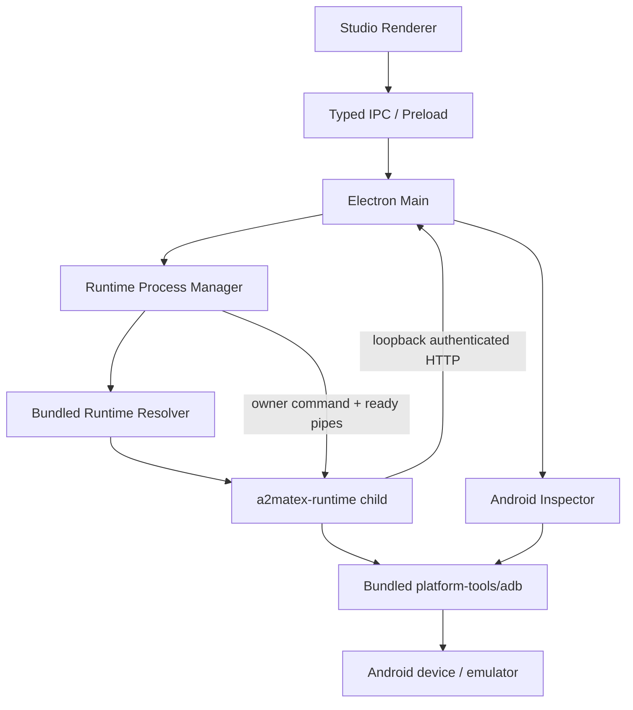

# A2MaTeX Studio — Đóng gói Runtime để người dùng tải app và chạy workflow

> **Trạng thái:** Phase 0–5 code complete cho Linux/Windows x64; native Windows CI, signing và fresh-device E2E còn cần xác minh  
> **Ngày đối chiếu:** 2026-11-22  
> **Phạm vi:** `a2matex-studio`, release artifacts của `a2matex-runtime`, Android Platform Tools,
> Linux `.deb`/AppImage và Windows NSIS `.exe`  
> **Liên quan:** [Local Runtime Integration Plan](local-runtime-integration-plan.md),
> [Runtime Device & Run API Integration Plan](runtime-device-run-api-integration-plan.md),
> [Desktop Onboarding and Windows Distribution](desktop-onboarding-and-windows-distribution.md)

## 1. Mục tiêu

Người dùng tải và cài A2MaTeX Studio, sau đó có thể validate, compile và chạy workflow mà không phải:

- cài Go hoặc Node.js;
- tải riêng `a2matex-runtime`;
- tải riêng Android Platform Tools chỉ để có `adb`;
- cấu hình `A2MATEX_RUNTIME_EXECUTABLE`;
- cấu hình `A2MATEX_RUNTIME_ADB_EXECUTABLE_PATH`;
- mở terminal và chạy Runtime bằng tay.

Runtime vẫn là một process riêng do Electron Main quản lý. “Tích hợp trong Studio” trong tài liệu này
nghĩa là Runtime và ADB được đóng gói trong installer, được Studio resolve từ resources của app và được
Studio tự khởi động khi cần; không có nghĩa là nhúng Go Runtime vào JavaScript bundle hoặc `app.asar`.

Luồng mong muốn:

```text
User cài/mở Studio
  -> chọn hoặc tạo Project
  -> kết nối Android device/emulator
  -> bấm Run
  -> Electron Main resolve bundled Runtime
  -> Studio spawn Runtime bằng managed lifecycle
  -> Runtime resolve bundled ADB
  -> Studio compile + start run
  -> workflow chạy trên device
  -> khi Studio thoát, managed Runtime cũng dừng
```

### 1.1. Implementation snapshot — 2026-11-22

Đã triển khai trong Studio:

- pin Runtime `0.1.0` bằng exact commit và pin Android Platform Tools `37.0.3` bằng URL versioned +
  SHA-256 trong `build/runtime-dependencies.json`;
- script stage an toàn, kiểm tra archive path traversal, checksum, version, executable mode và tạo
  `runtime-manifest.json`;
- integrity anchor được sinh vào `build/runtime-integrity.json`, đóng bên trong ASAR và được so với
  manifest ngoài ASAR trước khi Runtime được spawn;
- Linux `extraResources` đưa Runtime và full Platform Tools vào `resources/runtime/linux-x64`;
- Windows `extraResources` đưa `a2matex-runtime.exe`, `adb.exe`, hai ADB DLL và full Platform Tools vào
  `resources/runtime/win32-x64`;
- Runtime và Android Inspector dùng chung exact bundled ADB path; packaged mode không fallback sang ADB
  trong system `PATH`;
- Linux giữ FIFO ownership; Windows dùng inherited anonymous stdin/stdout pipes với `--owner-stdio`,
  application logs bị tách sang stderr để readiness token không thể lẫn vào log;
- managed Runtime smoke test xác minh `READY -> authenticated /runtime-info -> STOPPED`, explicit shutdown
  và owner-loss;
- release workflow checkout exact Runtime commit, native build, stage/verify/smoke trước packaging, inspect
  và smoke lại packaged resources;
- release evidence gồm CycloneDX SBOM, pinned dependency contract và Android Platform Tools NOTICE;
- Windows x64 đã trở lại release matrix; job native build, stage, smoke Runtime/Studio manager, inspect NSIS
  resources và fail nếu thiếu Authenticode signing credentials/signature;
- Runtime repository có native Linux/Windows release workflow, archives, checksums và Windows signing gate.

Bằng chứng local đã thực hiện:

- unit tests: 12 tests pass, gồm Windows executable resolution/transport và tamper detection cho toàn bộ
  Platform Tools tree;
- format, lint, typecheck và desktop build pass;
- `linux-unpacked`, AppImage và `.deb` đã build thành công;
- `.deb` contents có Runtime, ADB, manifest, NOTICE và executable mode đúng;
- packaged Electron QA xác nhận app spawn bundled Runtime, Validate trả `Workflow is valid`, Refresh
  Devices dùng bundled ADB và explicit shutdown không để orphan Runtime.
- Go test toàn bộ Runtime pass; Linux stdio compatibility smoke và owner-loss smoke pass;
- `a2matex-runtime.exe` đã cross-compile thành PE32+ x86-64; native execution vẫn phải chạy trên Windows CI.

Chưa được coi là acceptance đã pass:

- GitHub Actions mới chưa được chạy trên remote;
- Runtime branch `phase4-windows-runtime` và commit pin phải được push trước khi Studio CI có thể checkout;
- repository variable `ANDROID_SDK_LICENSE_ACCEPTED=1` cần project owner thiết lập sau khi chấp nhận
  Android SDK License;
- fresh-machine E2E với Android emulator/device READY và một workflow chạy đến terminal state chưa được
  thực hiện trong lượt triển khai này;
- Windows signing secrets, NSIS install/upgrade/uninstall và native Windows manager smoke chưa có live
  evidence;
- Linux udev rules chỉ có diagnostics/hướng dẫn, không được installer tự động sửa system permissions.

## 2. Đánh giá độc lập các giả định

### 2.1. Đóng gói Runtime không đồng nghĩa nhét binary vào ASAR

Binary cần được hệ điều hành execute trực tiếp. Vì vậy `a2matex-runtime`, `adb` và các DLL/file phụ trợ
phải nằm trong `resources/runtime/...` thông qua `electron-builder.extraResources`, không nằm trong
`app.asar`.

Đặt executable trong ASAR có thể làm path không phải file thực trên filesystem, mất executable mode
hoặc buộc Electron extract ngầm theo cách khó kiểm soát. Layout resources tường minh dễ kiểm tra hash,
quyền thực thi và version hơn.

### 2.2. Biến môi trường hiện tại chỉ là development override

Lệnh development:

```bash
A2MATEX_RUNTIME_ADB_EXECUTABLE_PATH=/absolute/path/to/adb npm run dev
```

không phải cơ chế phân phối cho người dùng cuối. Biến này chỉ cấu hình ADB mà Runtime child kế thừa;
nó không tự cài Runtime và cũng không thể chứa đường dẫn của máy developer trong release artifact.

Production phải chạy được khi tất cả các biến sau đều vắng mặt:

```text
A2MATEX_RUNTIME_EXECUTABLE
A2MATEX_RUNTIME_ADB_EXECUTABLE_PATH
A2MATEX_ADB_PATH
```

Các biến này vẫn có thể được giữ làm override phục vụ development hoặc diagnostics nội bộ, nhưng không
được là điều kiện để flow production hoạt động.

### 2.3. Auto-run Runtime nên là lazy-start, không nhất thiết eager-start

Runtime manager hiện khởi động Runtime khi operation đầu tiên gọi `ensureReady()`, ví dụ validate,
compile, list/refresh devices hoặc start run. Đây là lựa chọn khuyến nghị vì:

- không giữ process khi người dùng chỉ xem hoặc chỉnh metadata;
- lỗi Runtime không chặn toàn bộ app bootstrap;
- Runtime vẫn sẵn sàng trước operation cần nó;
- lifecycle owner, replacement và shutdown đã tập trung trong một manager.

Nếu Product yêu cầu hiển thị Runtime `READY` ngay sau khi mở Studio, nên thêm một explicit warm-up
operation có xử lý lỗi nền. Không gọi private lifecycle method rải rác trong bootstrap và UI.

### 2.4. Windows không dùng numeric POSIX file descriptors

Giả định ban đầu rằng có thể truyền `3/4` như Linux là không đúng trên Windows: `HANDLE` không phải POSIX
file descriptor. Implementation dùng anonymous pipes do Node tạo và expose cho child qua stdin/stdout:

- stdin chỉ nhận một control frame `shutdown\n`; EOF được coi là owner loss;
- stdout chỉ xuất đúng một readiness frame;
- Runtime chuyển application logs sang stderr trước khi khởi tạo logger;
- token không nằm trong CLI, file discovery hoặc renderer;
- Linux vẫn giữ FIFO descriptors hiện tại, không bị đổi contract.

Không dùng named connection file hay reusable TCP discovery record để né Windows ownership work.

### 2.5. Bundled ADB không loại bỏ mọi yêu cầu của thiết bị USB

Bundled Platform Tools loại bỏ yêu cầu user tự cài `adb`, nhưng không thể tự giải quyết mọi điều kiện
ngoài app:

- Android device vẫn phải bật Developer options và USB debugging;
- user vẫn phải xác nhận RSA authorization trên device;
- Linux có thể cần udev rules/quyền truy cập USB;
- Windows có thể cần driver USB của OEM;
- policy máy doanh nghiệp hoặc antivirus có thể chặn child executable.

Studio phải phân biệt lỗi “ADB không tồn tại” với “device chưa authorize”, “permission denied” và “driver
không nhận thiết bị”. Không được hướng dẫn user tắt antivirus hoặc chạy app với quyền admin như giải pháp
mặc định.

## 3. Baseline trước khi triển khai

Phần này ghi lại trạng thái được dùng để xác định scope, không phải trạng thái hiện tại sau implementation.
Kết quả hiện tại nằm ở [Implementation snapshot](#11-implementation-snapshot--2026-11-22) và
[Definition of Done](#15-definition-of-done).

### 3.1. Những phần đã có

- `electron/main/runtime/process/runtime-executable.ts` đã resolve:
  - development override `A2MATEX_RUNTIME_EXECUTABLE`;
  - development sibling `../a2matex-runtime/bin/a2matex-runtime`;
  - packaged resource `resources/runtime/<platform>-<arch>/a2matex-runtime`.
- `RuntimeProcessManager` đã có lazy start, single-flight startup, readiness probe, retry replacement và
  bounded shutdown.
- Runtime ADB resolver đã ưu tiên `platform-tools/adb` nằm cạnh Runtime executable.
- Studio đã có Runtime HTTP client và orchestration cho validation, compilation, devices và run.
- Release workflow trước thay đổi build Linux x64 và Windows x64.

### 3.2. Những khoảng trống đã được xử lý trong Phase 0–5

- Linux `extraResources`, exact Runtime source pin, Platform Tools archive pin/checksum và package gates;
- shared Runtime/ADB resolver, ASAR anchor, executable SHA-256 và no-PATH-fallback policy cho packaged mode;
- Android Inspector dùng cùng bundled ADB và có diagnostics cho device authorization/offline/permission;
- managed Runtime smoke test, package inspection, SBOM và license evidence trong release workflow.
- Windows stdio ownership adapter, `.exe`/DLL layout, Windows Platform Tools pin/tree hash, signing gates
  và native Windows release matrix.

Khoảng trống còn lại là live Windows runner/signing evidence và fresh-machine/device E2E. Chúng không bị
diễn giải sai thành đã hoàn thành chỉ vì cross-compile và Linux compatibility smoke pass.

## 4. Kiến trúc đích



Nguyên tắc:

1. Renderer không nhận Runtime executable path, ADB path, session token hoặc loopback URL.
2. Electron Main là process duy nhất resolve và spawn executable.
3. Runtime và Inspector dùng cùng một bundled ADB executable.
4. Runtime chỉ listen loopback và tiếp tục dùng per-session authentication.
5. Runtime phải dừng khi owner pipe đóng hoặc Studio shutdown.
6. Runtime/ADB artifacts phải được pin version và verify checksum trong CI.
7. Release không được publish nếu một platform thiếu artifact tương ứng.

## 5. Layout artifact bắt buộc

### 5.1. Linux x64

```text
resources/
└── runtime/
    └── linux-x64/
        ├── a2matex-runtime             # regular file, executable
        ├── runtime-manifest.json
        └── platform-tools/
            ├── adb                     # regular file, executable
            ├── fastboot
            ├── NOTICE.txt
            └── ...                     # các file trong official archive
```

### 5.2. Windows x64

```text
resources\
└── runtime\
    └── win32-x64\
        ├── a2matex-runtime.exe
        ├── runtime-manifest.json
        └── platform-tools\
            ├── adb.exe
            ├── AdbWinApi.dll
            ├── AdbWinUsbApi.dll
            ├── NOTICE.txt
            └── ...
```

Không copy riêng `adb.exe` mà bỏ DLL đi cùng. Để giảm sai khác với archive upstream, pipeline nên copy
nguyên thư mục `platform-tools`, sau đó áp dụng allow-list/size check nếu cần tối ưu dung lượng.

### 5.3. Runtime manifest

Mỗi runtime directory phải có manifest do CI tạo, ví dụ:

```json
{
  "schemaVersion": 1,
  "runtimeVersion": "0.1.0",
  "runtimeCommit": "<40 lowercase hex>",
  "platform": "linux",
  "arch": "x64",
  "runtimeSha256": "<64 lowercase hex>",
  "adbSha256": "<64 lowercase hex>",
  "platformToolsVersion": "<pinned version>",
  "platformToolsArchiveSha256": "<64 lowercase hex>",
  "platformToolsTreeSha256": "<64 lowercase hex>",
  "runtimeIrFormatVersions": [1]
}
```

Manifest là metadata build và verification input; Runtime `/runtime-info` vẫn là nguồn xác nhận version
thực tế sau khi child đã chạy. Studio phải fail closed nếu manifest platform/arch không khớp process hiện
tại hoặc executable hash không khớp.

## 6. Contract release giữa Studio và Runtime

### 6.1. Artifact names

Runtime repository nên phát hành tối thiểu:

```text
a2matex-runtime-<version>-linux-x64.tar.gz
a2matex-runtime-<version>-windows-x64.zip
SHA256SUMS.txt
```

Mỗi archive chỉ chứa artifact của một platform/architecture. Không dùng một artifact chứa tất cả nền
tảng rồi để Studio tự đoán file.

### 6.2. Version pinning

Studio phải pin version Runtime bằng một nguồn duy nhất, ví dụ file:

```text
build/runtime-dependencies.json
```

Nội dung đề xuất:

```json
{
  "runtimeVersion": "0.1.0",
  "runtimeArtifacts": {
    "linux-x64": {
      "name": "a2matex-runtime-0.1.0-linux-x64.tar.gz",
      "sha256": "<64 lowercase hex>"
    },
    "win32-x64": {
      "name": "a2matex-runtime-0.1.0-windows-x64.zip",
      "sha256": "<64 lowercase hex>"
    }
  },
  "platformTools": {
    "version": "<pinned version>",
    "linux-x64": {
      "archive": "platform-tools-latest-linux.zip",
      "sha256": "<64 lowercase hex>"
    },
    "win32-x64": {
      "archive": "platform-tools-latest-windows.zip",
      "sha256": "<64 lowercase hex>"
    }
  }
}
```

Tên archive upstream có thể chứa chữ `latest`, nhưng dependency file của Studio vẫn phải pin checksum và
version đã kiểm chứng. Không tải một URL thay đổi nội dung mà bỏ qua checksum.

### 6.3. Hai cách cung cấp Runtime artifact

**Quyết định đã triển khai cho Phase 0–3:** Studio CI checkout exact commit được pin, dùng Go version từ
`a2matex-runtime/go.mod`, native build Runtime và tạo SHA-256 trong manifest trước packaging. Cách này
không phụ thuộc vào một GitHub Runtime Release chưa tồn tại và vẫn fail closed khi checkout không đúng
commit. Khi Runtime có immutable release artifacts, có thể chuyển sang cách khuyến nghị dưới đây mà giữ
nguyên manifest/layout contract.

**Khuyến nghị — Runtime phát hành artifact độc lập:**

- Runtime CI build/test/sign một lần;
- Studio download đúng version;
- release Studio cũ có thể tái tạo từ version pin;
- dễ audit checksum và compatibility.

**Tạm thời — Studio CI checkout và build Runtime:**

- nhanh để unblock Linux packaging;
- cần Go toolchain, quyền đọc sibling/private repository và pin commit;
- dễ tạo binary khác nhau khi rebuild release cũ;
- làm Studio workflow phụ thuộc sâu vào cấu trúc Runtime repository.

Không build Runtime trên máy người dùng trong installer hoặc first run.

## 7. Thay đổi cần thực hiện trong Studio

### 7.1. `package.json`

Thêm `extraResources` theo platform. Với scope x64 hiện tại, cấu hình đích tương đương:

```json
{
  "build": {
    "linux": {
      "extraResources": [
        {
          "from": "build-resources/runtime/linux-x64",
          "to": "runtime/linux-x64"
        }
      ]
    },
    "win": {
      "extraResources": [
        {
          "from": "build-resources/runtime/win32-x64",
          "to": "runtime/win32-x64"
        }
      ]
    }
  }
}
```

Trước khi chốt config, cần xác nhận electron-builder version hiện tại hỗ trợ platform-specific
`extraResources` đúng như trên. Nếu cấu hình bị merge không đúng, dùng file config riêng theo platform
hoặc script staging, không giải quyết bằng cách đưa toàn bộ binaries mọi OS vào mọi installer.

### 7.2. Runtime executable resolver

`electron/main/runtime/process/runtime-executable.ts` cần:

- giữ absolute dev override;
- Linux resolve `a2matex-runtime`;
- Windows resolve `a2matex-runtime.exe`;
- chỉ cho phép resolved real path nằm trong expected runtime root;
- reject symlink và non-regular file như hiện tại;
- verify platform/arch manifest và SHA-256 trước khi spawn;
- trả lỗi phân loại rõ: missing, corrupt, incompatible, unsupported.

Không fallback sang một `a2matex-runtime` bất kỳ trong system `PATH` ở production.

### 7.3. Bundled ADB resolver dùng chung

Thêm resolver trong Electron Main, ví dụ:

```text
electron/main/runtime/process/bundled-adb-executable.ts
```

Policy:

```text
Development:
  explicit A2MATEX_ADB_PATH override
  -> sibling a2matex-runtime/bin/platform-tools/<adb name>
  -> PATH fallback chỉ khi development policy cho phép

Packaged:
  resources/runtime/<platform>-<arch>/platform-tools/<adb name>
  -> không PATH fallback mặc định
```

Android Inspector phải nhận executable path đã resolve qua constructor. Runtime không cần nhận
`A2MATEX_RUNTIME_ADB_EXECUTABLE_PATH` trong packaged mode nếu ADB nằm đúng adjacent layout mà resolver
Go đã hỗ trợ.

Nếu vẫn truyền environment cho child để explicit hóa path, chỉ tạo child `env` từ `process.env` cộng
đúng một validated absolute bundled path; không log environment hoặc path chứa dữ liệu nhạy cảm.

### 7.4. Runtime lifecycle

Giữ lazy managed lifecycle hiện tại:

```text
STOPPED -> STARTING -> READY -> STOPPING -> STOPPED
              |          |
              v          v
            FAILED <--- UNHEALTHY
```

Không thêm một Runtime process riêng cho mỗi operation. Mọi validate/compile/devices/run của cùng Studio
instance dùng một owned child còn healthy.

Khi user bấm Run:

1. `RuntimeRunCoordinator` capture immutable source snapshot.
2. Runtime manager `ensureReady()`.
3. Probe `/runtime-info` và compatibility.
4. Refresh device inventory.
5. Compile exact snapshot nếu cache không fresh.
6. Start run bằng stable request identity.
7. Poll/read run state theo contract hiện có.

ADB server được `adb` tự khởi động khi command đầu tiên cần nó chạy; Studio không cần chạy một daemon ADB
riêng bằng shell script.

## 8. Thay đổi cần thực hiện trong Runtime

### 8.1. Release automation

Runtime repository cần workflow:

1. chạy format/lint/test;
2. build native Linux x64;
3. build native Windows x64;
4. inject version, commit và build time;
5. chạy executable smoke test trên cùng OS;
6. tạo archive theo contract;
7. sinh SHA-256;
8. ký artifact nếu release policy yêu cầu;
9. publish immutable release artifacts.

Cross-compile Go có thể tạo binary, nhưng không thay thế native smoke test, đặc biệt với Windows handle
inheritance và process lifecycle.

### 8.2. Windows managed ownership

Runtime đã nhận numeric owner command/readiness handles và mở chúng thành `os.File`, nhưng toàn bộ đường
truyền phải được kiểm chứng trên Windows thật. Studio và Runtime cần thống nhất:

- loại pipe/handle được dùng;
- handle nào có thể inherit;
- cách truyền exact handle value qua CLI;
- command direction và readiness direction;
- EOF/owner-loss behavior;
- cleanup khi spawn thất bại;
- shutdown khi Studio crash hoặc exit;
- không để handle ngoài scope bị child inherit.

Không dùng connection file chứa session token làm fallback chỉ để né Windows pipe work. Nếu sau spike
cần protocol khác, phải cập nhật threat model và lifecycle contract trước.

## 9. Release pipeline của Studio

### 9.1. Build job theo platform

Mỗi matrix job thực hiện theo thứ tự:

1. checkout Studio;
2. install Node dependencies bằng lockfile;
3. đọc `build/runtime-dependencies.json`;
4. download Runtime artifact cho exact platform/arch;
5. verify Runtime archive SHA-256 trước khi extract;
6. download Platform Tools archive;
7. verify Platform Tools SHA-256 trước khi extract;
8. stage đúng layout trong `build-resources/runtime/<platform>-<arch>`;
9. kiểm tra file bắt buộc và executable mode;
10. tạo `runtime-manifest.json`;
11. build Studio;
12. package bằng electron-builder;
13. inspect unpacked package/installer contents;
14. smoke test packaged app trên runner hoặc VM phù hợp;
15. upload artifact chỉ khi tất cả gate pass.

### 9.2. Fail-closed checks

Linux build phải fail nếu thiếu hoặc sai:

```text
runtime/linux-x64/a2matex-runtime
runtime/linux-x64/runtime-manifest.json
runtime/linux-x64/platform-tools/adb
```

Windows build phải fail nếu thiếu hoặc sai:

```text
runtime/win32-x64/a2matex-runtime.exe
runtime/win32-x64/runtime-manifest.json
runtime/win32-x64/platform-tools/adb.exe
runtime/win32-x64/platform-tools/AdbWinApi.dll
runtime/win32-x64/platform-tools/AdbWinUsbApi.dll
```

Không chỉ kiểm tra staging directory. Phải inspect output sau electron-builder để chứng minh resources đã
được copy vào package thật.

### 9.3. Publication gate

Release job hiện phụ thuộc toàn bộ build matrix. Giữ fail-closed behavior:

- nếu Linux Runtime integration fail, không publish release có `.deb` lỗi;
- nếu Windows Runtime integration chưa hỗ trợ, có hai lựa chọn hợp lệ:
  1. bỏ Windows khỏi public release cho đến khi hoàn thành; hoặc
  2. công bố Windows là editor-only với capability flag rõ ràng.

Không phát hành `.exe` và mô tả “run workflow supported” khi code vẫn trả
`RUNTIME_PLATFORM_UNSUPPORTED`.

### 9.4. Build Windows từ máy developer

`npm run dist:win` chạy các smoke test Windows và do đó yêu cầu host `win32-x64`. Ubuntu x64 có thể tạo
installer bằng `npm run dist:win:cross`. Cross-build stage đúng Windows Runtime/Platform Tools, package
vào thư mục riêng `release-win`, rồi kiểm tra manifest, checksum, DLL, ASAR anchor và resources trong
`win-unpacked`. Runtime/ADB Windows không được execute trên Ubuntu; native Windows smoke/signature và
fresh-device E2E vẫn thuộc CI/acceptance trên Windows.

Mặc định, tải Platform Tools yêu cầu biến
`A2MATEX_ANDROID_SDK_LICENSE_ACCEPTED=1`, chỉ được đặt sau khi chủ dự án chấp thuận license. Nếu chủ dự
án đã cung cấp một archive được chấp thuận, có thể trỏ `A2MATEX_PLATFORM_TOOLS_ARCHIVE` tới archive đó;
script vẫn kiểm tra SHA-256 và version pin trước khi stage. Electron-builder cần Wine để tạo NSIS installer
trên Linux.

## 10. Security và integrity

### 10.1. Supply chain

- Pin Runtime version và artifact checksum.
- Pin Platform Tools version/checksum.
- Chỉ tải qua HTTPS từ nguồn đã chốt.
- Không execute file trước khi verify archive và extracted executable.
- Lưu source URL, version và checksum trong release evidence/SBOM.
- Review license/redistribution requirements trước khi phân phối Platform Tools.

### 10.2. Runtime integrity

- Verify `runtime-manifest.json` trước spawn.
- Verify SHA-256 của Runtime và ADB executable ở packaged mode.
- Không follow symlink ra ngoài runtime root.
- Không dùng shell để spawn Runtime hoặc ADB.
- Không đưa Runtime token/base URL sang renderer hoặc log.
- Windows nên ký cả installer, Studio executable và Runtime executable theo release policy.

### 10.3. Filesystem permissions

- Linux Runtime/ADB phải có executable mode nhưng không writable bởi user khác.
- Temporary owner pipes giữ permission chỉ cho current user.
- Runtime state/database tiếp tục nằm trong user-specific data path, không ghi vào installation directory.
- Installer upgrade không được xóa project database/user data.

## 11. User experience và diagnostics

### 11.1. Normal path

User không thấy bước “Install Runtime”. UI chỉ hiển thị trạng thái nghiệp vụ:

```text
Runtime: Starting -> Ready
Device: Detecting -> Ready
Run: Preparing -> Running -> Succeeded/Failed
```

### 11.2. Lỗi cần phân biệt

| Tình huống                        | Diagnostic/UI đề xuất                                       |
| --------------------------------- | ----------------------------------------------------------- |
| Runtime resource thiếu            | Installation is incomplete; reinstall Studio                |
| Runtime hash sai                  | Installation integrity check failed                         |
| Runtime version không tương thích | This Studio build requires a compatible Runtime             |
| Runtime startup timeout           | Runtime could not start; retry/restart Studio               |
| Bundled ADB thiếu/hỏng            | Android tools installation is incomplete                    |
| Không có device                   | Connect a device or start an emulator                       |
| Device unauthorized               | Confirm USB debugging authorization on the device           |
| Linux permission denied           | Configure device USB permissions/udev rules                 |
| Windows driver thiếu              | Install the USB driver supplied by the device vendor        |
| Device offline                    | Reconnect device or restart ADB through a controlled action |

Thông báo không được yêu cầu user tìm đường dẫn `adb` trong packaged normal flow.

### 11.3. Linux udev và Windows driver

MVP an toàn là detect và hướng dẫn có mục tiêu. Nếu `.deb` cài udev rules tự động, cần:

- legal/security review;
- danh sách vendor IDs có nguồn và được maintain;
- post-install/post-remove scripts idempotent;
- không cấp permission rộng cho mọi USB device;
- kiểm thử upgrade/uninstall.

Windows không nên bundle driver OEM tùy tiện. Studio chỉ hướng dẫn đúng vendor/device hoặc liên kết tài
liệu hỗ trợ đã được duyệt.

## 12. Kiểm thử bắt buộc

### 12.1. Unit tests

- resolve đúng executable name theo platform;
- reject relative override;
- reject symlink/outside-root/non-regular file;
- reject manifest platform/arch mismatch;
- reject SHA-256 mismatch;
- resolve bundled ADB cho Runtime và Inspector;
- packaged mode không fallback PATH;
- development overrides vẫn hoạt động có kiểm soát.

### 12.2. Integration tests

- concurrent operations chỉ spawn một Runtime child;
- Runtime ready record và `/runtime-info` thuộc cùng session;
- validate/compile/devices/run dùng bundled Runtime;
- Inspector và Runtime dùng cùng bundled ADB;
- Runtime crash được map/replaced đúng policy;
- Studio shutdown không để orphan Runtime;
- owner loss làm Runtime tự dừng;
- đường dẫn resources có space và Unicode vẫn chạy.

### 12.3. Package inspection

- inspect Linux unpacked resources;
- inspect `.deb` contents;
- inspect Windows unpacked resources/NSIS installation;
- xác nhận Runtime/ADB nằm ngoài ASAR;
- xác nhận executable mode Linux;
- xác nhận Windows DLL nằm cạnh `adb.exe`;
- xác nhận manifest/checksum tương ứng đúng bytes trong installer.

### 12.4. Fresh-machine end-to-end

Chạy trên VM/máy sạch không có Go, Node.js, Runtime hoặc system ADB:

1. cài Studio;
2. không set bất kỳ `A2MATEX_*` environment variable nào;
3. mở Studio;
4. đăng nhập và mở project;
5. kết nối emulator/device READY;
6. bấm Run;
7. xác nhận Runtime child được tự spawn;
8. xác nhận workflow thực thi trên device;
9. xác nhận run đạt terminal state;
10. thoát Studio;
11. xác nhận không còn Runtime child/orphan process;
12. mở lại Studio và chạy lần hai.

Linux phải test ít nhất `.deb`; AppImage là target riêng vì permission/integration khác `.deb`. Windows
phải test installer, upgrade, uninstall và first run trên Windows 10/11 x64 thật hoặc VM tương đương.

## 13. Kế hoạch triển khai theo phase

### Phase 0 — Artifact contract và dependency pin — Implemented

- Chốt Runtime artifact names, manifest schema và checksum policy.
- Thêm `build/runtime-dependencies.json`.
- Chốt Platform Tools version và redistribution review.
- Thêm script read-only để validate staging layout.

**Exit criteria:** CI có thể tải và verify immutable Runtime + Platform Tools artifacts cho Linux x64;
không execute artifact chưa verify.

### Phase 1 — Linux bundled Runtime — Implemented, local verified

- Thêm Linux `extraResources`.
- Stage `a2matex-runtime` và full `platform-tools`.
- Verify manifest/hash trước spawn.
- Package `.deb` và inspect contents.
- Chạy managed Runtime smoke test từ packaged resources.

**Exit criteria:** máy Linux sạch mở `.deb`, Validate/Compile/Run tự khởi động bundled Runtime mà không có
environment override hoặc system Runtime.

### Phase 2 — Unified bundled ADB — Implemented, local verified

- Thêm shared ADB resolver trong Electron Main.
- Chuyển Android Inspector sang bundled ADB.
- Giữ dev override có kiểm soát.
- Thêm diagnostics unauthorized/offline/permission/driver.

**Exit criteria:** máy sạch không có `adb` trong `PATH` vẫn refresh devices, Inspector capture và chạy
workflow bằng cùng bundled Platform Tools.

### Phase 3 — Linux release hardening — Code complete, external acceptance pending

- Thêm checksum/package inspection gates.
- Định nghĩa clean VM/device E2E và giữ acceptance ở trạng thái pending cho đến khi có device READY.
- Đánh giá udev onboarding.
- Bổ sung SBOM/license notices.
- Xác nhận upgrade/uninstall không ảnh hưởng user data.

**Exit criteria:** Linux release job fail closed khi thiếu/sai Runtime, ADB hoặc manifest; fresh-machine
E2E pass.

### Phase 4 — Windows managed Runtime spike — Implemented, native acceptance pending

- Implement Windows inherited stdio pipe adapter.
- Resolve `.exe` executable name và loại bỏ Windows `RUNTIME_PLATFORM_UNSUPPORTED` gate.
- Thêm shutdown, owner-loss, ready record và exact manager-state smoke trên Windows runner.
- Không thay bằng insecure connection file fallback.

**Exit criteria:** packaged Studio trên Windows đạt `STOPPED -> STARTING -> READY -> STOPPED`, không orphan
child, token không lộ ra renderer/log.

### Phase 5 — Windows bundled distribution — Automation implemented, live acceptance pending

- Pin Windows Runtime source và versioned Platform Tools archive/checksum.
- Thêm Windows `extraResources`, full tree hash và required ADB DLL checks.
- Bắt buộc signing credentials, verify Authenticode cho Studio, Runtime và NSIS installer.
- Inspect `win-unpacked`/ASAR anchor và smoke exact packaged manager resources.
- Giữ fresh-machine workflow E2E ở pending cho đến khi chạy trên Windows 10/11 với device READY.

**Exit criteria:** Windows x64 user cài `.exe`, không cài Runtime/ADB riêng, và chạy workflow thành công;
uninstall/upgrade pass, không còn `RUNTIME_PLATFORM_UNSUPPORTED`.

## 14. Danh sách file dự kiến thay đổi

### Studio

- `package.json`
- `.github/workflows/release.yml`
- `build/runtime-dependencies.json` (mới)
- `scripts/prepare-runtime-resources.mjs` (mới)
- `scripts/verify-packaged-runtime.mjs` (mới)
- `electron/main/runtime/process/runtime-executable.ts`
- `electron/main/runtime/process/runtime-pipes.ts`
- `electron/main/runtime/process/bundled-adb-executable.ts` (mới hoặc tên tương đương)
- `electron/main/adapters/android/adb-client.ts`
- `electron/main/bootstrap.ts`
- Runtime/ADB resolver, lifecycle và packaging tests tương ứng

### Runtime

- Runtime release workflow mới
- Windows-specific owner pipe/handle implementation nếu spike xác nhận cần tách platform
- Runtime artifact manifest/checksum scripts
- Native Linux/Windows smoke tests

Tên file mới là đề xuất, không phải contract bắt buộc. Khi triển khai phải giữ boundary hiện có và tránh
duplicate resolver/lifecycle logic.

## 15. Definition of Done

Chỉ đánh dấu hoàn thành cho từng platform khi tất cả điều kiện sau đúng:

- [x] Installer chứa đúng Runtime binary cho Linux x64.
- [x] Installer chứa Platform Tools và mọi dependency đi kèm.
- [x] Runtime/ADB nằm ngoài ASAR.
- [x] CI được cấu hình verify immutable checksum trước packaging; live run còn pending.
- [x] App verify anchored manifest/integrity trước spawn.
- [x] Packaged mode không cần environment variables.
- [x] Packaged mode không cần system Runtime hoặc ADB.
- [x] Validate chạy qua bundled Runtime trong packaged Electron QA (`Workflow is valid`).
- [ ] Compile chạy qua bundled Runtime trên project có compile input phù hợp.
- [x] Device refresh và Inspector resolve bundled ADB.
- [ ] Run workflow thành công trên emulator/device READY.
- [x] Runtime tự dừng khi Studio explicit shutdown; owner-loss automation đã có smoke/lifecycle coverage.
- [x] Packaged QA không còn orphan Runtime sau shutdown.
- [ ] Fresh-machine E2E pass trên installer thật.
- [x] Diagnostics phân biệt installation integrity, authorization, offline và Linux USB permission.
- [x] Windows managed transport không dùng connection file và không đưa token vào CLI/log.
- [x] Windows Runtime/ADB resolver, Platform Tools DLL/tree integrity và `extraResources` đã triển khai.
- [x] Windows native build/package/signature/smoke gates đã được cấu hình fail closed trong CI.
- [ ] Runtime commit pin đã được push và native Windows CI pass.
- [ ] Authenticode signing chạy thành công với production certificate.
- [ ] NSIS install/upgrade/uninstall và fresh-machine workflow E2E pass trên Windows 10/11.

## 16. Ngoài phạm vi

- Tự động bật Developer options/USB debugging trên điện thoại.
- Tự động chấp nhận RSA authorization thay user.
- Bundle mọi OEM USB driver Windows.
- Cho phép renderer spawn Runtime/ADB trực tiếp.
- Download executable không pin version/checksum trong first run.
- Chạy workflow cloud khi Local Runtime không có.
- Coi liveness `/health` là đủ để bỏ qua authenticated `/runtime-info` compatibility probe.

## 17. Kết luận

Đường đi phù hợp không phải thêm một shell command vào installer, mà là coi Runtime và Platform Tools là
versioned release dependencies của Studio. Electron Main tiếp tục sở hữu lifecycle; electron-builder chỉ
phân phối đúng sidecar artifacts; CI và app cùng fail closed khi artifact thiếu, sai platform hoặc sai
integrity.

Linux vẫn là platform có local packaged evidence đầy đủ hơn. Windows code path, distribution layout và
fail-closed CI đã được triển khai, nhưng chỉ được công bố production-ready sau khi commit Runtime được
push, native Windows job ký/chạy thành công và fresh-machine device E2E pass. Cách này tránh đánh đồng
“cross-compile được `.exe`” với “installer thực sự chạy workflow và cleanup đúng trên Windows”.
