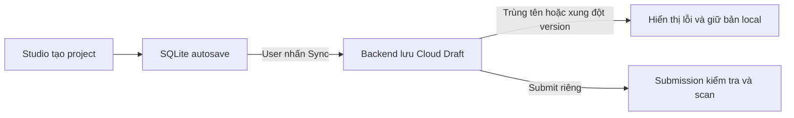

# A2MaTeX Studio — Project Management, Local Autosave & Cloud Sync

**Version:** 2.1

**Architecture:** Local-first / SQLite Autosave / Explicit Cloud Sync

## Overview

Studio tạo project và lưu working copy vào SQLite. Khi đăng nhập, Studio tải danh sách cloud project của Publisher để kiểm tra tên trước khi tạo project. User chủ động nhấn Sync để lưu Cloud Draft, kể cả khi workflow chưa hoàn chỉnh hoặc chưa hợp lệ. Submission là bước riêng có kiểm tra và scan. MVP demo dùng một tài khoản trên một thiết bị tại một thời điểm.

## 1. Nguyên tắc thiết kế

A2MaTeX Studio sử dụng mô hình local-first.

- SQLite là source of truth của project working copy.
- Khi tạo project, hệ thống khởi tạo project và draft local trong SQLite.
- Mọi thay đổi trong editor được tự động lưu vào SQLite thông qua debounce.
- Autosave chỉ lưu local, tuyệt đối không tự động gọi Cloud Sync.
- Backend Project quản lý remote identity, ownership và metadata.
- Backend ProjectDraft lưu current workflow snapshot có version.
- Chỉ khi user nhấn nút Sync mới đưa SQLite draft lên cloud.
- Cloud refresh không được tự động ghi đè workflow đã có local.
- Nếu local và cloud có thay đổi không tương thích, dừng Sync, hiển thị lỗi và giữ working copy local.
- Không cho tạo project trùng normalized name.

## 2. Phân biệt Local Draft và Cloud Draft

### 2.1. Local Draft — SQLite

Local Draft là working snapshot được lưu trong SQLite.

Bao gồm:

- Project metadata.
- Workflow documents.
- Input schema.
- Runtime IR.
- Validation summary.
- Test summary.
- Local revision và trạng thái sync.

Local Draft được tạo ngay khi project được tạo.

Sau đó được cập nhật tự động thông qua debounce autosave mỗi khi user chỉnh sửa.

Local Draft không sử dụng backend ProjectDraft `version` làm revision của mình.

### 2.2. Cloud Draft — Backend

Cloud ProjectDraft chỉ tồn tại sau lần Sync thành công đầu tiên.

Cloud Draft chứa:

- `editorGraph`
- `inputSchema`
- `runtimeIr`
- `validationSummary`
- `testSummary`
- `version`
- `contentHash`
- `savedAt`

Mỗi Project có tối đa một current ProjectDraft trên backend.

Mỗi lần sync thành công, backend quyết định version mới theo optimistic locking và same-content retry rules.

### 2.3. So sánh

| Đặc điểm          | Local Draft        | Cloud Draft             |
| ----------------- | ------------------ | ----------------------- |
| Storage           | SQLite             | Backend                 |
| Được tạo khi      | Create Project     | Sync lần đầu            |
| Được cập nhật khi | Autosave           | User nhấn Sync          |
| Revision          | `local_revision`   | `version`               |
| Hoạt động offline | Có                 | Không                   |
| Conflict handling | Local transaction  | Optimistic locking      |
| Source of truth   | Local working copy | Remote current snapshot |

**Invariant:** Autosave không đồng nghĩa với Sync. Một project có thể có hàng trăm lần autosave local nhưng vẫn chưa có Cloud ProjectDraft.

---

## 3. Create Project Lifecycle

### 3.1. Tạo project mới

Khi user submit Create Project:

1. Normalize project name bằng `lower(trim(name))`.
2. Kiểm tra duplicate name trong SQLite và cloud project index của Publisher đã tải khi khởi động. Khi offline, dùng danh sách cloud gần nhất đã cache.
3. Khởi tạo `local_id`.
4. Đặt `remote_project_id = NULL`.
5. Tạo initial Project metadata.
6. Tạo initial WorkflowDocument.
7. Tạo `project_draft_state`.
8. Commit tất cả trong một SQLite transaction.
9. Mở project workspace bằng `local_id`.

Ngay sau transaction, project đã có một local draft hợp lệ, kể cả khi user chưa chỉnh sửa workflow.

Không gọi `POST /projects` hoặc `PUT /draft` trong Create flow.

### 3.2. Giá trị khởi tạo

Ví dụ:

- `local_revision = 0`
- `metadata_revision = 0`
- `remote_project_id = NULL`
- `base_remote_version = NULL`
- `observed_remote_version = NULL`
- `last_synced_local_revision = NULL`
- `sync_status = local-only`

Project có thể được chỉnh sửa và autosave hoàn toàn offline.

---

## 4. Debounced Local Autosave

### 4.1. Mục tiêu

User không cần nhấn Ctrl+S sau mỗi lần chỉnh sửa.

Khi user thay đổi project hoặc workflow, Studio tự động lưu working state vào SQLite sau một khoảng thời gian không có thay đổi mới.

**Debounce đề xuất: 3 giây.**

Thời gian được tính từ lần thay đổi dữ liệu cuối cùng, không phải từ lần click chuột hoặc di chuyển con trỏ cuối cùng.

### 4.2. Autosave trigger

Autosave được kích hoạt khi thay đổi:

- Project name hoặc description.
- Workflow nodes/edges.
- Node position hoặc persisted layout.
- Node parameters.
- Workflow metadata.
- Entry workflow.
- Input schema.
- Các cấu hình khác thuộc persisted authoring document.

Không trigger autosave khi chỉ thay đổi transient UI state như:

- Node selection.
- Hover.
- Open panel.
- Cursor position.
- Temporary viewport state không thuộc document.
- Dữ liệu hiển thị tạm thời.

### 4.3. Debounce behavior

Khi xảy ra thay đổi hợp lệ:

1. Update Zustand working state.
2. Tăng workingRevision.
3. Đánh dấu editor dirty.
4. Reset debounce timer.
5. Nếu không có thay đổi mới trong 3 giây, bắt đầu autosave.
6. Capture immutable snapshot của editor.
7. Kiểm tra snapshot có thể lưu và mở lại. Vẫn autosave khi workflow chưa hoàn chỉnh hoặc không vượt qua validation.
8. Gửi IPC command đến Electron Main.
9. Electron Main ghi SQLite trong một transaction.
10. Sau khi commit, cập nhật savedRevision.

Nếu user tiếp tục chỉnh sửa trong thời gian debounce, timer được reset.

Nếu user chỉnh sửa liên tục, bổ sung cơ chế `maxWait`, ví dụ 30 giây, để tránh trường hợp autosave bị trì hoãn vô hạn.

### 4.4. SQLite transaction

Mỗi autosave commit đồng bộ:

- `projects` metadata.
- Workflow aggregates liên quan.
- `project_draft_state` local fields.

Chỉ tăng `local_revision` một lần cho mỗi transaction có thay đổi dữ liệu thực sự.

Nếu metadata thay đổi, tăng `metadata_revision`.

Nếu không có semantic changes so với snapshot đã lưu, bỏ qua transaction tăng revision không cần thiết.

Nếu graph/input thay đổi làm kết quả cũ hết hiệu lực, đặt `runtimeIr = null` khi chưa có kết quả compile cho snapshot hiện tại và xóa các summary đã stale bằng `{}`. Có thể giữ diagnostics được tạo cho snapshot hiện tại.

Nếu transaction thất bại:

- Không cập nhật savedRevision.
- Giữ editor dirty.
- Hiển thị local save error.
- Cho phép retry.

### 4.5. Race condition

Autosave phải xử lý đúng khi user tiếp tục edit trong lúc SQLite đang ghi.

Ví dụ:

- Editor đạt workingRevision 5.
- Autosave capture revision 5.
- Trong lúc transaction chạy, user edit thành revision 6.
- SQLite commit revision 5 thành công.

Kết quả:

- `savedRevision = 5`
- `workingRevision = 6`
- Editor vẫn dirty.
- Revision 6 được autosave trong lần tiếp theo.

Không đánh dấu toàn bộ editor clean chỉ vì một autosave cũ đã thành công.

Các write transaction của cùng project phải được serialize hoặc điều phối để snapshot cũ không ghi đè snapshot mới.

### 4.6. Flush pending autosave

Khi xảy ra:

- User nhấn Sync.
- User chuyển project.
- User đóng workspace.
- User nhấn Ctrl+S.

Studio phải cố gắng flush pending changes xuống SQLite.

Đặc biệt với Sync, local commit phải hoàn tất thành công trước khi đọc snapshot để upload.

Nếu local save thất bại, chặn Sync để không upload một bản draft cũ ngoài ý muốn.

Khi application bị force-kill hoặc hệ điều hành crash, không thể bảo đảm flush. Vì vậy debounce và maxWait cần được thiết kế để giảm cửa sổ mất dữ liệu.

---

## 5. Recent Projects — Local First

Khi khởi động Studio với tài khoản đã đăng nhập, gọi `GET /projects` và lấy đủ các trang thuộc Publisher hiện tại để cập nhật cloud project index. Mỗi khi truy cập vào màn hình chính của studio hiển thị danh sách project, gọi lại api này một lần nữa để đảm bảo luôn có danh sách cloud projects mới nhất và ko gặp name conflict khi tạo project mới. Khi offline, dùng index đã cache cho tài khoản đó nếu có.

Khi mở Recent Projects:

1. Query danh sách SQLite.
2. Render project local ngay lập tức.
3. Dùng cloud project index và làm mới qua `GET /projects` khi cần.
4. Merge cloud projects theo `remote_project_id`.
5. Thêm cloud-only projects chưa có trong SQLite.
6. Giữ nguyên local working copy.
7. Sort theo thời gian cập nhật gần nhất.

`effectiveUpdatedAt = max(local_updated_at, remote_updated_at)`

Local project chưa Sync vẫn hiển thị trong Recent Projects.

Cloud-only project được hiển thị nhưng chưa cần materialize vào SQLite cho đến khi user mở.

Nếu local-only và cloud-only trùng normalized name mà chưa có remote binding, hiển thị name-conflict và không tự merge theo tên.

---

## 6. Explicit Cloud Sync

### 6.1. Nguyên tắc

Nút **Sync** là entry point duy nhất để upload project/draft lên backend trong normal authoring flow.

Autosave không tự gọi Sync.

Sync phải lấy dữ liệu từ SQLite, không trực tiếp lấy từ Zustand.

### 6.2. Khi user nhấn Sync

Thực hiện theo thứ tự:

1. Disable hoặc serialize thao tác Sync trùng nhau trên cùng project.
2. Flush pending debounce autosave.
3. Chờ SQLite transaction hoàn tất.
4. Read immutable SQLite snapshot ở local revision N.
5. Resolve remote project identity.
6. GET Project/Draft nếu cần để xác định trạng thái remote.
7. Detect version/name conflict.
8. Nếu trùng tên hoặc có xung đột version, dừng Sync, hiển thị lỗi và giữ bản local.
9. Nếu không conflict, đồng bộ metadata.
10. Build ProjectDraft payload từ SQLite snapshot, kể cả khi workflow chưa hoàn chỉnh hoặc không hợp lệ. Dùng `runtimeIr: null` nếu chưa có IR cho snapshot hiện tại. Kiểm tra điều kiện submit và scan ở bước Submission.
11. PUT Cloud Draft.
12. Persist remote acknowledgement về SQLite.
13. Cập nhật sync status.

### 6.3. Case A — Project chưa có trên cloud

Điều kiện:

`remote_project_id = NULL`

Flow:

1. Làm mới cloud project index của Publisher và kiểm tra tên trước khi gọi `POST /projects`.
2. Nếu tên đã tồn tại và Studio chưa xác nhận binding, dừng Sync, giữ bản local và yêu cầu user đổi tên. Nếu lần tạo trước bị mất phản hồi, áp dụng cùng quy tắc cho Project trùng tên chưa có binding.
3. Gọi `POST /projects` với metadata từ SQLite và lưu ID trả về làm binding. Trong MVP một tài khoản dùng một thiết bị tại một thời điểm, Studio serialize bước kiểm tra tên và tạo cloud Project cho cùng Publisher. Backend có thể trả ID của Project trùng tên, kể cả khi Project đó chưa có draft, nên flow này dựa trên danh sách cloud vừa tải và giả định chỉ có một thiết bị ghi.
4. Với binding đã xác nhận, kiểm tra Cloud Draft. Khi `draft: null`, gửi PUT với `expectedVersion = 0`.
5. Lưu version, hash và savedAt do Backend trả về vào SQLite.

Nếu POST đã tạo Project và binding đã được lưu nhưng Draft PUT thất bại, lần Sync sau dùng binding đó để tiếp tục.

### 6.4. Case B — Project đã có trên cloud

Điều kiện:

`remote_project_id != NULL`

Flow:

1. GET remote Project/Draft.
2. Kiểm tra project status và quyền.
3. So sánh remote version/hash với local baseline.
4. Nếu remote không thay đổi, cho phép push local draft.
5. Nếu remote thay đổi và local có thay đổi chưa Sync, hiển thị conflict và giữ bản local. Nếu đang retry đúng payload của lần PUT bị mất phản hồi, gửi lại với expectedVersion ban đầu để Backend xác nhận cùng content hoặc trả conflict.
6. Nếu remote thay đổi và local clean, chuyển remote-ahead, không auto pull.
7. Khi push, sử dụng expectedVersion phù hợp.
8. Nhận remote acknowledgement.
9. Update `last_synced_local_revision = N`.

Nếu trong lúc Sync, editor đã autosave local revision N+1, trạng thái vẫn là `local-ahead`.

### 6.5. Metadata Sync

Project metadata được sync qua Project API riêng.

Workflow được sync qua ProjectDraft API.

Không đưa Project name, description, publisher hoặc sync metadata vào `editorGraph`.

Nếu metadata update thành công nhưng Draft PUT thất bại, giữ metadata acknowledgement và retry phần Draft còn pending.

---

## 7. Local và Cloud Version Management

### 7.1. Revision fields

| Field                        | Vai trò                            |
| ---------------------------- | ---------------------------------- |
| `workingRevision`            | Editor working state               |
| `savedRevision`              | Revision đã autosave local         |
| `local_revision`             | SQLite durable revision            |
| `metadata_revision`          | Metadata local revision            |
| `metadata_synced_revision`   | Metadata đã sync                   |
| `base_remote_version`        | Cloud baseline                     |
| `observed_remote_version`    | Cloud version mới nhất đã quan sát |
| `last_synced_local_revision` | SQLite revision đã upload          |

### 7.2. Ví dụ lifecycle

| Action            | Local revision | Cloud draft version |
| ----------------- | -------------: | ------------------- |
| Create Project    |              0 | NULL                |
| Edit + Autosave   |              1 | NULL                |
| Edit + Autosave   |              2 | NULL                |
| Edit + Autosave   |              3 | NULL                |
| Nhấn Sync lần đầu |              3 | 1                   |
| Edit + Autosave   |              4 | 1                   |
| Edit + Autosave   |              5 | 1                   |
| Nhấn Sync lần hai |              5 | 2                   |

Các version cloud trong ví dụ giả định mỗi lần Sync có content mới và backend tăng version một lần.

**Local revision và Cloud Draft version là hai bộ đếm độc lập.**

Autosave không làm tăng Cloud Draft version.

Nếu Sync lại cùng content, backend có thể trả success với version không đổi.

---

## 8. Conflict và bảo vệ Local Draft

Cloud refresh không tự thay workflow đang có trong SQLite, dù local draft đã sync hay chưa.

Nếu remote draft thay đổi:

- Local clean: hiển thị remote-ahead, cho phép user chọn cập nhật.
- Local dirty hoặc local-ahead: chuyển conflict.
- Không auto import remote editorGraph.
- Không tự chọn cloud-wins.

Nếu Backend trả version conflict, Studio hiển thị lỗi và giữ working copy trong SQLite. Các thao tác review, ghi đè cloud và thay bản local bằng bản cloud thuộc phạm vi hỗ trợ đa thiết bị sau MVP.

---

## 9. UI States

Tách trạng thái Local Save và Cloud Sync.

### Local Save State

- `dirty`: Editor có thay đổi chưa commit.
- `saving-local`: SQLite autosave đang chạy.
- `saved-local`: Working copy đã persist.
- `local-save-error`: Local commit thất bại.

### Cloud Sync State

- `local-only`: Chưa có remote project.
- `local-ahead`: SQLite có thay đổi chưa Sync.
- `syncing`: Đang Sync.
- `synced`: Local revision hiện tại đã Sync.
- `remote-ahead`: Cloud có version mới.
- `conflict`: Cần xử lý khác biệt.
- `name-conflict`: Trùng tên, chưa xác định binding.
- `offline`: Cloud unavailable.
- `error`: Cloud Sync thất bại.

### UI Behavior

Khi user chỉnh sửa:

`Unsaved changes → Saving locally… → Saved locally`

Nếu chưa Sync, vẫn hiển thị trạng thái cloud riêng như:

`Not synced` hoặc `Local changes`

Khi user nhấn Sync và backend xác nhận:

`Syncing… → Synced`

Nếu local thay đổi thêm trong lúc Sync:

`Syncing… → Local changes`

Không hiển thị `Synced` khi chỉ autosave SQLite thành công.

---

## 10. Definition of Done

- Create Project tạo SQLite project và initial Local Draft trước khi mở workspace.
- Debounce autosave mặc định 3 giây sau lần thay đổi dữ liệu cuối cùng.
- Autosave chỉ ghi SQLite, không gọi Project/Draft mutation API.
- Local revision tăng khi có semantic changes được commit.
- Metadata và workflow được save atomic.
- Autosave đang chạy không làm mất các edit mới hơn.
- Sync luôn flush pending autosave trước khi đọc SQLite snapshot.
- Sync chỉ upload dữ liệu từ immutable SQLite snapshot.
- Project chưa có cloud được tạo remote identity trước khi tạo ProjectDraft.
- Cloud Draft đầu tiên dùng `expectedVersion = 0` khi remote draft chưa tồn tại.
- Project đã có cloud phải kiểm tra remote version/hash trước khi push.
- Remote version và contentHash được lấy từ backend acknowledgement.
- Recent Projects render local trước, merge cloud sau.
- Không cho tạo duplicate normalized name theo local và cloud đã biết.
- Không tự overwrite local workflow khi remote thay đổi.
- Studio tải cloud project index của Publisher khi khởi động và dùng cache khi offline nếu có.
- First Sync gặp tên trùng khi chưa xác nhận binding thì giữ bản local và yêu cầu đổi tên.
- Sync gặp version conflict thì hiển thị lỗi và giữ bản local.
- Workflow chưa hoàn chỉnh hoặc không hợp lệ vẫn được autosave và Sync. IR và summary hết hiệu lực được xử lý trước khi upload. Submission thực hiện kiểm tra và scan riêng.
- Network failure không làm mất Local Draft.
- Cloud sync chỉ diễn ra khi user chủ động nhấn Sync.
- Một project có thể autosave local nhiều lần mà Cloud Draft version không đổi.

**Final invariant:** Create tạo Local Draft. Edit kích hoạt Debounced Autosave vào SQLite. Sync mới đưa Local Draft lên Backend ProjectDraft và nhận Cloud Draft version. Cloud refresh không tự thay thế Local Draft.

---

## 11. Kế hoạch triển khai theo phase

### 11.1. Đánh giá giả định trước khi triển khai

Các phase bên dưới dựa trên hiện trạng codebase: Studio hiện lưu project thành thư mục JSON qua `ProjectFileService`; chưa có SQLite driver, local project index, Project/ProjectDraft API client hoặc Sync orchestrator. Vì vậy đây là một thay đổi kiến trúc theo từng lát cắt, không phải chỉ bổ sung debounce và một nút Sync.

Các giả định cần xác nhận ở Phase 0:

- Backend đã có hoặc sẽ cung cấp Project và ProjectDraft API với phân trang, optimistic locking, same-content retry và response acknowledgement đầy đủ.
- Backend xác định Publisher từ access token; client không được tự chọn Publisher tùy ý.
- `editorGraph`, `inputSchema`, `runtimeIr`, `validationSummary` và `testSummary` có schema/version rõ ràng. Hiện `ProjectDocument` mới chỉ biểu diễn manifest và workflows.
- SQLite là source of truth cho working copy. Project folder JSON hiện tại được giữ như luồng import/export hoặc compatibility, không tiếp tục là một source of truth thứ hai.
- Cloud cache và SQLite data được partition theo account/Publisher để dữ liệu của tài khoản trước không bị dùng cho tài khoản sau.
- “Một tài khoản, một thiết bị” chỉ là giới hạn MVP, không phải cơ chế bảo đảm tính đúng đắn.

Các điểm cần điều chỉnh hoặc làm rõ:

1. **Kiểm tra duplicate name ở client không đủ để chống race.** Cloud index giúp báo lỗi sớm nhưng backend vẫn phải có unique constraint theo `(publisher_id, normalized_name)` và trả lỗi typed conflict. Việc serialize ở một Studio process không bảo vệ được retry, session khác hoặc request mất phản hồi.
2. **`lower(trim(name))` chưa phải normalization đủ chặt.** Client và backend phải dùng cùng một contract, tối thiểu cần quyết định Unicode normalization, whitespace collapse và locale/case-folding. Không tự suy diễn hai tên giống nhau nếu backend chưa quy định.
3. **POST mất phản hồi không thể giải quyết an toàn chỉ bằng tên.** Nên hỗ trợ idempotency key ổn định theo local project cho `POST /projects`. Nếu backend chưa hỗ trợ, GET-by-name chỉ là fallback có rủi ro và phải kiểm tra ownership trước khi bind.
4. **Content hash phải do backend định nghĩa.** Cần xác định canonical serialization và hash bao phủ field nào; client không nên tự tạo hash rồi giả định tương thích.
5. **Cloud-only project cần một thao tác pull rõ ràng.** “Không auto overwrite local” không cấm materialize một project chưa có local copy. Lần đầu user mở cloud-only project phải tải snapshot, ghi SQLite trong transaction rồi mới mở editor.
6. **Giữ đồng thời file JSON và SQLite làm working storage sẽ tạo dual-write inconsistency.** Hướng đề xuất là chuyển editor sang SQLite, còn `ProjectFileService` trở thành import/export adapter cho project cũ. Nếu sản phẩm vẫn cần chỉnh trực tiếp project folder, phải có một thiết kế đồng bộ riêng trước khi code.
7. **Rename, delete, logout và account switching chưa được mô tả.** MVP tối thiểu phải chặn rename trùng tên, không xóa local khi logout, xóa token khỏi memory đúng flow hiện có và không hiển thị cache của account khác.

### Phase 0 — Chốt contract và kiến trúc nền

**Mục tiêu:** loại bỏ các điểm mơ hồ có thể làm schema local hoặc Sync flow phải viết lại.

**Công việc:**

- Viết ADR xác nhận SQLite là working source of truth và vai trò mới của project folder JSON là import/export/compatibility.
- Chốt Project API: list pagination, get, create, update metadata, error codes, project status và quyền.
- Chốt ProjectDraft API: get, put, `expectedVersion`, response `version/contentHash/savedAt`, same-content retry và version conflict.
- Chốt idempotency cho create Project và PUT Draft khi request thành công nhưng response bị mất.
- Chốt name-normalization contract dùng chung giữa Studio/backend và unique constraint phía backend.
- Chốt schema/version của local snapshot và cloud payload, bao gồm cách xác định stale IR/summary.
- Chốt quy tắc account partition, database path, backup và migration.
- Lập state-transition table cho Local Save State và Cloud Sync State, bao gồm event `edit`, `save success/fail`, `sync`, `remote observed`, `offline`, `logout`.

**Đầu ra:** ADR, API examples, error mapping, schema payload và state-transition table được review.

**Exit criteria:** không còn endpoint/field/error quan trọng nào phải đoán khi viết client; backend xác nhận unique constraint và optimistic-lock behavior bằng contract test hoặc API fixture.

### Phase 1 — SQLite foundation và local data model

**Phụ thuộc:** Phase 0.

**Mục tiêu:** tạo persistence layer bền vững mà chưa thay đổi editor flow hiện tại.

**Công việc:**

- Chọn SQLite library tương thích Electron và packaging target; thêm kiểm tra native module trong CI/build.
- Tạo database bootstrap, versioned migrations, transaction helper và serialized write queue theo project.
- Tạo tối thiểu các bảng/aggregate:
  - `projects`: local identity, account scope, metadata, normalized name, remote binding và timestamps.
  - `workflow_documents`: persisted authoring documents và schema version.
  - `project_draft_state`: local/metadata revisions, remote baselines, hash, saved time và sync status.
  - `cloud_project_cache`: account-scoped remote index, pagination refresh metadata và last successful refresh.
- Tạo unique index cho local normalized name trong đúng account scope; không dùng cache làm database constraint.
- Mở rộng application `ProjectRepository` theo local identity thay vì phụ thuộc `ProjectLocation`.
- Tách `ProjectFileService` thành adapter import/export; không dual-write JSON trong mỗi autosave.
- Bổ sung typed errors cho migration, transaction, duplicate name và corrupted local data.

**Kiểm thử bắt buộc:** migration chạy lặp an toàn, rollback toàn transaction, duplicate constraint, account isolation, reopen sau app restart và concurrent writes của cùng project được serialize.

**Exit criteria:** có thể create/read/update một project và initial draft hoàn toàn trong SQLite; restart app vẫn đọc lại đúng snapshot; chưa có network mutation.

### Phase 2 — Local-first Create, Open và Recent Projects

**Phụ thuộc:** Phase 1.

**Mục tiêu:** chuyển lifecycle local từ folder-based sang SQLite trước khi thêm autosave/cloud.

**Công việc:**

- Thay Create flow bằng một SQLite transaction tạo `projects`, initial workflow và `project_draft_state` với các giá trị khởi tạo trong mục 3.2.
- Dùng `local_id` làm route/session identity; `remote_project_id` ban đầu là `NULL`.
- Query Recent Projects từ SQLite và render ngay, không chờ network.
- Mở local project từ SQLite và khởi tạo `workingRevision/savedRevision` đúng snapshot durable.
- Bổ sung import project folder cũ: parse/migrate bằng logic hiện tại, sau đó materialize vào SQLite trong transaction.
- Giữ export/save-as folder như một hành động rõ ràng, tách khỏi local autosave.
- Kiểm tra duplicate local name bằng cùng normalization contract đã chốt.

**Kiểm thử bắt buộc:** create atomic, create offline, duplicate name, import project cũ, recent list sau restart và lỗi giữa transaction không để lại project nửa vời.

**Exit criteria:** Create/Open/Recent hoạt động với SQLite là source of truth; app không còn yêu cầu chọn parent folder khi tạo project local mới, trừ khi product quyết định ngược lại trong ADR.

### Phase 3 — Debounced Local Autosave và flush barrier

**Phụ thuộc:** Phase 2.

**Mục tiêu:** tự động persist mọi semantic edit mà không làm mất edit mới hơn.

**Công việc:**

- Tách semantic document state khỏi transient UI state; chỉ semantic command mới tăng `workingRevision`.
- Cài autosave coordinator với debounce mặc định 3 giây và `maxWait` 30 giây.
- Khi timer chạy, capture immutable snapshot kèm revision; Electron Main commit snapshot trong một transaction.
- Chỉ tăng `local_revision` khi semantic content khác durable snapshot; tăng `metadata_revision` khi metadata thực sự đổi.
- Xóa/stale `runtimeIr` và summary theo snapshot identity, không chỉ dựa vào editor status.
- Khi save revision N hoàn tất trong lúc editor đã ở N+1, chỉ cập nhật `savedRevision = N` và schedule lần save tiếp theo.
- Thêm `flushPendingAutosave()` dùng chung cho Sync, chuyển project, đóng workspace và Ctrl+S.
- Chặn đóng/chuyển project khi flush lỗi và cho user retry hoặc xác nhận rời đi với cảnh báo mất phần chưa lưu.
- Hiển thị Local Save State độc lập với Cloud Sync State.

**Kiểm thử bắt buộc:** fake-timer debounce/maxWait, no-op edit không tăng revision, edit trong khi write đang chạy, write failure/retry, two queued snapshots không ghi ngược thứ tự, flush trước close/switch và workflow invalid vẫn được lưu.

**Exit criteria:** autosave không gọi network; crash/restart chỉ có thể mất phần nằm trong cửa sổ debounce/maxWait; Ctrl+S là flush local chứ không phải Cloud Sync.

### Phase 4 — Cloud read model, project index và merge Recent Projects

**Phụ thuộc:** Phase 0 và Phase 2. Có thể bắt đầu sau khi contract ổn định, nhưng chỉ tích hợp UI sau Phase 3.

**Mục tiêu:** đọc cloud an toàn mà chưa thực hiện create/update remote.

**Công việc:**

- Tạo Project API client trong Electron Main, dùng auth/session và request conventions hiện có; renderer chỉ gọi qua typed IPC/preload API.
- Fetch toàn bộ pages của Publisher với cancellation, timeout và typed error mapping.
- Refresh khi đăng nhập/khôi phục session, khi vào Project Home và ngay trước First Sync.
- Ghi cache theo account chỉ sau một refresh hợp lệ; không xóa cache tốt khi refresh tạm thời thất bại.
- Merge local/remote bằng `remote_project_id`; không bind theo tên.
- Hiển thị local-only, bound project và cloud-only; sort bằng `effectiveUpdatedAt` với quy tắc parse timestamp rõ ràng.
- Nếu local-only và cloud-only trùng normalized name, đánh dấu `name-conflict` nhưng không auto merge.
- Khi offline, render SQLite ngay và dùng cache đúng account.

**Kiểm thử bắt buộc:** pagination, refresh race/cancellation, expired auth, offline cache, account switching, duplicate-name presentation, merge không tạo duplicate và remote refresh không ghi workflow local.

**Exit criteria:** Project Home luôn render local trước; network failure không làm mất hoặc thay working copy; phase này không có POST/PUT.

### Phase 5 — First Sync cho local-only project

**Phụ thuộc:** Phase 3 và Phase 4.

**Mục tiêu:** hoàn thiện vertical slice đầu tiên từ local-only đến Cloud Draft version 1.

**Công việc:**

- Tạo Sync coordinator/application use case; serialize Sync theo `local_id` và expose một progress/error model duy nhất.
- Khi nhấn Sync: flush autosave, read immutable SQLite snapshot revision N, refresh cloud index và kiểm tra name conflict.
- Gọi `POST /projects` với idempotency key đã chốt; persist `remote_project_id` ngay sau acknowledgement trong transaction riêng.
- Sync metadata riêng và lưu `metadata_synced_revision` theo acknowledgement.
- GET Draft/baseline nếu contract yêu cầu; khi chưa có draft, PUT payload với `expectedVersion = 0`.
- Chỉ lấy `base_remote_version`, `observed_remote_version`, `contentHash` và `savedAt` từ backend response.
- Persist `last_synced_local_revision = N`. Nếu local đã lên N+1, kết thúc ở `local-ahead`, không phải `synced`.
- Nếu Project create thành công nhưng Draft PUT thất bại, lần retry phải tiếp tục từ binding đã lưu, không tạo Project thứ hai.

**Kiểm thử bắt buộc:** happy path, invalid/incomplete workflow vẫn Sync, name conflict, create response bị mất, metadata success + draft fail, draft success acknowledgement, local edit trong lúc Sync, offline và app restart giữa từng checkpoint.

**Exit criteria:** local-only project Sync được lên cloud đúng một identity; retry không tạo duplicate; mọi failure giữ nguyên Local Draft.

### Phase 6 — Re-sync, optimistic locking và conflict detection

**Phụ thuộc:** Phase 5.

**Mục tiêu:** Sync lặp lại an toàn cho project đã có remote binding.

**Công việc:**

- Trước push, GET Project/Draft và so sánh remote version/hash với local baseline.
- Xử lý đầy đủ ma trận:
  - remote unchanged + local ahead: push với expected version hiện tại;
  - remote unchanged + local clean: no-op hoặc same-content success;
  - remote changed + local ahead/dirty: `conflict`, không PUT;
  - remote changed + local clean: `remote-ahead`, không auto pull;
  - permission/status invalid: typed error, không mutation.
- Hỗ trợ retry đúng payload sau PUT mất response theo idempotency/same-content contract.
- Sync metadata và draft theo checkpoint độc lập để partial success có thể resume.
- Không bao giờ đổi SQLite editorGraph từ refresh/check conflict.

**Kiểm thử bắt buộc:** version conflict, same-content retry, remote-ahead, local-ahead, concurrent local edit, metadata partial success, forbidden/status transition và server hash/version response bất thường.

**Exit criteria:** mọi nhánh trong conflict matrix có test; không có cloud-wins ngầm; UI không báo `synced` nếu revision hiện tại chưa được acknowledgement.

### Phase 7 — Cloud-only open và explicit remote update

**Phụ thuộc:** Phase 4 và Phase 6.

**Mục tiêu:** project chỉ có trên cloud có thể được mở mà không vi phạm nguyên tắc bảo vệ Local Draft.

**Công việc:**

- Khi user mở cloud-only project, GET Project/Draft rồi materialize metadata, workflow và baseline vào SQLite trong một transaction.
- Nếu cloud Project chưa có Draft, tạo một local initial draft được bind với remote Project; không tự PUT cho đến khi user nhấn Sync.
- Với `remote-ahead` và local clean, cung cấp action **Update from cloud** có preview/confirmation; chỉ replace local sau khi transaction thành công.
- Với conflict/local-ahead, MVP chỉ hiển thị nguyên nhân và giữ local; overwrite/merge thuộc phase sau MVP.
- Định nghĩa behavior khi payload cloud dùng schema mới hơn hoặc bị hỏng: không mở editor với dữ liệu nửa vời và không ghi đè bản local tốt.

**Kiểm thử bắt buộc:** cloud-only có/không có draft, materialization rollback, unsupported schema, remote-ahead explicit update và local conflict không bị overwrite.

**Exit criteria:** mọi item cloud-only trong Recent Projects có hành vi mở xác định; không có automatic pull vào project đã tồn tại local.

### Phase 8 — UX hoàn thiện, hardening và rollout

**Phụ thuộc:** Phase 3 đến Phase 7.

**Mục tiêu:** chứng minh các invariant end-to-end và phát hành có thể quan sát/rollback.

**Công việc:**

- Hoàn thiện badge/message/action cho toàn bộ Local Save State và Cloud Sync State; không dùng một nhãn chung cho cả hai.
- Disable/dedupe Sync đúng lúc, nhưng vẫn cho phép editor tiếp tục nhận edit trong khi network chạy.
- Bổ sung structured logging/telemetry không chứa workflow content hoặc token: local revision, sync attempt ID, remote version, state transition và typed error code.
- Thêm database backup/migration recovery và thông báo khi local database không thể mở.
- Chạy E2E cho create → autosave → restart → first sync → edit → re-sync; thêm các kịch bản offline, request timeout, lost response, conflict và account switching.
- Chạy `format:check`, `lint`, `typecheck`, unit/integration tests, desktop build và packaging smoke test trên target OS.
- Rollout sau feature flag; đo local-save failure, duplicate create, sync conflict và retry rate trước khi bỏ flag.
- Cập nhật tài liệu vận hành và user-facing copy; ghi rõ Sync không phải Submission.

**Exit criteria:** toàn bộ Definition of Done ở mục 10 có test hoặc bằng chứng kiểm tra tương ứng; không còn đường mutation cloud ngoài explicit Sync trong normal authoring flow; có phương án tắt feature mà không làm mất Local Draft.

### 11.2. Thứ tự delivery đề xuất

Triển khai theo thứ tự `Phase 0 → 1 → 2 → 3 → 4 → 5 → 6 → 7 → 8`.

Các mốc có thể demo độc lập:

- **Milestone A — Local-first:** hoàn thành Phase 1–3; create/open/recent/autosave chạy hoàn toàn offline bằng SQLite.
- **Milestone B — First cloud backup:** hoàn thành Phase 4–5; local-only project Sync lần đầu an toàn.
- **Milestone C — Safe repeated sync:** hoàn thành Phase 6; optimistic locking và conflict behavior đầy đủ.
- **Milestone D — Cloud interoperability:** hoàn thành Phase 7–8; mở cloud-only, explicit update, hardening và rollout.

Không nên triển khai nút Sync trước khi Phase 3 có flush barrier và immutable SQLite snapshot; nếu làm ngược thứ tự, request có thể upload một revision cũ hơn nội dung user vừa chỉnh sửa.
