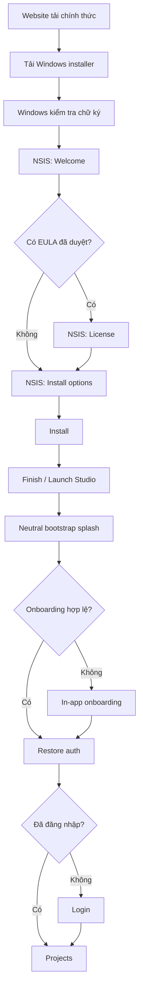

# A2MaTeX Studio — Desktop Onboarding trước và sau khi cài đặt

> **Trạng thái:** Step 1–5, route guard và local atomic persistence đã triển khai; release signing và kiểm thử fresh-install còn pending
> **Ngày:** 2026-11-09
> **Phạm vi:** Website tải ứng dụng, Windows NSIS installer, first-run onboarding và các lần mở app sau
> **Liên quan:** ADR-004 — Desktop onboarding and Windows distribution boundary; Authentication Flow;
> Project Management, Local Autosave & Cloud Sync

## 1. Mục đích

Tài liệu này đặc tả hành trình của người dùng từ trước khi tải A2MaTeX Studio đến khi hoàn thành thiết
lập lần đầu trên Windows. Mục tiêu là tạo một luồng nhất quán nhưng vẫn giữ đúng ranh giới giữa:

1. website/download portal;
2. Windows installer;
3. onboarding chạy bên trong desktop app;
4. đăng nhập và workspace làm việc;
5. các lần khởi động app sau đó.

Onboarding không phải cơ chế cấp license, chống chia sẻ installer hoặc xác thực tài khoản. Nó cũng
không được ghi vào project workflow hay A2MaTeX Package.

## 2. Kết luận thiết kế và các giả định cần sửa

### 2.1. Hai phần onboarding không nằm trong cùng một ứng dụng

- **Trước khi cài đặt** thuộc website phát hành và NSIS installer.
- **Sau khi cài đặt** thuộc Electron app và được thực hiện ở lần chạy đầu tiên.
- Website checkbox hoặc signed download URL không chứng minh người dùng đã chấp nhận policy trong app.
- Installer không nên chứa logic đăng nhập, chọn project hoặc cấp quyền filesystem cho renderer.

### 2.2. Không giả định installer hiện tại đã sẵn sàng production

Codebase hiện có script build Electron nhưng chưa có contract hoàn chỉnh cho:

- EULA đã được Legal duyệt và version hóa;
- Windows code signing;
- checksum/release channel;
- onboarding state service;
- route `/onboarding` và guard ưu tiên onboarding;
- workspace picker dành riêng cho onboarding;
- test fresh-install trên Windows thật.

Các đoạn cấu hình trong tài liệu này là yêu cầu triển khai, không phải bằng chứng rằng capability đã
tồn tại.

### 2.3. Quyết định về “workspace” phải được hiểu đúng

Studio hiện dùng SQLite làm local working source of truth và chỉ cấp quyền folder cho các hành động
import/export cụ thể. Vì vậy `projectRoot` trong ADR không được tự động biến thành một thư mục mà
renderer có quyền đọc/ghi tùy ý.

MVP có hai lựa chọn cần Product chốt:

- **Recommended:** bước Workspace chỉ giải thích local storage và cho phép chọn thư mục export mặc
  định; quyền thật vẫn được cấp lại bằng native picker khi cần.
- **Alternative:** lưu một workspace folder mặc định trong Electron Main, revalidate khi khởi động và
  phát capability ngắn hạn cho từng operation. Không trả raw path như một quyền truy cập cho renderer.

## 3. Tổng quan hành trình



Thứ tự guard là tuần tự. Không chạy onboarding hydration và auth redirect song song vì có thể gây
flicker, mất return URL hoặc hiển thị Login trước policy bắt buộc.

## 4. Giai đoạn trước khi cài đặt

### 4.1. Trang tải ứng dụng

Trang tải chính thức phải giúp người dùng biết họ đang tải gì trước khi bấm Download.

#### Nội dung bắt buộc

- Tên sản phẩm: **A2MaTeX Studio**.
- Phiên bản, ví dụ `0.1.0`.
- Nền tảng và kiến trúc: Windows 10/11 64-bit (`x64`).
- Dung lượng file và dung lượng ổ đĩa dự kiến sau khi cài.
- Publisher hiển thị trên chữ ký số.
- Release notes và known issues.
- SHA-256 checksum.
- Link Terms of Service, Privacy Policy và support.
- Thông tin Android Platform Tools nếu ADB chưa được bundle trong installer.

#### Hành động

- Primary: **Download for Windows**.
- Secondary: **View release notes**.
- Secondary: **Verify checksum**.

Website có thể ghi nhận analytics tải xuống theo policy đã duyệt, nhưng không được coi việc tải file là
chấp nhận policy, license runtime hoặc quyền sử dụng tài khoản.

### 4.2. Trạng thái download

| Trạng thái        | Hành vi                                                            |
| ----------------- | ------------------------------------------------------------------ |
| Chuẩn bị tải      | Hiển thị version, platform và checksum trước khi tạo request       |
| Đang tải          | Browser quản lý tiến trình; website không tuyên bố app đã được cài |
| Thành công        | Hiển thị hướng dẫn mở installer và cách xử lý SmartScreen hợp lệ   |
| Link hết hạn      | Tạo link mới; không yêu cầu người dùng tải lại website bundle      |
| Không tương thích | Không đưa bản Windows x64 cho máy ARM nếu chưa có artifact phù hợp |

### 4.3. Ranh giới an toàn

- Chỉ phát hành từ domain/release channel chính thức.
- Không hướng dẫn người dùng tắt antivirus hoặc bỏ toàn bộ Windows security.
- Production installer phải được code-sign; checksum không thay thế chữ ký số.
- Download gate, nếu có, chỉ kiểm soát việc cấp URL; file đã tải vẫn có thể được chia sẻ.

## 5. Windows installer

Windows MVP dùng NSIS installer. Traditional installer được ưu tiên khi cần hiển thị EULA hoặc cho
phép chọn thư mục cài đặt.

### 5.1. Màn Welcome

**Mục tiêu:** xác nhận đúng sản phẩm và phiên bản trước khi thay đổi máy.

Nội dung:

- logo và tên A2MaTeX Studio;
- version;
- publisher;
- thông báo đóng phiên bản Studio đang chạy;
- nút **Next** và **Cancel**.

Không yêu cầu tài khoản ở màn này.

### 5.2. Màn License/EULA

Chỉ hiển thị khi Legal đã cung cấp nội dung được duyệt và version hóa.

- Không pre-check hoặc tự động chấp nhận.
- Có **Accept** và **Cancel** rõ ràng.
- Nội dung EULA là release asset, không hard-code rải rác trong React hoặc NSIS script.
- Installer acceptance không thay thế Privacy/Analytics choice trong app nếu hai mục có phạm vi pháp
  lý khác nhau.

Nếu chưa có EULA được duyệt, bỏ màn này thay vì dùng placeholder như văn bản pháp lý thật.

### 5.3. Màn Install options

Cho phép chọn:

- thư mục cài đặt;
- tạo shortcut Desktop;
- tạo shortcut Start Menu;
- launch at startup nếu Product thực sự yêu cầu, mặc định tắt.

Không chọn project workspace ở đây. NSIS không sở hữu location capability và không thể thay Electron
Main cấp quyền filesystem an toàn.

### 5.4. Màn Installing

- Hiển thị progress xác định được khi có thể.
- Không mở app trước khi file và registry operation hoàn thành.
- Upgrade giữ dữ liệu trong `app.getPath('userData')`.
- Uninstall không mặc định xóa project, credentials hoặc onboarding state nếu chưa có quyết định
  Product/Privacy rõ ràng.

### 5.5. Màn Finish

- Thông báo cài đặt thành công.
- Checkbox **Launch A2MaTeX Studio** có thể bật mặc định.
- Link release notes là tùy chọn.
- Không tuyên bố setup đã hoàn tất; first-run onboarding vẫn còn ở trong app.

### 5.6. Installer failure

| Lỗi                 | Hành vi                                                           |
| ------------------- | ----------------------------------------------------------------- |
| Chữ ký không hợp lệ | Dừng cài, hướng dẫn tải lại từ kênh chính thức                    |
| Không đủ quyền      | Cho retry/elevation theo NSIS; không chạy app ở trạng thái cài dở |
| Thiếu dung lượng    | Hiển thị dung lượng cần thêm                                      |
| File đang được dùng | Yêu cầu đóng Studio hoặc retry                                    |
| Upgrade thất bại    | Giữ bản cũ chạy được nếu installer hỗ trợ rollback                |

## 6. Bootstrap sau khi cài đặt

Khi app khởi động, renderer chỉ hiển thị neutral splash trong lúc Electron Main tải onboarding state.

Thứ tự bắt buộc:

```text
desktop bootstrap
  → load policy manifest
  → load + validate onboarding state
  → onboarding required? /onboarding
  → restore auth session
  → signed out? /login
  → load/revalidate catalog
  → validated return URL hoặc /projects
```

Neutral splash không hiển thị “Restoring session…” trước khi biết onboarding đã hoàn thành, vì thông
báo đó làm lộ sai thứ tự guard.

## 7. First-run onboarding trong app

P0 gồm năm bước:

```text
Welcome → Policies → Workspace → Optional Setup → Finish
```

Wizard là full-window route riêng, không nằm bên trong `AppShell` và không yêu cầu authenticated
session để hoàn tất các bước local/offline.

### 7.1. Step 1 — Welcome

**Mục tiêu:** giới thiệu ngắn gọn giá trị và phạm vi thiết lập.

Nội dung:

- logo và tên Studio;
- “Build and manage Android automation workflows”;
- ba điểm ngắn: local-first projects, Android tooling, optional cloud sync;
- thông báo có thể thay đổi cài đặt sau trong Settings.

Hành động:

- **Get started** → Policies;
- **Exit** → xác nhận và đóng app.

Không có Skip nếu policy và workspace field đang được xác định là bắt buộc.

### 7.2. Step 2 — Policies

Hiển thị riêng từng tài liệu:

- Terms of Service và version;
- Privacy Policy và version;
- link mở nội dung đầy đủ;
- analytics/telemetry choice riêng biệt.

Quy tắc:

- Required checkbox không được pre-check.
- Analytics mặc định `null` hoặc `false`; không thu thập trước khi opt-in.
- **Continue** chỉ bật khi các policy bắt buộc đã được chấp nhận.
- **Decline** không xóa project hoặc credential. MVP quay lại review hoặc Exit cho đến khi Product
  chốt refusal behavior.
- Offline có thể lưu local acceptance. Nếu backend yêu cầu account-bound evidence, trạng thái sync là
  `pending`, không giả vờ đã được server chấp nhận.

### 7.3. Step 3 — Workspace

**Recommended MVP wording:** “Choose where exported projects are saved by default.”

Nội dung:

- giải thích SQLite là local working storage;
- hiển thị folder label đã chọn, không xem raw path là renderer authority;
- **Choose folder** mở native directory picker qua Electron Main;
- **Use default location** dùng thư mục mặc định do Main quyết định.

Validation:

- Main canonicalize và kiểm tra directory tồn tại/quyền phù hợp;
- renderer không được gửi một path tùy ý để tự cấp quyền;
- khi restart, Main revalidate path và cấp capability mới;
- folder mất hoặc không còn quyền → hiển thị recovery, không tự reset onboarding hay xóa project.

### 7.4. Step 4 — Optional Setup

Các lựa chọn không bắt buộc:

- kiểm tra ADB có sẵn;
- hướng dẫn cài Android Platform Tools;
- chọn theme/system theme nếu Product yêu cầu;
- desktop shortcut status chỉ để hiển thị, không tự sửa installer state;
- analytics choice có thể được nhắc lại nhưng không được đổi ngầm.

ADB check phải phân biệt:

- available;
- not found;
- found but no device;
- permission/driver issue.

Người dùng được phép chọn **Set up later**. Thiếu ADB không chặn việc thiết kế workflow offline.

### 7.5. Step 5 — Finish

Hiển thị summary:

- policy versions đã chấp nhận;
- analytics enabled/disabled;
- workspace/export location label;
- ADB status;
- bước tiếp theo là Sign in hoặc Projects nếu session đã tồn tại.

Khi nhấn **Finish setup**:

1. renderer gửi draft setup, không gửi `completed=true` tùy ý;
2. Main kiểm tra current policy versions và required fields;
3. Main ghi state atomically;
4. Main trả onboarding snapshot mới;
5. router mới chuyển sang auth restoration/login/projects.

Nếu write thất bại, giữ wizard ở Finish và cho Retry; không chuyển trang bằng optimistic state.

## 8. Các lần mở app sau

### 8.1. Onboarding hợp lệ

- Bỏ qua wizard.
- Restore auth.
- Nếu signed out → Login.
- Nếu authenticated → Projects hoặc return URL hợp lệ.

### 8.2. Policy version thay đổi

- Mở `/onboarding/policies` ở review mode.
- Chỉ yêu cầu review policy có material version change.
- Không xóa project, catalog cache, onboarding preferences hoặc credentials.
- Analytics choice không tự chuyển thành `true` sau policy update.

### 8.3. Workspace không còn khả dụng

- Không chạy lại toàn bộ Welcome/Policies.
- Mở recovery screen chỉ cho Workspace.
- Cho chọn folder mới, dùng default hoặc tiếp tục với operation không cần export folder nếu policy cho
  phép.

### 8.4. State bị hỏng hoặc version mới hơn app hỗ trợ

- Không tự suy ra `completed=true`.
- Giữ project và credential nguyên trạng.
- Hiển thị safe recovery với Retry, Reset onboarding preferences hoặc Exit.
- Reset chỉ xóa onboarding config được xác định; không xóa SQLite project database.

## 9. Onboarding state

State nằm dưới `app.getPath('userData')/config`, do Electron Main sở hữu.

```ts
interface OnboardingStateV1 {
  schemaVersion: 1;
  completed: boolean;
  acceptedTermsVersion: string | null;
  acceptedPrivacyVersion: string | null;
  analyticsOptIn: boolean | null;
  completedAt: string | null;
  projectRoot: string | null;
}
```

Yêu cầu lưu trữ:

- validate bằng schema trước và sau khi đọc;
- write vào temporary file, flush nếu adapter hỗ trợ, rồi atomic rename;
- không lưu access token/refresh token;
- không lưu state trong `localStorage` hoặc project document;
- không đưa state vào A2MaTeX Package;
- log chỉ chứa event/status, không log raw path hoặc policy evidence nhạy cảm.

`completed` là kết quả Main tính toán từ policy versions và fields hợp lệ, không phải flag renderer có
thể tự bật.

## 10. Policy manifest

Desktop Main tải policy hiện hành từ API công khai, không để renderer tự gọi API:

- `GET /api/v1/terms/current?type=CUSTOMER_TERMS` cho Terms của người dùng app;
- `GET /api/v1/terms/current?type=PRIVACY_POLICY` cho Privacy;
- `PUBLISHER_TERMS` không thuộc onboarding customer;
- response được validate schema, giới hạn kích thước và hiển thị trong iframe sandbox;
- khi Finish, Main tải lại current versions trước khi ghi acceptance atomically.

Contract nội bộ:

```ts
interface PolicyManifest {
  terms: { version: string; url: string; required: boolean };
  privacy: { version: string; url: string; required: boolean };
  analytics: { required: false; defaultValue: false };
}
```

Để hỗ trợ onboarding lần đầu khi offline, phase tiếp theo cần cache last-known-good hoặc bundle một
manifest đã được duyệt trong signed app:

- cache last-known-good;
- xác minh schema và origin allow-list;
- không hạ policy version âm thầm;
- định nghĩa rõ material change nào yêu cầu re-consent;
- server consent record, nếu có, vẫn tách khỏi local UX state.

## 11. Electron boundary và IPC

### 11.1. Application contracts đề xuất

```ts
interface OnboardingSnapshot {
  status: 'required' | 'complete' | 'recovery';
  currentStep: 'welcome' | 'policies' | 'workspace' | 'optional' | 'finish';
  termsVersion: string;
  privacyVersion: string;
  analyticsOptIn: boolean | null;
  workspace: { label: string; capability: string } | null;
  pendingConsentSync: boolean;
}

interface CompleteOnboardingInput {
  acceptedTermsVersion: string;
  acceptedPrivacyVersion: string;
  analyticsOptIn: boolean;
  workspaceCapability: string | null;
}
```

### 11.2. Preload methods đề xuất

```ts
window.studioHost.onboarding.getState();
window.studioHost.onboarding.chooseWorkspace();
window.studioHost.onboarding.complete(input);
window.studioHost.onboarding.resetPreferences();
window.studioHost.onboarding.subscribe(listener);
```

Mọi payload IPC phải có schema, size limit và typed error. `chooseWorkspace()` mở native picker; không
có API kiểu `grantPath(path: string)`.

## 12. Router và guard ownership

Hiện trạng router chỉ có Login và `RequireSession`. Target architecture thêm onboarding provider và
guard ở ngoài auth guard:

```tsx
<Routes>
  <Route path="/onboarding/*" element={<OnboardingFlow />} />
  <Route element={<RequireOnboarding />}>
    <Route path="/login" element={<LoginPage />} />
    <Route element={<RequireSession />}>
      <Route element={<AppShell />}>{/* protected routes */}</Route>
    </Route>
  </Route>
</Routes>
```

`RequireOnboarding` chịu trách nhiệm:

- neutral hydration splash;
- validate internal return URL;
- redirect về onboarding khi required/recovery;
- không gọi login hoặc catalog trước khi onboarding state sẵn sàng.

## 13. Accessibility và nội dung

- Wizard dùng một `<h1>` duy nhất cho step title và landmark rõ ràng.
- Step indicator có text, không chỉ dùng màu.
- Focus chuyển vào heading/error đầu tiên sau navigation.
- Back/Next/Exit có accessible name ổn định.
- Policy links mở qua allow-listed external URL handler, không cho web content điều hướng Electron
  window.
- Checkbox required và analytics có label riêng; không gộp consent.
- Tất cả flow sử dụng được bằng keyboard ở zoom 200%.
- Không dùng countdown, dark pattern hoặc nút Accept nổi bật đến mức che khuất Decline/Exit.

## 14. Analytics và privacy

Trước khi `analyticsOptIn === true`:

- không khởi tạo analytics SDK;
- không gửi onboarding step event ra ngoài;
- local diagnostic chỉ ghi lỗi kỹ thuật tối thiểu theo logging policy.

Sau opt-in, event đề xuất chỉ gồm:

- `onboarding_started`;
- `onboarding_step_completed` với step enum;
- `onboarding_completed`;
- `onboarding_recovery_shown` với reason enum.

Không gửi account, raw workspace path, project name, policy text hoặc credential.

## 15. Current implementation status

| Khu vực   | Hiện tại                                                     | Cần triển khai                                                                   |
| --------- | ------------------------------------------------------------ | -------------------------------------------------------------------------------- |
| Router    | `/onboarding` và `RequireOnboarding` đã có                   | Tách auth provider hydration để bảo đảm auth không restore song song             |
| State     | Main-owned schema v1 và atomic write đã có                   | Recovery/reset cho state hỏng                                                    |
| IPC       | get state/policies, folder picker và complete đã có          | Subscribe/reset nếu Product cần                                                  |
| UI        | Welcome, Policies, Workspace, Optional Setup và Finish đã có | Recovery và policy-update review mode                                            |
| Policy    | Main tải/validate Customer Terms + Privacy từ API            | Cache last-known-good cho first-run offline; Legal sửa placeholder trong Privacy |
| Installer | Có thể tạo unsigned NSIS artifact                            | Tách build/release output, approved EULA, signing, checksum, installer tests     |
| Policy    | Chưa có trusted manifest                                     | Version source, offline fixture và re-consent rules                              |
| Analytics | Chưa có consent-controlled integration                       | Default disabled và Settings control                                             |
| Tests     | Auth/project tests có sẵn                                    | Fresh install, restart, corruption, policy update, offline và real installer     |

## 16. Kế hoạch triển khai

### Phase 0 — Product/Legal decisions

1. Chốt Terms, Privacy versions và refusal behavior.
2. Chốt Workspace là export default hay persistent capability root.
3. Chốt analytics provider, event allow-list và retention.
4. Chốt uninstall có giữ onboarding state hay không.

### Phase 1 — Domain và Main persistence

1. Thêm onboarding types và schema.
2. Thêm repository port và use cases.
3. Thêm atomic userData adapter và migration.
4. Thêm policy manifest bundle và validation.
5. Viết unit/contract tests trước IPC.

### Phase 2 — IPC và guard ordering

1. Đăng ký typed channels.
2. Tái sử dụng LocationRegistry/native picker.
3. Thêm provider và `RequireOnboarding`.
4. Bảo toàn validated internal return URL.
5. Đảm bảo auth/catalog không hydrate trước onboarding decision.

### Phase 3 — Wizard UI

1. Welcome và Policies.
2. Workspace và recovery.
3. Optional Setup/ADB diagnostics.
4. Finish commit và Settings entry.
5. Accessibility test cho keyboard, focus và screen reader semantics.

### Phase 4 — Windows release

1. Tách renderer build output khỏi installer artifact output.
2. Chỉ include production files trong `app.asar`.
3. Thêm approved EULA nếu có.
4. Code-sign NSIS installer và executable.
5. Xuất checksum/release metadata.
6. Smoke test install, upgrade, uninstall và first launch trên Windows sạch.

## 17. Acceptance criteria

### Trước khi cài đặt

- Người dùng thấy version, architecture, publisher và checksum trước khi tải.
- Installer production có chữ ký hợp lệ và tải từ channel chính thức.
- Website không đánh đồng download với policy acceptance.

### Installer

- Cài/upgrade/uninstall không xóa project hoặc credential ngoài policy đã chốt.
- Không yêu cầu login, workspace hoặc analytics trong NSIS.
- Launch checkbox chỉ chạy app sau khi installation hoàn tất.

### First run

- Fresh install luôn vào Welcome trước Login.
- Required policy checkbox không pre-check.
- Analytics mặc định disabled/null.
- Workspace picker không nhận arbitrary renderer path.
- Finish chỉ chuyển trang sau atomic state write thành công.
- Offline user hoàn thành được local steps.

### Restart và recovery

- Completed/current onboarding không hiện lại.
- Material policy update chỉ mở policy review.
- Corrupt state không xóa project hoặc credentials.
- Missing workspace mở recovery riêng.
- Deep link được giữ và chỉ restore sau khi onboarding và auth đều hợp lệ.

## 18. Test matrix tối thiểu

| Scenario                         | Kỳ vọng                                              |
| -------------------------------- | ---------------------------------------------------- |
| Fresh install, signed out        | Welcome → wizard → Login → Projects                  |
| Fresh install, offline           | Hoàn thành local setup; consent sync pending nếu cần |
| Restart sau Finish               | Bỏ qua wizard; restore auth                          |
| Terms version thay đổi           | Mở Policies review; giữ project/session data         |
| Analytics từ `null` sang `false` | Không khởi tạo analytics SDK                         |
| Workspace bị xóa                 | Recovery picker; không chạy lại Policies             |
| State JSON bị truncate           | Safe recovery; không tự đánh dấu completed           |
| Main write thất bại              | Finish hiển thị retry; không redirect                |
| Deep link khi chưa onboarding    | Hoàn tất onboarding → auth → return URL hợp lệ       |
| Installer upgrade                | Giữ userData và onboarding state tương thích         |
| Installer uninstall              | Hành vi dữ liệu đúng với quyết định Product/Privacy  |

## 19. Open decisions

- Q-018: Nội dung và version source của Terms/Privacy là gì?
- Q-019: Policy change nào được coi là material và bắt buộc review lại?
- Q-020: Khi từ chối policy, app chỉ Exit hay cho local read-only mode?
- Q-021: Workspace là export default hay persistent project root capability?
- Q-022: Backend có cần account-bound consent evidence không?
- Q-023: Retention và xóa consent evidence như thế nào?
- ADB có được bundle theo installer hay yêu cầu cài Android Platform Tools riêng?
- Uninstaller có cung cấp lựa chọn xóa local settings/database không?
- Auto-update channel và rollback policy thuộc release milestone nào?

Không triển khai placeholder cho các quyết định pháp lý hoặc privacy chưa được phê duyệt. Khi blocker
chưa được giải quyết, UI phải dùng wording trung tính và capability tương ứng phải giữ ở trạng thái
disabled thay vì suy đoán hành vi.
