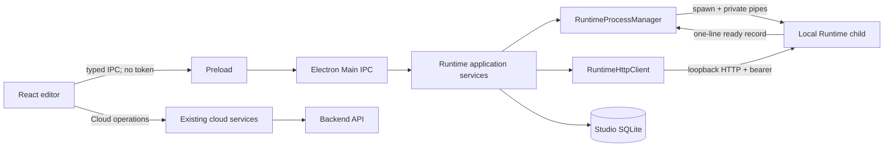

# A2MaTeX Studio — Kế hoạch tích hợp Local Runtime

> Trạng thái: Partially implemented — Linux development vertical slice hoàn tất; Windows/packaging còn chặn  
> Ngày đối chiếu: 2026-11-18  
> Phạm vi: `a2matex-studio` (Electron + React + SQLite) tích hợp `a2matex-runtime` chạy trên cùng máy  
> Tài liệu nguồn:
> [local_authentication.md](local_authentication.md),
> [node_definition_to_project_draft_guide.md](node_definition_to_project_draft_guide.md),
> [studio.md](studio.md)

### Implementation snapshot — 2026-11-18

Đã triển khai trong Studio:

- managed sidecar lazy-start trên Linux bằng hai FIFO riêng, single-flight startup, strict ready-record
  parser, authenticated readiness probe, một lần replacement và bounded shutdown;
- HTTP client loopback riêng, tắt proxy/redirect, giới hạn timeout/body và không đưa token/base URL sang
  renderer;
- validation đã cắt hoàn toàn cloud auth/Backend envelope, dùng canonical Editor Graph và direct Runtime
  response; manual validation giữ stale guard, automatic validation debounce sau lần Validate chủ động đầu
  tiên và dừng sau explicit shutdown;
- typed Runtime IPC/preload cho status, validate, compile, device inventory/refresh và shutdown;
- compilation UI, SQLite migration v6, `source_revision`, compare-and-set cache provenance và Cloud Draft
  chỉ gửi cache còn fresh;
- Runtime status/shutdown UI, retry limits khớp contract Runtime (`3` attempts, `60_000 ms`), default input
  schema đầy đủ;
- unit/integration tests cho ready record, response schemas, canonical graph và SQLite provenance; smoke test
  với Runtime Go thật đã pass `READY -> VALID -> compiled IR -> STOPPED` trên Linux.

Chưa được coi là hoàn tất:

- Windows raw-handle handoff chưa có spike chạy thật; code trả `RUNTIME_PLATFORM_UNSUPPORTED`, không dùng
  connection-file fallback;
- chưa bundle/sign/checksum Runtime binary trong installer vì repo chưa có release artifact contract;
- device inventory đã có IPC nhưng chưa có Test Run picker do run/admission API vẫn ngoài scope;
- compatibility hiện kiểm tra IR format và supported node handlers; catalog refresh theo actual Runtime
  version và cache provenance theo runtime/catalog version vẫn cần hoàn thiện trước production rollout.

Lưu ý khi development: không chạy Runtime standalone (`make run` hoặc `go run ./cmd/agent`) đồng thời
với Studio. Port `6810` là default của standalone flow. Studio tự spawn một managed child trên loopback
port trống và dùng `apiBaseUrl` được child trả qua private readiness pipe. Nếu standalone process đang giữ
execution-store lock, Studio trả `RUNTIME_ALREADY_RUNNING` thay vì kết nối vào session đó.

## 0. Quyết định đã chốt cho validation hiện có

Studio **đã có** action, orchestration và UI Diagnostics cho workflow validation. Phần này được giữ lại.
Transport gọi Backend validation đã được bỏ và chuyển hoàn toàn sang Local Runtime do Studio quản lý.

```text
Trước migration
Validate UI
  -> save local revision
  -> Electron Main lấy cloud access token
  -> POST Backend /api/v1/workflow-validation
  -> parse Backend envelope
  -> Diagnostics

Hiện tại (đã triển khai)
Validate UI
  -> save/capture đúng local revision
  -> Electron Main ensure Local Runtime READY
  -> authenticated GET Local Runtime /runtime-info
  -> POST Local Runtime /api/v1/workflow-validation
  -> parse direct Runtime result
  -> Diagnostics
```

Quyết định migration:

- giữ action **Validate**, stale-revision guard, pending Node Config guard, Diagnostics tab và
  node/edge navigation hiện có;
- bỏ `getValidAccessToken()`, refresh-token retry và account-session errors khỏi validation path;
- bỏ Backend base URL/global Axios instance khỏi validation path;
- dùng per-start Runtime session token chỉ trong Electron Main;
- Runtime trả validation object trực tiếp, không parse `{ data, statusCode }`;
- không dual-write, không gọi đồng thời Backend và Runtime để so sánh trong production;
- không fallback về Backend validation khi Runtime start/probe/request thất bại; UI phải báo lỗi Runtime
  rõ ràng và cho Retry;
- cloud login không còn là điều kiện trực tiếp để chạy validation local. Node Catalog vẫn có thể phụ
  thuộc cloud session hoặc cache theo contract riêng;
- không đưa local Runtime token/base URL qua IPC hoặc log.

Tài liệu [workflow-validation-api-integration.md](workflow-validation-api-integration.md) vẫn mô tả
implementation UI/orchestration hiện tại, nhưng quyết định transport Backend trong tài liệu đó đã bị
thay thế bởi kế hoạch này.

## 1. Kết luận và hướng triển khai đề xuất

Studio nên tích hợp Runtime như một **managed sidecar process do Electron Main sở hữu**. Renderer không
được đọc executable, PID, `apiBaseUrl` hoặc `sessionToken`; renderer chỉ gọi các IPC operation hẹp như
validate, compile, refresh devices và shutdown.

Không nên sửa client validation hiện tại bằng cách chỉ đổi URL từ Backend sang localhost. Client đó
đang gắn cloud access token, dùng global Axios config và parse cloud envelope. Local Runtime có lifecycle,
authentication, response shape và failure model khác hoàn toàn. Cần tạo riêng ba lớp:

1. `RuntimeProcessManager`: start/reuse/probe/replace/shutdown child process;
2. `RuntimeHttpClient`: HTTP loopback có bearer token của đúng child session;
3. application services: validation, compilation, device inventory và runtime status.

Triển khai nên theo vertical slice: handshake → validation → authoring contract → compilation/cache →
device picker → packaging. Cách này cho phép chứng minh process/auth/transport trước khi thay đổi lớn
editor và persistence.

## 2. Phạm vi và ranh giới trách nhiệm

### 2.1. Trong phạm vi

- Lazy-start một Runtime duy nhất do Studio sở hữu và tái sử dụng giữa các request.
- Nhận credentials qua readiness pipe riêng, giữ trong Electron Main memory.
- Probe `GET /runtime-info` trước mỗi requested operation.
- Gọi local APIs:
  - `POST /workflow-validation`;
  - `POST /workflow-compilation`;
  - `GET /devices` và `POST /devices/refresh` cho Test Run device picker;
  - `GET /runtime-info` cho readiness/compatibility.
- Cập nhật Node Catalog mapping, binding editor và Editor Graph theo Node Definition mới.
- Cache Runtime IR và validation summary cùng source provenance trong SQLite.
- UI trạng thái Runtime, lỗi có hướng xử lý và action **Shut down Runtime**.
- Bundle/resolve Runtime executable cho Linux và Windows.

### 2.2. Không nằm trong phase này

- Workflow execution/Test Run API nếu Runtime chưa cung cấp run/admission contract.
- Thay Backend Node Catalog, Cloud Draft, login hoặc sync bằng local Runtime.
- Cho renderer gọi loopback HTTP trực tiếp.
- Đọc `runtime-connection.json` trong managed Studio flow. File này chỉ dành cho standalone/manual test.
- Chuyển Android UI Inspector screenshot/hierarchy hiện tại sang Runtime. Runtime hiện chỉ có device
  inventory; Inspector vẫn dùng Electron Main ADB service cho đến khi có API tương đương.
- Tin Runtime IR từ local cache khi Submission. Backend vẫn compile frozen Submission snapshot.

## 3. Các giả định cần sửa hoặc xác nhận

### 3.1. “Local Runtime thay toàn bộ Backend” — không đúng

Runtime chỉ thay nơi validate/compile local và sau này execute Test Run. Node Catalog, authentication,
Cloud Draft và Submission vẫn là Backend responsibility. Studio cần duy trì hai security domain tách biệt:

- Cloud API: HTTPS + account access token;
- Local Runtime: loopback HTTP + per-process session token.

Không dùng chung Axios instance, interceptor, retry refresh-token hoặc error mapping giữa hai domain.

### 3.2. “Có thể tái sử dụng workflow validation service hiện tại” — không hợp lý

Implementation hiện tại trong `src/application/workflow-validation/` và
`electron/main/api/workflow-validation.api.ts`:

- bắt buộc login và gọi `getValidAccessToken()`;
- retry 401 bằng refresh token;
- gọi global Backend base URL;
- kỳ vọng response `{ data, statusCode: 200 }`.

Runtime trả validation object trực tiếp và 401 nghĩa là Runtime session đã stale, không phải cloud session
hết hạn. Client hiện tại cần được thay thế hoặc đổi tên thành cloud validation legacy, không repoint.

### 3.3. “Runtime nên start cùng Studio” — không cần thiết

Theo contract, mở project list có thể để Runtime ở trạng thái stopped. Request authoring đầu tiên mới
lazy-start Runtime. Điều này giảm startup cost và tránh giữ ADB/database resource khi user chỉ quản lý
project.

### 3.4. “Connection file dùng được cho Studio” — sai với managed launch

Studio phải dùng hai inherited pipes. Managed Runtime không publish credentials qua connection file.
Fallback sang file sẽ làm yếu ownership/lifecycle semantics và có thể đọc nhầm session của standalone
process.

### 3.5. “SQLite đã có `runtime_ir_json` nên cache đã an toàn” — chưa đủ

Hiện chưa có `runtime_ir_source_revision`. `local_revision` lại tăng cả khi artifacts thay đổi, nên không
thể dùng chính nó làm provenance sau khi ghi compile result. Cần một `source_revision` độc lập, chỉ tăng
khi `editorGraph` hoặc workflow-level `inputSchema` thay đổi.

### 3.6. “Editor Graph serializer hiện đã loại Studio-only fields” — code hiện tại không bảo đảm

`workflowNodeSchema` vẫn nhận và `encodeWorkflowDocument()` vẫn giữ `name`, `labelMode`, `description`
và `disabled`. Runtime Editor Graph decoder là strict; gửi các field này có thể tạo
`EDITOR_GRAPH_CONTRACT_INVALID`.

Cần một serializer duy nhất dành riêng cho shared Editor Graph. Local authoring document có thể giữ
metadata phục vụ Studio, nhưng payload gửi Runtime/Backend chỉ chứa contract fields.

### 3.7. “Device picker và Android UI Inspector là cùng một luồng” — không đúng

Runtime inventory dùng `adbSerial` và trạng thái `READY`/`UNAVAILABLE`. Inspector hiện cần thêm model,
screenshot PNG và UI hierarchy. Chỉ Test Run picker chuyển sang Runtime trong phase này; Inspector vẫn
giữ implementation hiện có.

### 3.8. Các quyết định phải chốt trước khi production rollout

1. **Windows pipe handoff:** cần spike chứng minh Electron/Node có thể truyền đúng raw inherited handles
   mà Go Runtime đang nhận qua `--owner-command-pipe` và `--owner-ready-pipe`. Không được giả định extra
   stdio fd trên Windows tương đương POSIX fd.
2. **Multi-workflow:** Project Draft cloud hiện có một `editorGraph`/`runtimeIr`, trong khi Studio cho
   nhiều workflow. MVP nên compile/cache entry workflow; nếu Test Run cho mọi workflow thì cache phải
   key theo `(local_id, workflow_path)` và chỉ project entry cache được đưa vào Cloud Draft.
3. **Workflow input schema:** project mới đang dùng `{}`, nhưng Runtime compile yêu cầu object schema đầy
   đủ. Chốt nguồn authoring của `inputSchema`; trước mắt default hợp lệ là
   `{ "type":"object", "properties":{}, "required":[], "additionalProperties":false }`.
4. **Runtime distribution:** chốt artifact name, version, checksum/signing, nơi CI lấy binary và ma trận
   OS/architecture. Không build Go Runtime ngầm trong `npm run build` của máy release.
5. **Managed launch contract:** nếu Windows spike thất bại, sửa contract Runtime để hỗ trợ cơ chế Electron
   có thể sở hữu an toàn (ví dụ platform adapter/native helper hoặc named pipe có ACL), không fallback
   sang public discovery file.

## 4. Target architecture



Nguyên tắc:

- Một Main process có tối đa một owned Runtime child.
- Chỉ credentials nhận từ child hiện tại mới được dùng.
- Mỗi operation đi qua readiness gate, không dựa vào health public để xác nhận authentication.
- Không log token, Authorization header, full ready record hoặc Runtime IR/body nhạy cảm.
- Runtime HTTP client chỉ được gọi đúng origin đã validate từ ready record.

## 5. Runtime process lifecycle

### 5.1. State machine

```text
STOPPED -> STARTING -> READY -> STOPPING -> STOPPED
              |          |
              v          v
            FAILED <--- UNHEALTHY
```

`ensureReady()` phải single-flight: nhiều validation request đồng thời chỉ được spawn một child. State
READY gồm child identity, control channel, `apiBaseUrl`, token và parsed `runtime-info` của cùng session.

### 5.2. Managed launch

Thêm `electron/main/runtime/process/` với các component đề xuất:

- `runtime-executable.ts`: resolve executable từ dev override tuyệt đối hoặc packaged resources;
- `runtime-process-manager.ts`: state machine và single-flight startup/replacement;
- `runtime-pipes.ts`: platform adapter tạo command/readiness pipes;
- `runtime-ready-record.ts`: strict parser cho một JSON line;
- `runtime-process.error.ts`: typed lifecycle errors.

Luồng start:

1. Resolve executable theo platform; reject path không tồn tại/không phải file.
2. Tạo hai pipe khác nhau:
   - parent ghi command, child đọc;
   - child ghi ready record, parent đọc.
3. Spawn không qua shell, truyền đúng child handles bằng hai flags Runtime.
4. Đóng child ends ở parent ngay sau spawn; giới hạn startup timeout và kích thước ready frame.
5. Đọc đúng một newline-delimited JSON object. Port dưới đây chỉ là ví dụ; managed child dùng port trống
   do Studio cấp, không mặc định là `6810`:

   ```json
   { "apiBaseUrl": "http://127.0.0.1:49152/api/v1", "sessionToken": "<43 chars>" }
   ```

6. Validate:
   - scheme đúng `http:`;
   - hostname là numeric loopback IPv4/IPv6, không chấp nhận DNS name;
   - không có username/password/query/fragment;
   - path kết thúc chính xác bằng `/api/v1`;
   - token đúng shape/length contract;
   - URL normalization không làm đổi origin ngoài ý muốn.
7. Gọi authenticated `GET /runtime-info` với timeout ngắn. Chỉ sau khi response parse và compatibility
   pass mới chuyển sang READY.
8. Theo dõi `exit`, `error`, pipe EOF và command-channel state. Child exit phải xóa credentials ngay.

Không đưa ready record hoặc token vào renderer state. Có thể expose trạng thái đã sanitize:
`STOPPED | STARTING | READY | FAILED`, runtime version và error code.

### 5.3. Readiness gate trước mỗi operation

`withReadyRuntime(operation)` thực hiện:

1. start/reuse child;
2. xác nhận child chưa exit và command channel còn live;
3. bounded authenticated `GET {apiBaseUrl}/runtime-info`;
4. nếu probe thất bại: clear session, shutdown/collect child cũ, start replacement một lần;
5. chỉ gửi pending operation sau khi replacement READY;
6. không retry vô hạn và không retry non-idempotent operation nếu chưa chứng minh request chưa được nhận.

Validation, compilation và inventory refresh hiện là side-effect-free/idempotent, có thể retry một lần
sau replacement. Run API tương lai phải có request id/idempotency rule riêng.

### 5.4. Shutdown

- Action explicit shutdown ghi chính xác `shutdown\n` vào command pipe, ngừng auto-validation, chờ child
  exit trong bounded timeout rồi mới dùng termination fallback.
- Owner pipe bị đóng hoặc Studio crash phải làm Runtime fail closed và tự dừng.
- `app.will-quit` cần shutdown async có guard chống re-entry; đóng SQLite sau khi Runtime được thu hồi.
- Sau explicit shutdown, operation do user chủ động có thể start lại; timer validation tự động không được
  tự start lại cho đến khi user tạo operation mới hoặc bật lại integration.

## 6. Local Runtime HTTP client và authentication

Tạo client riêng trong `electron/main/runtime/http/`; không dùng
`electron/main/api/request.ts` vì đó là cloud singleton.

Client phải:

- dùng per-session immutable base URL/token;
- set `Authorization: Bearer <sessionToken>` và `Accept: application/json`;
- set `Content-Type: application/json` cho POST;
- bypass proxy (`proxy: false` nếu dùng Axios) và không đọc proxy env cho loopback;
- reject redirect (`maxRedirects: 0` hoặc equivalent);
- enforce response/body limits và timeout theo operation;
- không gửi compressed request hoặc query parameters;
- parse shared error `{ "error": { "code", "message", "retryable" } }`;
- map 401 thành stale local session để Runtime manager thay child, không refresh cloud token;
- verify request URL vẫn cùng exact origin/path prefix với ready record.

### 6.1. Response contracts cần parse strict

`GET /runtime-info`:

```ts
interface RuntimeInfo {
  runtimeVersion: string;
  runtimeIrFormatVersions: number[];
  supportedNodes: Array<{ type: string; runtimeHandler: string }>;
}
```

`POST /workflow-validation` trả trực tiếp:

```ts
interface ValidationResult {
  status: 'INVALID' | 'VALID_WITH_WARNINGS' | 'VALID';
  errors: Diagnostic[];
  warnings: Diagnostic[];
  truncated: boolean;
}
```

`POST /workflow-compilation` trả trực tiếp:

```ts
interface CompilationResult {
  validation: ValidationResult;
  runtimeIr: Record<string, unknown> | null;
}
```

Không parse local response bằng schema `{data,statusCode}` hiện tại. Diagnostic code nên có known-code
mapping để UI giải thích, nhưng parser không nên làm toàn response thất bại chỉ vì Runtime bổ sung một
diagnostic code mới hợp lệ; giữ unknown code dạng string và render fallback. Version/shape chính vẫn parse
strict.

### 6.2. Compatibility gate

Sau `runtime-info`:

- so runtime version với `ProjectManifest.minimumRuntimeVersion`;
- bảo đảm Runtime hỗ trợ Runtime IR format Studio sẽ decode/use;
- so các node đang dùng với `supportedNodes` trước compile/Test Run;
- Catalog query dùng version của Runtime READY thay cho constant hard-code khi Runtime đã start;
- nếu Runtime chưa start, có thể dùng configured target version để load Catalog, nhưng phải refresh/recheck
  khi actual version khác.

Authoring/save/sync vẫn được phép khi handler chưa supported; local compile/Test Run phải bị block với
message cụ thể.

## 7. Cập nhật Editor Graph và Node Definition

### 7.1. Tạo shared Editor Graph serializer

Thêm `src/application/runtime/to-runtime-editor-graph.ts` (hoặc domain adapter tương đương) và dùng chung
cho validation, compilation và Cloud Draft. Serializer output node chỉ gồm:

- `id`, `type`, `config`, `bindings`, `errorPolicy`, `editor`;
- optional `timeoutMs`, `retryPolicy` khi contract cho phép.

Edge chỉ gồm `id`, `sourceNodeId`, `sourcePort`, `targetNodeId`.

Không gửi `name`, `labelMode`, `description`, `disabled`, catalog schema, icon, capability,
`runtimeHandler`, form state hoặc cached hint. Cần chốt riêng semantics `disabled`; cho đến khi shared
contract hỗ trợ, UI không được tuyên bố node disabled sẽ bypass ở Runtime.

Không tạo serializer khác nhau cho Runtime và Cloud Draft; hai bên phải nhận cùng canonical graph
snapshot.

### 7.2. Update Node Catalog parser/domain

Sửa:

- `src/domain/node-catalog/node-catalog.ts`;
- `src/domain/schema/object-value-schema.ts`;
- `src/application/node-catalog/to-workflow-node-catalog.ts`;
- `src/domain/workflow/node-definition.ts`.

Khoảng cách hiện tại:

- value schema chỉ hỗ trợ string/integer/boolean; contract cần finite number và binding metadata;
- input fields chưa giữ `bindingKinds` và fields theo từng kind;
- `outputPorts` mapper chỉ xử lý static string array, chưa có dynamic ports;
- chưa có `dynamicInputs` cho Switch;
- targeting model hiện là `targeting`, cần map đúng contract `editorHints.targeting` nếu Backend đã đổi;
- `defaultTimeoutMs`, minimum runtime version và handler support chưa đi hết vào editor behavior.

Parser nên version hóa contract hoặc có adapter rõ ràng; không silently đoán shape giữa catalog cũ/mới.

### 7.3. Binding editor tổng quát

Thay literal-only path trong `node-configuration-draft.ts`, `SchemaValueField.tsx` và
`NodeConfigurationInspector.tsx` bằng source selector dựa trên từng field `bindingKinds`:

- `LITERAL`: value theo schema;
- `WORKFLOW_INPUT`: chọn property tương thích từ workflow input schema;
- `NODE_OUTPUT`: chọn producer + required output field, kiểm tra type và dominance;
- `FLOW_VARIABLE`: suggest preceding FLOW writes, vẫn cho nhập tên hợp lệ;
- `GLOBAL_VARIABLE`: suggest RUN_GROUP writes, vẫn cho nhập tên hợp lệ.

Đổi kind phải replace toàn bộ binding object, không merge field cũ. Variable name phải match
`^[A-Za-z_][A-Za-z0-9_]{0,99}$` và case-sensitive.

Type compatibility và graph dominance nên nằm ở pure domain functions có unit test, không nhúng vào
React component.

### 7.4. Set Variable

Không special-case schema ngoài contract:

- lưu `config.name`, explicit `config.scope`;
- lưu source tại `bindings.value`;
- cho các scalar type contract hỗ trợ, không ép một value type cố định;
- output port/error edge lấy từ definition.

### 7.5. Switch

Tạo editor chuyên biệt nhưng lưu đúng generic draft shape:

- mỗi rule có UUID ổn định trong `config.rules`;
- binary operand ở `bindings[rule.id]`;
- unary operator phải xóa operand binding;
- branch edge dùng `sourcePort = rule.id`;
- delete rule phải xóa binding và mọi edge tham chiếu;
- reorder giữ nguyên UUID/binding/edge;
- `default` và mỗi rule UUID có đúng một outgoing edge; `error` chỉ khi `ERROR_BRANCH`.

Các workflow commands nên thực hiện update rule/binding/edge atomically để undo/redo không tạo graph
trung gian hỏng.

### 7.6. Targeting mode

Khi đổi mode:

1. lấy union field names của tất cả modes;
2. xóa các targeting binding cũ;
3. set `config.targetMode`;
4. khởi tạo chỉ form của mode mới;
5. giữ non-target bindings nếu có.

`modeBindings` hiện có thể phục hồi giá trị mode cũ trong pending form; behavior này nên bỏ nếu contract
yêu cầu mode mới được khởi tạo sạch. Persisted node luôn chỉ chứa bindings của mode được chọn.

## 8. Validation và compilation flow

### 8.1. Automatic validation

- Chỉ validate committed graph; pause khi node configuration form đang dirty.
- Debounce edit, cancel/supersede request cũ nếu có thể.
- Capture `{projectId, workflowPath, editorRevision, editorGraph}` thành immutable snapshot.
- Không bắt buộc flush SQLite trước mọi auto-validation; disk save và local validation là hai concerns.
- Chỉ apply result nếu project/workflow/revision vẫn trùng; nếu không, discard response.
- Manual Validate có thể flush trước nếu UX muốn bảo đảm “validate saved draft”, nhưng phải ghi rõ semantics.

UI gọi trực tiếp typed `runtime.validate`; không giữ thêm validation service/IPC legacy song song. Giữ
diagnostics UI và navigation, nhưng dùng lifecycle error codes, ví dụ:

- `RUNTIME_NOT_INSTALLED`;
- `RUNTIME_START_FAILED`;
- `RUNTIME_START_TIMEOUT`;
- `RUNTIME_READY_RECORD_INVALID`;
- `RUNTIME_INCOMPATIBLE`;
- `RUNTIME_SESSION_STALE`;
- `RUNTIME_UNAVAILABLE`;
- `RUNTIME_INVALID_RESPONSE`;
- `RUNTIME_PAYLOAD_TOO_LARGE`.

### 8.2. Compilation

Compilation request phải chụp graph và input schema trong cùng source snapshot:

```json
{
  "editorGraph": {},
  "inputSchema": {}
}
```

Flow:

1. bảo đảm không có pending uncommitted node form;
2. capture `sourceRevision`, workflow path, canonical graph và input schema;
3. `ensureReady()` và compatibility check;
4. gọi `/workflow-compilation`;
5. nếu validation invalid hoặc `runtimeIr: null`, lưu/hiển thị diagnostics nhưng không dùng cache cũ;
6. nếu success, chỉ persist khi source revision vẫn trùng;
7. Test Run tương lai chỉ dùng IR có matching provenance và vẫn để Runtime admission validate lại.

## 9. SQLite và Project Draft migration

### 9.1. Vấn đề hiện tại

`project_draft_state` đã có `input_schema_json`, `runtime_ir_json`,
`validation_summary_json`, nhưng:

- project mới khởi tạo `input_schema_json = '{}'`;
- không có source revision/provenance;
- save source chỉ null Runtime IR theo coarse `workflowsChanged`;
- artifact-only save cũng tăng `local_revision`;
- cache là project-level dù Studio hỗ trợ nhiều workflows.

### 9.2. Migration đề xuất

Thêm migration tiếp theo và bump `CURRENT_DATABASE_VERSION`:

```sql
ALTER TABLE project_draft_state
ADD COLUMN source_revision INTEGER NOT NULL DEFAULT 0 CHECK (source_revision >= 0);

ALTER TABLE project_draft_state
ADD COLUMN runtime_ir_source_revision INTEGER CHECK (runtime_ir_source_revision >= 0);

ALTER TABLE project_draft_state
ADD COLUMN validation_source_revision INTEGER CHECK (validation_source_revision >= 0);

ALTER TABLE project_draft_state
ADD COLUMN runtime_ir_workflow_path TEXT;
```

Nếu product chốt compile mọi workflow, thay ba cache columns project-level bằng bảng riêng:

```text
runtime_compile_cache(
  local_id,
  workflow_path,
  source_revision,
  runtime_ir_json,
  validation_summary_json,
  runtime_version,
  catalog_hash,
  compiled_at
)
```

Phương án bảng riêng hợp lý hơn về dài hạn; phương án thêm columns ít migration hơn cho MVP entry-only.

Rules:

- `source_revision` tăng khi canonical Editor Graph hoặc workflow input schema đổi;
- cache write không tăng `source_revision`;
- cache result chỉ được ghi bằng compare-and-set với expected source revision;
- source edit làm provenance mismatch ngay; có thể giữ JSON cũ để debug nhưng không được execute/sync như
  current cache;
- cloud replace/import phải set provenance `null` trừ khi có bằng chứng cache đi kèm đúng source;
- Runtime version/catalog hash nên được lưu để invalidate khi compilation semantics đổi.

Thêm repository operation riêng như `saveRuntimeCompilation(input)` thay vì đi qua generic project save.
Operation này phải transactionally kiểm tra account/local id/workflow/source revision rồi ghi cache.

### 9.3. Cloud Draft

`createCloudDraftPayload()` phải lấy cùng canonical Editor Graph serializer. Chỉ đưa `runtimeIr` và
`validationSummary` vào payload khi provenance match current source; nếu stale thì gửi `null`/empty summary.
Backend có thể lưu cache nhưng không được coi nó là authoritative cho Submission.

## 10. IPC, preload và UI changes

### 10.1. Typed IPC surface

Thêm channels trong `electron/shared/channels.ts` và typed methods trong preload/`StudioHostApi`:

```ts
runtime.getStatus();
runtime.validate({ editorGraph });
runtime.compile({ editorGraph, inputSchema, projectId, workflowPath, sourceRevision });
runtime.listDevices();
runtime.refreshDevices();
runtime.shutdown();
runtime.onStatusChanged(listener);
```

IPC handler phải validate input bằng Zod, kiểm tra trusted sender như các handler hiện tại, giới hạn payload
trước khi start Runtime và trả `HostResult`. Không expose generic `runtime.request(url, options)`.

### 10.2. UI

- Hiển thị Runtime state ở status area: Stopped/Starting/Ready/Error và sanitized runtime version.
- **Shut down Runtime** chỉ enabled khi Studio đang sở hữu child.
- Sau explicit shutdown, dừng auto-validation cho đến operation chủ động kế tiếp.
- Diagnostics phân biệt:
  - graph invalid (HTTP 200 + diagnostics);
  - Runtime lifecycle/transport failure;
  - invalid request/contract mismatch;
  - handler/version incompatibility.
- Compilation busy state và stale state phải gắn project/workflow/revision.
- Device picker chỉ enable `READY`; giữ selection còn READY sau refresh, flag selection biến mất hoặc
  unavailable; refresh failure không xóa snapshot list đã hiển thị.

## 11. Danh sách file/module dự kiến

### 11.1. Thêm mới

- `src/application/runtime/runtime.types.ts`
- `src/application/runtime/runtime.schema.ts`
- `src/application/runtime/runtime.error.ts`
- `src/application/runtime/to-runtime-editor-graph.ts`
- `electron/main/runtime/process/runtime-process-manager.ts`
- `electron/main/runtime/process/runtime-executable.ts`
- `electron/main/runtime/process/runtime-pipes.ts`
- `electron/main/runtime/process/runtime-ready-record.ts`
- `electron/main/runtime/http/runtime-http-client.ts`
- `electron/main/runtime/create-runtime-services.ts`
- `electron/main/ipc/register-runtime-handlers.ts`
- SQLite migration version tiếp theo.

### 11.2. Sửa

- `electron/main/bootstrap.ts`: construct một Runtime manager, register handlers, shutdown order.
- `electron/shared/channels.ts`, `electron/preload/index.cts`,
  `src/infrastructure/electron/studio-host-api.ts`: typed Runtime IPC.
- `package.json`: `extraResources`/artifact config cho Runtime binaries theo platform; không đặt binary
  cần execute bên trong ASAR.
- `src/application/workflow-validation/*`: chỉ giữ direct response schema/types dùng chung cho UI và
  Runtime client.
- `src/presentation/features/workflow-editor/useWorkflowValidation.ts`: debounce/snapshot/stale handling.
- `src/domain/node-catalog/node-catalog.ts`, `src/domain/schema/object-value-schema.ts`,
  `src/application/node-catalog/to-workflow-node-catalog.ts`: Node Definition contract mới.
- `src/domain/project/workflow-document-schema.ts`: thêm execution settings nếu shared contract xác nhận;
  tách authoring metadata khỏi Runtime graph serializer.
- `src/domain/workflow/node-configuration-draft.ts` và editor components: binding source selector,
  Switch/Set Variable/targeting semantics.
- `electron/main/persistence/studio-database.ts`,
  `electron/main/adapters/project/sqlite-local-project-repository.ts`,
  `src/application/project/local-project.types.ts`: source/cache provenance.
- `src/application/project/cloud-project-document.ts`: canonical graph + only-fresh cache extraction.
- `src/presentation/pages/MainWorkflowPage.tsx` và status/settings UI: Runtime state/shutdown/compile action.

### 11.3. Xóa hoặc đổi vai trò

- Xóa `electron/main/api/workflow-validation.api.ts`, validation IPC handler/service cũ và cloud-auth
  error mapping; chỉ giữ typed `studio:runtime:validate`.
- Không sửa global cloud `request.ts` để trỏ localhost.

## 12. Kế hoạch triển khai theo phase

### Phase 0 — Contract freeze và platform spike

- Chốt năm quyết định ở mục 3.8.
- Viết fixture JSON dùng chung cho ready record, runtime-info, validation, compilation, devices và errors.
- Spike managed pipe Linux và Windows với executable Runtime thật.
- Chốt build artifact/version mapping và dev override.

**Exit criteria:** start/probe/shutdown thật thành công trên Linux và Windows; token không xuất hiện trong
log/renderer; không dùng connection file.

### Phase 1 — Process manager + runtime-info vertical slice

- Implement lifecycle state machine, pipe parser, secure local HTTP client, status IPC và explicit shutdown.
- Thêm replacement-on-failed-probe một lần.
- Thêm compatibility parser nhưng chưa cần compile UI.

**Exit criteria:** concurrent `ensureReady()` chỉ spawn một child; restart tạo token mới và session cũ bị
xóa; app quit không để orphan child.

### Phase 2 — Cut over workflow validation

- Implement direct local validation schema/error mapping.
- Chuyển manual Validate trước, sau đó thêm debounced automatic validation.
- Dùng canonical Editor Graph serializer và stale-response guard.
- Retire hoàn toàn cloud-token validation path:
  - xóa `WorkflowValidationService` và dependency `MainAuthSession`;
  - UI/preload dùng trực tiếp typed Runtime validation operation;
  - bỏ access-token refresh/retry và Backend response envelope;
  - không giữ duplicate validation IPC surface.
- Không fallback sang Backend validation khi Local Runtime unavailable.

**Exit criteria:** valid graph/invalid graph/400/401/413/500/start failure đều hiển thị đúng; Backend login
không còn là điều kiện để gọi local Runtime nếu Catalog cache/source đã sẵn sàng.

### Phase 3 — Node Definition và authoring contract

- Update catalog parser/mapping.
- Implement binding kinds, type compatibility, dominance, variable suggestions.
- Implement Set Variable, Switch, dynamic ports và clean targeting mode switch.
- Thêm execution settings khi contract đã xác nhận.

**Exit criteria:** round-trip graph fixture không chứa schema/catalog metadata; Switch operations giữ UUID
ổn định; mỗi binding kind serialize đúng; Runtime validation nhận graph không contract error.

### Phase 4 — Compilation + SQLite provenance

- Migrate DB/source revision.
- Implement compile IPC/service and CAS cache write.
- Default/migrate workflow input schema hợp lệ.
- Chỉ expose current IR khi provenance, workflow, Runtime version và catalog hash match.

**Exit criteria:** edit trong lúc compile không overwrite cache; failed compile không dùng old IR; app
restart đọc cache nhưng chỉ đánh dấu usable khi provenance match; Cloud payload không gửi stale IR.

### Phase 5 — Device picker và packaging hardening

- Implement Runtime device inventory cho Test Run picker.
- Giữ Android Inspector trên existing ADB service.
- Bundle signed/checksummed binaries, test installed AppImage/deb/Windows installer.
- Thêm operational logging đã redact và support diagnostics không chứa token.

**Exit criteria:** packaged app start Runtime không phụ thuộc repo/path dev; refresh devices giữ selection
đúng; uninstall/update không để binary/process orphan.

### Phase 6 — Test Run khi run contract sẵn sàng

- Gửi exact fresh compiled IR và selected `adbSerial` qua run API.
- Admission revalidates device/IR/handler.
- Thêm active-run close guard **Stop and exit** / **Stay open**.

Phase này không được tự suy diễn từ validation/compilation APIs hiện tại.

## 13. Test plan

### 13.1. Unit tests

- Ready URL/token parser: IPv4, IPv6, DNS/non-loopback, redirect/path/query, malformed/oversize frame.
- Runtime state machine: concurrent start, timeout, early exit, stale probe, one replacement, shutdown.
- HTTP client: bearer/no-store headers, proxy disabled, redirect rejected, timeout/body limits, error envelope.
- Response schemas: direct validation/compilation/runtime-info/device shapes.
- Canonical Editor Graph strips Studio-only/catalog fields.
- Binding kind replacement, type compatibility, dominance, variable-name validation.
- Switch add/reorder/operator-change/duplicate/delete invariants.
- Target mode clears old binding union.
- Cache provenance and CAS behavior.

### 13.2. Integration tests

- Spawn real Runtime binary with inherited pipes on Linux và Windows.
- Validate/compile fixtures against real Runtime.
- Kill child giữa probe và request; xác nhận bounded recovery.
- Restart child; old token bị 401 và không được reuse.
- SQLite migrate database v5 có draft/cache hiện tại; dữ liệu authoring không mất.
- Cloud payload dùng đúng graph/input schema và loại stale cache.
- Runtime supported handlers so với Catalog nodes.

### 13.3. Security tests

- Renderer không thể đọc token/base URL hoặc gọi arbitrary local URL.
- Proxy env không nhận được loopback request/token.
- 3xx không forward Authorization.
- Logs/errors/crash reports không chứa token/ready record/request Authorization.
- Symlink/path substitution không thay Runtime executable trong packaged resolution.
- Pipe owner loss làm child dừng.

### 13.4. Packaging smoke tests

- Linux AppImage/deb x64 (và architecture khác nếu release hỗ trợ).
- Windows NSIS x64.
- Runtime binary executable permission, path có space, first start, explicit shutdown, app quit, update.
- Máy không cài Go và không có Runtime repo vẫn chạy được packaged integration.

## 14. Definition of Done

Tích hợp được xem là hoàn thành cho authoring/compilation khi:

1. Studio lazy-start và sở hữu đúng một Runtime child qua private managed channel.
2. Credentials không rời Electron Main memory và không xuất hiện trong logs/renderer.
3. Mỗi operation có authenticated readiness probe, bounded timeout và replacement rule.
4. Validation/compilation parse đúng direct Runtime contract, không còn cloud auth/envelope assumptions.
5. Editor Graph gửi đi không chứa Node Definition schema hoặc Studio-only metadata.
6. BindingKinds, Set Variable, Switch và targeting mode serialize đúng Project Draft contract.
7. Runtime IR chỉ usable khi source provenance match; stale/failed compile không fallback sang old IR.
8. Cloud Draft có thể chứa cache nhưng Submission không tin cache đó.
9. Test Run device picker dùng Runtime inventory; Android Inspector không bị regression.
10. Linux/Windows packaged smoke tests và security tests pass.

## 15. Rủi ro chính và giảm thiểu

| Rủi ro                                                    | Tác động                                     | Giảm thiểu                                                                                   |
| --------------------------------------------------------- | -------------------------------------------- | -------------------------------------------------------------------------------------------- |
| Windows không truyền được raw pipe handles từ Electron JS | Chặn managed launch                          | Spike Phase 0; chuẩn bị native/platform contract change, không dùng connection-file fallback |
| Runtime/Catalog/Backend contract lệch phiên bản           | Graph validate ở nơi này nhưng fail nơi khác | Versioned schemas, fixtures dùng chung, compatibility gate và contract tests                 |
| Runtime response đến sau khi user đã edit                 | Diagnostics/cache sai revision               | Immutable snapshot + revision check + CAS persistence                                        |
| Global Axios/proxy làm lộ token hoặc redirect             | Security incident                            | Client riêng, proxy off, redirect off, exact loopback origin                                 |
| Project-level cache ghi đè workflow khác                  | Chạy sai IR                                  | Entry-only MVP hoặc cache table key theo workflow                                            |
| Studio-only fields lọt vào Editor Graph                   | Runtime contract invalid                     | Một canonical serializer dùng cho Runtime và Cloud                                           |
| Hai ADB stack bị hiểu là một                              | Regression Inspector/device UX               | Tách Test Run inventory khỏi authoring Inspector cho đến khi Runtime đủ API                  |
| Binary sidecar thiếu/sai version trong installer          | Feature không hoạt động sau release          | CI artifact manifest, checksum/signing và installed-app smoke test                           |

## 16. Thứ tự ưu tiên khuyến nghị

Ưu tiên cao nhất không phải là viết compile UI ngay, mà là chứng minh managed process boundary trên cả
Linux và Windows. Sau đó cut over validation thành vertical slice đầu tiên vì UI và diagnostics đã có,
giúp kiểm nghiệm lifecycle/auth/HTTP bằng giá trị thực. Chỉ khi slice này ổn định mới mở rộng Node
Definition và compile cache; nếu làm ngược lại, lỗi pipe/session/transport sẽ trộn với lỗi graph schema và
làm khó xác định nguyên nhân.
