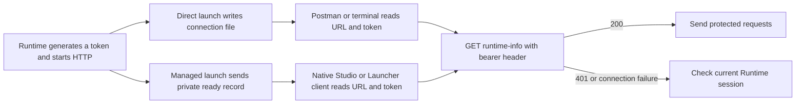

# Runtime local authentication

## Overview

Runtime generates a fresh session token every time it starts. Clients use
the API base URL and session token from that process to send authenticated
requests to its loopback HTTP listener. For manual testing on Linux or
Windows, start Runtime directly and read its connection file. Studio and
Launcher receive the credentials through the private readiness pipe when
they launch their own Runtime child.



## 1. Start Runtime for manual testing

Start it as your signed-in user and wait for the `runtime_ready` log. Leave
that terminal running and use a second terminal for the requests. If Studio
or Launcher already owns the Runtime, shut it down from that app before
starting a standalone instance.

**Linux.** Run this from the `a2matex-runtime` repository root.

```bash
make run
```

**Windows.** Run this in PowerShell from the `a2matex-runtime` repository root.

```powershell
go run -buildvcs=false ./cmd/agent
```

For an installed Windows executable, run `.\a2matex-runtime.exe` from its
installation directory. Use the URL supplied by the running process for all
requests, including when its listen address is overridden. See the
[B5 session contract](../runtime_process_foundation/b5_local_authentication.md#session-contract).

## 2. Find the connection file

| Platform | Path |
|---|---|
| Linux, preferred | `$XDG_RUNTIME_DIR/a2matex/runtime-connection.json` when `$XDG_RUNTIME_DIR` is an existing absolute directory |
| Linux, first fallback | `$XDG_CONFIG_HOME/a2matex/runtime/runtime-connection.json` when `$XDG_CONFIG_HOME` is absolute |
| Linux, final fallback | `$HOME/.config/a2matex/runtime/runtime-connection.json` |
| Windows | `%LOCALAPPDATA%\A2MaTeX\Runtime\runtime-connection.json` |

On Linux, run this in Bash to print the path selected from your environment.

```bash
if [[ ${XDG_RUNTIME_DIR:-} = /* && -d ${XDG_RUNTIME_DIR:-} ]]; then
  CONNECTION_FILE="$XDG_RUNTIME_DIR/a2matex/runtime-connection.json"
elif [[ ${XDG_CONFIG_HOME:-} = /* ]]; then
  CONNECTION_FILE="$XDG_CONFIG_HOME/a2matex/runtime/runtime-connection.json"
else
  CONNECTION_FILE="$HOME/.config/a2matex/runtime/runtime-connection.json"
fi
printf '%s\n' "$CONNECTION_FILE"
```

On Windows, run this in PowerShell.

```powershell
$ConnectionFile = Join-Path $env:LOCALAPPDATA 'A2MaTeX\Runtime\runtime-connection.json'
Get-Item -LiteralPath $ConnectionFile
```

Open the file in a local editor when you need to copy the fields into
Postman. It contains a URL that already includes `/api/v1` and a
43-character token. This example uses a placeholder.

```json
{
  "apiBaseUrl": "http://127.0.0.1:6810/api/v1",
  "sessionToken": "<token generated by Runtime>"
}
```

## 3. Send the bearer token

Use exactly one `Authorization` header on each protected request. Append the
route suffix to `apiBaseUrl`.

```http
GET /api/v1/runtime-info
Authorization: Bearer <sessionToken>
```

### Postman on Linux or Windows

1. Open Postman on the machine running Runtime. Create local environment

   values `API_BASE_URL` and `SESSION_TOKEN` from the connection file.
2. Create a **GET** request to `{{API_BASE_URL}}/runtime-info` with no body or

   query parameters.
3. In **Authorization**, select **Bearer Token**. Set the **Token** field to

   `{{SESSION_TOKEN}}`. Postman adds `Bearer` to the header automatically.
4. Send the request. Expect **HTTP 200** and Runtime information. To verify

   the authentication check, select **No Auth** on the same request and
    send it again. Expect **HTTP 401** with `error.code` set to `UNAUTHORIZED`.

For protected JSON POST requests, use the same bearer token and add
`Content-Type: application/json`. For endpoint bodies and examples, see
[Studio authoring APIs](studio.md#current-api-inventory-and-examples) and
[Launcher APIs](launcher.md#current-api-inventory).

### Linux terminal

With `CONNECTION_FILE` set from step 2, use Python 3 to read both values
from the same file snapshot and pass the header to curl through stdin.

```bash
if connection_values=$(python3 - "$CONNECTION_FILE" <<'PY'
import json
import sys

with open(sys.argv[1], encoding="utf-8") as connection_file:
    connection = json.load(connection_file)
print(connection["apiBaseUrl"])
print(connection["sessionToken"])
PY
); then
  mapfile -t runtime_connection <<< "$connection_values"
  printf 'header = "Authorization: Bearer %s"\n' "${runtime_connection[1]}" |
    curl --config - --noproxy '*' --max-time 5 -i "${runtime_connection[0]}/runtime-info"
fi
```

### Windows terminal

With `$ConnectionFile` set from step 2, read it in PowerShell and pass the
header to `curl.exe` through stdin.

```powershell
$Connection = Get-Content -LiteralPath $ConnectionFile -Raw -ErrorAction Stop | ConvertFrom-Json -ErrorAction Stop
$CurlConfig = 'header = "Authorization: Bearer {0}"' -f $Connection.sessionToken
$CurlConfig | curl.exe --config - --noproxy '*' --max-time 5 -i "$($Connection.apiBaseUrl)/runtime-info"
```

## 4. Handle restart and authentication failures

| What you see | What to check |
|---|---|
| Connection file is missing | Confirm you launched Runtime directly, waited for `runtime_ready`, and used the same OS account and environment. Managed launches publish privately to the owning app. |
| HTTP 401 | Reload the connection file or the managed session. Check that the request uses one header with a single `Bearer` prefix and the current token. |
| Connection refused or timeout | Check the Runtime process and its startup log, then reread the API URL. A previous process can leave a stale file after an abrupt exit. |
| Health returns 200 | The listener is alive. Use authenticated `GET /runtime-info` to confirm your token works. |

Each restart generates a fresh token. Refresh local Postman values after a
restart and keep credentials out of shared Postman values, exports, logs,
screenshots, and URLs.

## 5. Studio and Launcher integration

The native owner starts the child with inherited command and readiness
pipes. Read the single JSON ready record from the readiness pipe and keep
the two fields in native memory. Verify that `apiBaseUrl` uses HTTP on a
numeric loopback address and ends in `/api/v1`. Bypass proxies and reject
redirects. The native client attaches the current bearer token to its HTTP
requests.

Before each requested operation, confirm that the child and control channel
are live and make a bounded authenticated `GET {apiBaseUrl}/runtime-info`
probe. If the child exits or the probe fails, clear the credentials for that
child and follow the managed replacement flow before sending pending work.
See [managed startup and readiness](managed_runtime.md#readiness-and-authentication)
for Linux descriptors, Windows handles, and replacement rules.
