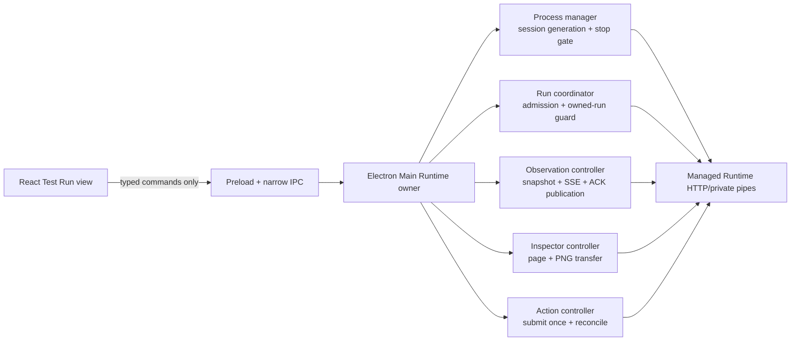

# A2MaTeX Studio — Kế hoạch triển khai Multi-device, Observability và Runtime Controls

> Trạng thái: Phase 2–6 đã được triển khai trong working tree; live Runtime/device và native close/Quit acceptance còn chờ môi trường thật  
> Ngày đối chiếu: 2026-11-25  
> Phạm vi chính: `a2matex-studio`  
> Tài liệu nguồn: [studio.md](studio.md),
> [studio_observability.md](studio_observability.md),
> [managed_runtime.md](managed_runtime.md)  
> Kế thừa: [runtime-device-run-api-integration-plan.md](../runtime-device-run-api-integration-plan.md)

## 1. Mục tiêu

Hoàn thiện luồng Development Test Run của Studio từ trạng thái hiện tại — đã có managed Runtime,
compile, single-device admission, snapshot polling và attempt API — thành một trải nghiệm đầy đủ gồm:

1. Chọn và chạy đồng thời trên một hoặc nhiều Android device, với input riêng cho từng device.
2. Hiển thị đầy đủ trạng thái group và từng device, không còn giả định `deviceExecutions[0]`.
3. Theo dõi run theo thời gian thực qua SSE, reconnect an toàn theo cursor và phục hồi bằng snapshot.
4. Inspect attempt theo từng device, phân trang đúng contract và xem Screenshot artifact đã commit.
5. Pause, Resume hoặc Cancel toàn bộ RunGroup với trạng thái pending/uncertain được giữ ở Electron Main.
6. Shutdown Runtime và thoát Studio có chủ đích, không tự relaunch do callback/reconnect đến muộn.
7. Có test tự động, controlled fixtures và manual acceptance đủ để thực hiện I8 sau khi implementation
   hoàn tất.

Plan này chỉ mô tả công việc. Không phase nào trong tài liệu này được xem là đã triển khai hoặc đã pass
acceptance cho tới khi có code và bằng chứng test tương ứng.

## 2. Kết luận sau khi đánh giá độc lập

### 2.1. Các giả định ban đầu và điểm cần hiệu chỉnh

| Giả định dễ mắc phải                                             | Đánh giá                                                                                                                                  | Quyết định trong plan                                                                                            |
| ---------------------------------------------------------------- | ----------------------------------------------------------------------------------------------------------------------------------------- | ---------------------------------------------------------------------------------------------------------------- |
| Ba tài liệu phản ánh chính xác checkout Studio hiện tại          | Không hoàn toàn đúng. `studio_observability.md` là handoff read-only tại revision cũ và dùng đường dẫn `a2matex-ide`.                     | Dùng ba tài liệu làm contract/đích đến, nhưng lấy code trong checkout này làm bằng chứng hiện trạng.             |
| Runtime đã hỗ trợ multi-device nghĩa là Studio đã hỗ trợ         | Sai. Runtime H4 đã có, nhưng Studio vẫn dùng tuple đúng một device, radio picker và nhiều chỗ đọc phần tử `[0]`.                          | Multi-device Studio là một vertical slice riêng từ DTO đến UI, không phải thay radio bằng checkbox.              |
| Có thể thêm SSE rồi bỏ toàn bộ snapshot polling                  | Không hợp lý. SSE là nguồn thay đổi liên tục; snapshot vẫn là nguồn bootstrap/repair có watermark, history vẫn là nguồn chi tiết attempt. | Snapshot + SSE + paged history có vai trò khác nhau; reducer phải chống state regression giữa ba nguồn.          |
| `withReadyRuntime` hiện tại dùng được cho mọi API mới            | Không an toàn với mutation và stream dài. Nó có thể thay child rồi chạy lại operation sau timeout/session error.                          | Tách readiness/recovery khỏi operation retry; action POST chỉ gửi một lần sau readiness, SSE có lifecycle riêng. |
| Đóng panel, Cancel Run và Shut down Runtime là cùng một thao tác | Sai. Đóng panel chỉ dừng đọc; Cancel thay đổi cả RunGroup nhưng giữ Runtime; shutdown dùng private owner pipe và dừng process.            | Ba lifetime được quản lý tách biệt trong Main và UI.                                                             |
| Có thể giới hạn 32 devices vì UI khó hiển thị nhiều hơn          | Không có contract cho giới hạn 32. Giới hạn thực tế đến từ request/response byte limit và tài nguyên máy.                                 | Bỏ ceiling 32 khỏi DTO; dùng UI có scroll/virtualization và không tự lọc selection.                              |
| `dist:win` có nghĩa managed Runtime đã chạy trên Windows         | Sai. resolver và pipe adapter hiện chủ động từ chối `win32`. Runtime mới có cross-build, chưa có native parent acceptance.                | Windows là release gate riêng; không đánh dấu cross-platform hoàn tất chỉ từ build artifact.                     |
| Test cũ trong plan trước vẫn tồn tại và vẫn pass                 | Không có bằng chứng trong checkout hiện tại: thư mục `tests` chỉ còn `setup.ts`.                                                          | Phase đầu phải dựng lại regression baseline; không kế thừa số lượng test từ tài liệu cũ.                         |

### 2.2. Cách tiếp cận được chọn

Không triển khai I5, I6 và I7 đồng thời trực tiếp trong React. Cách đó dễ tạo ba nguồn state cạnh tranh,
đưa token/lifecycle xuống renderer và làm action bị gửi lặp.

Plan chọn thứ tự:

```text
Contract và owner safety
  -> Multi-device admission + multi-device result UI
  -> I5 snapshot/SSE observation owner
  -> I6 paged attempts + PNG preview
  -> I7 actions + shutdown/close convergence
  -> I8 review và E2E acceptance
```

Lý do: I5–I7 đều cần identity theo RunGroup/device, session generation, stop suppression và ownership
guard đúng. Nếu chưa bỏ giả định một device và chưa sửa mutation retry, triển khai observability trước sẽ
tạo thêm state cần viết lại.

## 3. Baseline đã xác minh trong checkout

### 3.1. Phần đã có và được tái sử dụng

| Năng lực                  | Hiện trạng                                                                                                                  | Bằng chứng chính                                                                                                                                                                         |
| ------------------------- | --------------------------------------------------------------------------------------------------------------------------- | ---------------------------------------------------------------------------------------------------------------------------------------------------------------------------------------- |
| Managed Runtime trên Unix | Có launch, private ready record, token native-only, authenticated `runtime-info`, dynamic loopback port và owner shutdown.  | [`runtime-process-manager.ts`](../../electron/main/runtime/process/runtime-process-manager.ts), [`runtime-ready-record.ts`](../../electron/main/runtime/process/runtime-ready-record.ts) |
| Authoring                 | Có validation, compilation, supported-node check và lưu compiled IR theo source revision.                                   | [`runtime-http-client.ts`](../../electron/main/runtime/http/runtime-http-client.ts), [`runtime-run-coordinator.ts`](../../electron/main/runtime/run/runtime-run-coordinator.ts)          |
| Device inventory          | Có cached list và refresh qua native bridge.                                                                                | [`create-runtime-services.ts`](../../electron/main/runtime/create-runtime-services.ts), [`useTestRun.ts`](../../src/presentation/features/test-run/useTestRun.ts)                        |
| Single-device Test Run    | Có compile → persist → refresh device → stable request ID → `POST /runs`; giữ pending admission khi outcome chưa chắc chắn. | [`runtime-run-coordinator.ts`](../../electron/main/runtime/run/runtime-run-coordinator.ts)                                                                                               |
| Run recovery/polling      | Có `GET /runs/active`, by-ID polling và phân biệt 404 data result.                                                          | [`runtime-http-client.ts`](../../electron/main/runtime/http/runtime-http-client.ts), [`useTestRunExecution.ts`](../../src/presentation/features/test-run/useTestRunExecution.ts)         |
| Attempt API               | Có JSON client, schema, IPC/preload/host bridge và UI progress cơ bản.                                                      | [`runtime.types.ts`](../../src/application/runtime/runtime.types.ts), [`register-runtime-handlers.ts`](../../electron/main/ipc/register-runtime-handlers.ts)                             |
| Exit guard cơ bản         | Có prompt Stay open / Stop and exit ở `before-quit`.                                                                        | [`bootstrap.ts`](../../electron/main/bootstrap.ts)                                                                                                                                       |

### 3.2. Khoảng trống thực tế

| Khu vực          | Khoảng trống hiện tại                                                                                              | Hậu quả nếu không sửa trước                                                         |
| ---------------- | ------------------------------------------------------------------------------------------------------------------ | ----------------------------------------------------------------------------------- |
| Start DTO        | `RuntimeStartRequest.devices` là tuple một phần tử; `RuntimeStartRunInput` chỉ có `adbSerial` và một input object. | Không thể biểu diễn đúng multi-device intent.                                       |
| Snapshot decoder | Summary và `deviceExecutions` có `.max(32)`; inventory có `.max(1000)`.                                            | Từ chối response hợp lệ ngoài client-only ceiling.                                  |
| Coordinator      | Chỉ refresh/check một serial, build một member và xác minh response bằng member đầu tiên.                          | Có thể admission/identity check sai khi mở rộng UI.                                 |
| Test Run dialog  | Radio picker, một selected device và một form input dùng chung.                                                    | Không có per-device inputs; refresh không thể giữ nhiều selection.                  |
| Execution UI     | Recovery, attempts và status panel đều dựa vào `deviceExecutions[0]`.                                              | Che trạng thái sibling, không inspect được device khác.                             |
| Attempt loading  | Mỗi snapshot thay đổi lại tải toàn bộ pages từ sequence 0.                                                         | Tăng memory/request, bỏ qua race RUNNING → terminal cùng sequence và không đúng I6. |
| SSE              | Chưa có stream transport, parser, observer, ACK bridge hoặc reducer.                                               | Chỉ có polling một giây; không có reconnect/cursor semantics I5.                    |
| Artifact         | Chưa có binary client/bridge/preview cho `/artifacts/{artifactId}`.                                                | Screenshot output không thể xem an toàn trong renderer.                             |
| Run actions      | Chưa có action schema/client/controller/IPC/UI.                                                                    | Không Pause/Resume/Cancel được RunGroup.                                            |
| Mutation safety  | `withReadyRuntime` retry toàn bộ operation khi timeout/session failure.                                            | Có nguy cơ gửi lại action đã được Runtime nhận.                                     |
| Owner identity   | Chưa có session generation; `runById` có thể cập nhật active guard từ bất kỳ run được inspect.                     | Historical run có thể làm sai exit guard/owned active run.                          |
| Intentional stop | Chưa có persistent native suppression; `ensureReady` có thể start lại sau shutdown.                                | Callback/reconnect/remount có thể vô tình relaunch Runtime.                         |
| Close flow       | Prompt nằm ở `before-quit`, chưa chặn window close trước khi window mất và chưa bao phủ pending control.           | Race giữa close, action, observer và process shutdown.                              |
| Windows          | Executable resolver và pipe adapter từ chối `win32`.                                                               | `dist:win` không tạo ra managed Runtime usable.                                     |
| Test evidence    | Không có test file ngoài `tests/setup.ts`.                                                                         | Không có regression gate cho các race quan trọng.                                   |

## 4. Kiến trúc đích



Nguyên tắc bắt buộc:

- Electron Main sở hữu process, credentials, session generation, stream, action intent và shutdown
  suppression. Renderer không nhận token hoặc Runtime URL.
- IPC là các method hẹp theo use case; không thêm generic HTTP, shell, ADB hoặc command bridge.
- `requestId`, `runGroupId`, `deviceExecutionId`, `nodeAttemptId`, event cursor, publication version và
  action submission version là các identity khác nhau.
- Cursor luôn là decimal string. Không ép sang JavaScript `number`.
- Snapshot là authoritative bootstrap/repair. SSE là committed delta stream. Attempt page là saved
  detail. Không coi một nguồn có thể thay thế hai nguồn còn lại.
- Hủy read/preview/observer không hủy workflow. HTTP Cancel không shutdown Runtime. Owner shutdown
  không được thay bằng action Cancel.

## 5. Phạm vi và ngoài phạm vi

### Trong phạm vi

- Multi-device picker, per-device inputs, complete-selection admission và result UI.
- I5 live events/reconnect/bounded publication.
- I6 selected-device paged attempt history và committed Screenshot preview.
- I7 group Pause/Resume/Cancel, pending intent, uncertainty reconciliation và explicit shutdown/exit.
- Linux implementation/acceptance; Windows managed parent enablement như một release gate riêng.
- Automated tests, controlled Runtime fixtures và manual multi-device/live-device acceptance.

### Ngoài phạm vi

- Production package/path admission Phase J.
- Wait Variable H6–H8.
- Per-device Pause/Resume/Cancel; H13 action scope là toàn RunGroup.
- Client-side device-cap setting hoặc silent selection truncation.
- Operational log streaming, stdout, resolved input/variable maps.
- Screenshot gallery, eager preload, recapture, project DB copy hoặc artifact disk cache.
- Background/tray Runtime, public shutdown API, raw SQL/ADB/shell bridge.
- Tự động resume run/RAM variables sau Runtime restart.

## 6. Phase 0 — Contract freeze và regression baseline

### Công việc

1. Ghi lại Studio revision, Runtime revision/version, OS và ADB path dùng cho acceptance.
2. Tạo contract fixtures tối thiểu cho:
   - one-device và multi-device snapshots;
   - 201 admission, 200 replay, 409 busy;
   - unavailableDevices indexed rejection;
   - I1 attempt page, cùng sequence đổi từ RUNNING sang terminal;
   - I4 SSE frames, heartbeat, split UTF-8/chunk, duplicate, gap và 410;
   - H13 202/200/409 bodies;
   - PNG hợp lệ, sai MIME, truncated và trên 2 MiB.
3. Dựng lại test baseline theo Vitest config hiện tại; không copy số lượng test từ plan cũ.
4. Chạy và lưu baseline thực tế: `npm run typecheck`, `npm run test`, `npm run lint`,
   `npm run build:desktop`.
5. Chốt tên DTO/channels trước khi sửa preload để Application/Main/Renderer không drift.

### Acceptance

- Fixtures parse độc lập và không chứa token/device data thật.
- Có báo cáo baseline pass/fail trung thực; failure có phân loại pre-existing hay do phase mới.
- Mỗi contract source được link về một trong ba tài liệu nguồn hoặc Runtime spec tương ứng.

## 7. Phase 1 — Shared safety prerequisites

Phase này không tạo UI nổi bật nhưng là điều kiện để multi-device, SSE và actions không làm hỏng
ownership/lifecycle.

### 7.1. DTO và decoder

- Đổi `RuntimeStartRequest.devices` từ tuple thành non-empty array.
- Đổi `RuntimeStartRunInput` thành `devices: RuntimeStartDeviceInput[]`; không giữ song song field
  `adbSerial` cũ sau migration.
- Bỏ `.max(32)` khỏi run summary/device execution decoder. Giữ consistency check:
  `deviceExecutions.length === summary.total`, unique identity/serial và summary sum bằng total.
- Xem lại inventory `.max(1000)`: nếu Runtime contract không có cap, dùng bounded HTTP response size làm
  safety boundary thay vì client-only policy.
- Nâng IPC start request allowance từ 2 MiB lên đúng 4 MiB contract; vẫn enforce Runtime IR 1 MiB.
- Bổ sung admission error schema cho `unavailableDevices`, giữ index/serial/reason để UI highlight tất cả
  member bị reject.
- Bổ sung event/action/control/observation/artifact DTO và Zod schemas, nhưng chưa expose UI action.

### 7.2. Runtime owner lifecycle

- Thêm monotonically increasing `sessionGeneration` cho mỗi owned child đã ready.
- Thêm native `automaticWorkSuppressed`/stop intent. Explicit shutdown set cờ đồng bộ trước khi dispose
  reads; chỉ explicit Runtime action sau child exit mới được clear.
- Tách các seam:
  - safe read/authoring operation có thể phục hồi readiness theo policy;
  - mutation chuẩn bị readiness nhưng không tự replay sau khi bắt đầu send;
  - long-lived stream open trả cancellable handle, không await toàn body trong `withReadyRuntime`;
  - local cancellation không map thành `RUNTIME_TIMEOUT` và không thay child.
- Mọi callback mang session generation; callback của child cũ không được clear session mới.

### 7.3. Owned-run guard

- Tách `ownedActiveRun` khỏi `selectedObservedRun`.
- Chỉ admission/recovery/explicit active discovery được xác lập ownership.
- `runById(B)` để inspect historical B không được clear/replace active A.
- Snapshot/event cũ của A không được overwrite admission mới C.
- Giữ pending admission request body immutable và stable requestId như hiện tại.

### Acceptance

- Test chứng minh action-like mutation không bị gửi lần hai sau timeout/lost response.
- Explicit shutdown ngăn validation/reconnect/read callback tự start Runtime lại.
- Historical run lookup không thay đổi active-run exit guard.
- Stale child exit/callback không xóa credentials/session generation mới.

## 8. Phase 2 — Multi-device Test Run

> Kết quả triển khai 2026-11-25: đã hoàn tất contract, coordinator, picker, per-device inputs,
> multi-member execution UI và automated regression tests. `format:check`, lint, typecheck, 9 tests và
> desktop build đều pass. Controlled 33-device contract fixture và lost-response replay đã pass; chưa
> chạy acceptance với hai Android targets thật trong phiên này.

### 8.1. Device selection và inputs

- Chuyển picker từ radio sang accessible checkbox list.
- Selection key là exact `adbSerial`; chỉ `READY` được chọn.
- Sau refresh thành công:
  - giữ selection còn READY;
  - giữ dấu vết và highlight selection biến mất/chuyển unavailable;
  - không tự bỏ member rồi cho Run tiếp;
  - hiển thị refresh error riêng, vẫn giữ cached list.
- Yêu cầu ít nhất một selection; không áp client count ceiling.
- Input UX được chọn:
  - một shared default form để nhập nhanh;
  - mỗi selected device có tab/row override độc lập;
  - nút “Apply to selected devices” là thao tác explicit, không liên kết ngầm object sau khi copy;
  - payload cuối luôn materialize một `inputs` object riêng cho từng member theo selection order.
- Khi schema/source đổi, reset/revalidate input drafts theo generation; không carry giá trị invalid vào run
  intent mới.

### 8.2. Admission coordinator

1. Synchronous intent lock trước async work.
2. Capture graph, input schema, ordered device/input pairs thành một immutable intent.
3. Compile captured graph/schema và CAS-persist đúng source revision.
4. Refresh inventory một lần; kiểm tra toàn bộ serial:
   - non-empty;
   - unique;
   - tất cả còn READY;
   - không sort lại hoặc silently deduplicate.
5. Tạo requestId đúng một lần ngoài retry; giữ nguyên body nếu outcome uncertain.
6. Sau 201/200, xác minh requestId và toàn bộ response membership theo order/serial, không chỉ member 0.
7. Với 422 indexed availability, highlight tất cả member lỗi; vì chưa admission nên user được sửa thành
   intent mới. Với lost response/5xx, giữ nguyên pending body để replay identity.

### 8.3. Multi-device execution UI

- Render group status, summary counts và toàn bộ `deviceExecutions`.
- Có member selector theo `deviceExecutionId`; ADB serial chỉ là label.
- Mỗi member hiển thị status, next node, timestamps và terminal error riêng.
- Một member FAILED không biến siblings đang RUNNING thành local failure; group status theo snapshot.
- Chỉ selected member điều khiển highlight/history view; đổi member không đổi action scope.
- Recovery từ `/runs/active` chọn member đầu theo UI default nhưng không encode giả định member 0 vào
  domain state; user có thể chuyển member.
- Dùng list virtualization/scroll cho nhiều devices thay vì đặt giới hạn admission tùy ý.

### Acceptance

- Chạy được 1, 2 và controlled 33-device fixture qua cùng contract.
- Hai devices nhận hai input objects khác nhau và response giữ đúng order.
- Một serial unavailable làm reject toàn selection; không có partial admission.
- Lost POST response replay cùng body trả cùng RunGroup, không chạy lần hai.
- UI hiển thị đồng thời một member terminal và một member running.
- Không còn `deviceExecutions[0]` trong orchestration/inspector logic; chỉ có thể tồn tại trong test fixture
  helper hoặc explicit default-selection function có tên rõ.

## 9. Phase 3 — I5 live events và reconnect

> Kết quả triển khai 2026-11-25: đã thêm native `node:http` SSE transport/parser, A6 closed union,
> exact string cursor, snapshot/event reducer, readiness-aware reconnect và 410 repair. Main giữ bounded
> unacknowledged/latest projection qua bridge observe/select/stop/ACK; renderer đã bỏ permanent group
> polling và hiển thị observation health. Owned-run guard chỉ nhận observation của run đã admission hoặc
> recovery; inspect historical run không còn thay active guard. Automated tests bao phủ split UTF-8/CRLF,
> heartbeat, cursor lớn hơn `Number.MAX_SAFE_INTEGER`, duplicate/gap, snapshot regression, bounded ACK và
> cursor expiry. Chưa nghiệm thu disconnect/reconnect với managed Runtime binary thật trong phiên này.

### 9.1. Native SSE transport/parser

- Thêm dedicated native stream adapter, ưu tiên `node:http` để kiểm soát header/body lifetime.
- Request `GET /events`, current Bearer, exact `Accept: text/event-stream`, optional
  `Last-Event-ID`; không query/body/token URL.
- Opening/header timeout 10 giây; idle watchdog 45 giây; không có total body timeout.
- Incremental UTF-8 parser hỗ trợ LF/CRLF, split chunks, multiline data và heartbeat comments.
- Bound partial/frame buffer 32 KiB; validate closed A6 event union và equality giữa frame id/type với JSON.
- Cursor là exact positive decimal string; process event trước khi advance cursor. Gaps hợp lệ, duplicate
  idempotent, incomplete EOF không được acknowledge.

### 9.2. Observation controller và reducer

- Một native observer/stream cho owner; không mở stream riêng cho mỗi React component.
- Với known run: by-ID snapshot → retain watermark W → subscribe sau W.
- State keys dùng runGroupId/deviceExecutionId/nodeAttemptId, không dùng nodeId hoặc serial đơn lẻ.
- Snapshot/event reconciliation:
  - snapshot cũ hơn processed cursor không được regress view;
  - snapshot mới hơn có thể repair group/device fields nhưng không tự tạo attempt detail;
  - terminal member không bị old RUNNING event mở lại;
  - `NODE_RETRY_SCHEDULED` chỉ hiển thị kế hoạch, không dispatch retry.
- 410: clear partial live facts → fetch fresh snapshots cho monitored views → subscribe từ cursor mới.
- Unexpected EOF/read error: readiness check rồi reconnect 1/2/4/8/15 giây; reset backoff sau valid
  event/heartbeat, không chỉ sau HTTP 200.
- Intentional stop/dispose cancel reader/timers và không reconnect/relaunch.

### 9.3. Bounded Main → renderer publication

Thêm narrow bridge tương đương:

```text
observeRun({runGroupId}) -> {observationId, initialView}
selectObservedDevice({observationId, deviceExecutionId})
stopObserving({observationId})
onObservationChanged(listener)
ackObservation({observationId, version})
```

- Listener được cài trước `observeRun`.
- Initial view version 1 chỉ trả qua invoke, không push; React apply xong mới ACK.
- Main giữ tối đa một unacknowledged envelope và một latest pending projection.
- Initial ACK deadline 10 giây; abandoned startup chỉ dispose observation, không ảnh hưởng run/action.
- Publication version, action submission version và SSE cursor không dùng thay thế lẫn nhau.
- Bind observation/sender; dispose khi WebContents bị destroy.

### 9.4. UI migration

- Thay permanent one-second group poll bằng observation view sau khi I5 ổn định.
- Giữ một serialized by-ID repair read khi cần; không chạy poller và observer cạnh tranh.
- Hiển thị observation health riêng với run status: connecting, live, reconnecting, stale, error.
- Feature flag/fallback chỉ được giữ trong rollout ngắn; không duy trì hai reducer production lâu dài.

### Acceptance

- Split frame, duplicate, gap, >`Number.MAX_SAFE_INTEGER`, heartbeat và invalid event đều có test.
- Snapshot 50 đến sau event 51 không làm status regress; snapshot 60 vẫn cho event 58+ bổ sung live facts.
- Disconnect observer không dừng run và không replace healthy child; reconnect replay từ processed cursor.
- 410 repair không redispatch node/action.
- Renderer không ACK vẫn không block native stream; memory không tăng theo số event.
- Remount/lost invoke reply/late ACK không leak stream hoặc làm observation cũ thành current.

## 10. Phase 4 — I6 attempt inspector và Screenshot artifact

> Kết quả triển khai 2026-11-25: attempt inspector chỉ giữ một page tối đa 100 rows, dùng exact
> `nextAfterSequence`, giữ page boundary khi refresh, merge same-ID RUNNING → terminal và chặn stale
> device/page replies bằng generation. I5 selected-member event đánh dirty read được serialize/throttle
> 250 ms. Inspector hiển thị attempt details/output/error và preview artifact theo yêu cầu explicit.
> Binary bridge có request ID/cancel, một transfer mỗi renderer, cap 16 MiB, MIME/Content-Length/PNG
> signature/IHDR/dimension validation và Blob URL cleanup. Automated tests bao phủ page 100 rows,
> same-sequence update, stale/late preview, PNG trên 2 MiB, wrong MIME, truncated, oversized và cancel.
> Chưa nghiệm thu artifact/download trên Android run thật trong phiên này.

### 10.1. Selected-page attempt history

- State theo selected `deviceExecutionId`, selected page boundary và selected attempt ID.
- Mỗi lần chỉ giữ một page tối đa 100 rows; Next dùng chính `nextAfterSequence`, không `+1`.
- Refresh lại original page boundary để thấy RUNNING → terminal tại cùng sequence; upsert bằng attempt ID.
- I5 event của selected member đánh dirty một page read; serialize và throttle start tối thiểu 250 ms.
- Nếu I5 chưa bật trong rollout, dùng one-second selected-page polling tạm thời; tuyệt đối không chạy cả hai.
- Selection/run/session generation đổi thì clear output, cancel/ignore stale read và preview.
- Không full-history loop, không collapse retries theo nodeId, không coi null continuation là run terminal.

### 10.2. Artifact binary path

- Thêm dedicated authenticated GET `/artifacts/{artifactId}` với 16 MiB encoded-byte cap; không tăng
  generic JSON cap 2 MiB.
- Validate canonical ID, 200 `image/png`, positive Content-Length, complete byte count, PNG signature,
  IHDR, chiều tối đa 4096 và tổng pixel tối đa 12,000,000.
- Non-200 decode bounded safe JSON envelope; 200 truncated/wrong MIME/decode error là preview failure.
- Narrow bridge dùng requestId và có cancel; một active transfer cho mỗi inspector.
- Renderer tạo Blob URL từ `Uint8Array`, revoke khi selection/page/image/view đổi hoặc unmount.
- Không đưa token, Runtime URL, local path hoặc native handle vào ``.

### 10.3. Inspector UI

- Device selector dùng snapshot membership.
- Attempt table/timeline hiển thị sequence, node label từ captured source nếu có, attempt number, status,
  timestamps, output/error.
- JSON output render như text/tree an toàn, không executable HTML.
- Successful Screenshot output có `artifactId` thì cho Preview; không đoán node type khi contract nguồn
  không còn, nhưng có thể preview canonical stored reference.
- History/preview errors tách biệt execution error và không thay đổi run status.

### Acceptance

- Hơn 100 attempts page đúng boundary, không retain toàn bộ history.
- Same-sequence RUNNING → SUCCEEDED được cập nhật mà không duplicate row.
- Đổi device khi request cũ về muộn không hiển thị output/image cũ.
- PNG trên 2 MiB nhưng dưới 16 MiB xem được; wrong MIME/truncated/oversized bị reject và partial bytes
  bị bỏ.
- Đóng preview hủy transfer/revoke URL nhưng không restart Runtime hoặc recapture.

## 11. Phase 5 — I7 Pause, Resume, Cancel

> Kết quả triển khai 2026-11-25: đã có exact action client riêng cho 202/200/409, không đi qua
> admission decoder hoặc `withReadyRuntime` retry. Electron Main giữ control intent theo run group,
> session generation và submission version; chỉ cho một POST in-flight, giữ UNCERTAIN khi mất outcome,
> cho Cancel supersede Pause/Resume pending và resolve `SESSION_ENDED` khi child đổi. Observation initial
> view và các publication đều mang control state. UI chỉ enable Pause/Resume/Cancel theo owned active group,
> pending/stale state, có Check state và chặn reply submission version cũ ghi đè state mới. Automated
> contract/unit/component tests đã bao phủ exact body/disposition/conflict snapshot, click đúp/no retry,
> superseding Cancel và session replacement. Live Pause/Resume/Cancel trên Android Runtime thật chưa được
> nghiệm thu trong phiên này.

### 11.1. HTTP/action contracts

- Thêm exact POST `/runs/{runGroupId}/actions` body `{"action":"PAUSE|RESUME|CANCEL"}`.
- Parse riêng:
  - 202 root snapshot → local `ACCEPTED`;
  - 200 root snapshot → local `ALREADY_TARGET`;
  - 409 `{error, snapshot}` → typed conflict, không làm mất snapshot;
  - other error-only envelope → safe error metadata.
- Không dùng admission error decoder cho action 409.
- Action không có client-generated action ID theo wire contract; idempotency/reconciliation dựa vào
  Runtime state và native submission generation.

### 11.2. Native control-state owner

Main giữ cho owned/control group:

```text
runGroupId + sessionGeneration
submissionVersion
action: PAUSE | RESUME | CANCEL | null
phase: IDLE | SUBMITTING | PENDING | UNCERTAIN | RESOLVED
resolution: TARGET_OBSERVED | ALREADY_TARGET | TERMINAL_WINNER |
            CONFLICT | REJECTED | SESSION_ENDED | null
lastError: safe allowlisted metadata | null
```

- Một POST in-flight; double click không dispatch hai lần.
- Set SUBMITTING trước send. Sau transport bắt đầu, timeout/500/lost IPC là UNCERTAIN, không auto retry.
- Read/observe cùng group để reconcile. User chỉ retry same action một cách explicit sau reconciliation.
- Cancel được phép supersede pending Pause/Resume bằng submissionVersion mới; reply cũ không settle Cancel.
- Close panel không xóa unresolved native intent. Reopen phải nhận controlState trong initial view trước
  khi enable buttons.
- Child replacement resolve old intent `SESSION_ENDED`; không replay Resume vào process mới.

### 11.3. Controls UI

| Điều kiện               | Controls                                                              |
| ----------------------- | --------------------------------------------------------------------- |
| RUNNING, IDLE           | Pause, Cancel                                                         |
| PAUSED, IDLE            | Resume, Cancel                                                        |
| POST đang send          | Disable new submission                                                |
| Pause/Resume pending    | Hiển thị requested; disable opposing action; cho phép explicit Cancel |
| Cancel pending          | Disable controls, tiếp tục observe                                    |
| UNCERTAIN/stale session | Hiển thị outcome unknown; yêu cầu Check state trước Pause/Resume      |
| Terminal/no group       | Disable actions, vẫn inspect history/artifact                         |

Không thêm `PAUSING`/`CANCELLING` vào saved Runtime DTO. 202 là accepted request, không phải đã đạt target.
Pause không freeze Delay đang chạy; Cancel giữ Runtime alive.

### Acceptance

- 202/200/409 đều giữ snapshot và disposition đúng.
- Lost action response không gửi lại action tự động và không replace healthy child.
- Reopen khi Pause/Cancel pending phục hồi control state trước button enable.
- Stale Pause reply không clear newer Cancel.
- Action trên historical selected run không thay owned active group.
- Cancel xong Runtime vẫn READY và có thể admission run mới.

## 12. Phase 6 — Explicit Runtime shutdown và app close

> Kết quả triển khai 2026-11-25: window close, system/menu Quit và `before-quit` hội tụ vào một guarded
> Main flow, prompt trước destruction khi admission/run/control còn unresolved và chỉ cleanup database sau
> owner shutdown settle. Automatic-work suppression được set đồng bộ và khóa vĩnh viễn cho app exit; late
> validation/read/action/SSE không thể clear gate. Runtime-only shutdown giữ Studio mở, dừng observation,
> preview và control intent, đồng thời chỉ cho phép Runtime chạy lại từ explicit Validate/Run/device/control
> action. Process manager gửi exact `shutdown\n`, chờ bounded exit/SIGTERM/SIGKILL và chỉ publish STOPPED
> sau confirmed exit; failure thành FAILED và được log/display an toàn. Đã có UI Stop Runtime và unit test
> cho suppression/STOPPING→STOPPED. Native Electron prompt/close với live child vẫn cần manual acceptance.

### Công việc

1. Gom window close, system Quit, menu Quit và `before-quit` vào một guarded native flow.
2. Nếu admission/run/control unresolved, prompt trước khi owning window bị destroy:
   - **Stay open**: giữ window, Runtime và run;
   - **Stop and exit**: thực hiện owner shutdown, không thay bằng HTTP Cancel.
3. Set automatic-work suppression đồng bộ trước khi:
   - cancel observer/reconnect;
   - cancel I6 page/preview;
   - invalidate queued reads/actions/validation;
   - clear session.
4. Gửi exact `shutdown\n`, chờ bounded child exit/termination; chỉ báo STOPPED sau exit.
5. Runtime shutdown riêng giữ Studio mở và suppression cho tới explicit permitted Runtime action mới.
6. Tránh duplicate prompt, recursive quit và cleanup DB trước khi Runtime owner flow settle.

### Acceptance

- Close button và Quit đều chỉ hiển thị một prompt.
- Stay open không làm mất window hoặc dừng run.
- Stop and exit không relaunch Runtime từ late validation/SSE/preview callback.
- Pending action không bị replay; Runtime hoàn tất shutdown/cancellation theo owner protocol.
- Stopped chỉ xuất hiện sau confirmed exit; lỗi shutdown được hiển thị/log safe.

## 13. Phase 7 — Windows managed parent prerequisite

Phase này độc lập với việc hoàn thiện Linux Studio và không được coi là pass từ cross-build.

### Công việc

- Thiết kế anonymous-pipe/handle inheritance cho Windows, không dùng Unix FIFO/mkfifo.
- Resolve `a2matex-runtime.exe` trong packaged resource root và kiểm tra regular trusted file.
- Truyền đúng child-visible owner command/ready handles; chỉ inherit handle cần thiết.
- Kiểm tra ready record, current-token auth, shutdown EOF/command, stale child exit và forced termination.
- Kiểm tra package `dist:win` thực sự chứa đúng Runtime executable/ADB strategy.
- Chạy native Windows parent acceptance; lưu bằng chứng riêng với Runtime cross-build evidence.

### Acceptance

- Studio Windows launch/ready/probe/operation/shutdown được chạy thật trên Windows.
- Token không đi qua command line/log/renderer/file của managed mode.
- Parent loss tạo EOF và Runtime recovery semantics đúng tài liệu.
- Không còn `RUNTIME_PLATFORM_UNSUPPORTED` trên supported Windows build.

## 14. Phase 8 — I8 review và end-to-end acceptance

Chỉ bắt đầu sau khi Phase 0–6 đã merge/pull vào checkout cần review; Phase 7 có thể là release gate riêng
nếu Linux beta được phép đi trước.

### Automated gates

```bash
npm run typecheck
npm run test
npm run lint
npm run build:desktop
```

Thêm focused suites cho:

- DTO/schema: multi-device, no fixed 32 ceiling, action 409, event union, artifact metadata.
- Process manager: generations, stop suppression, stale exit và no mutation replay.
- Coordinator: immutable multi-device intent, whole-selection validation, stable replay, owned-run guard.
- SSE parser/observer: chunking, heartbeat, cursor precision, backoff, expiry repair, ACK races.
- Inspector: page refresh/upsert, cancellation/generation, PNG validation/cleanup.
- Actions: pending/uncertain/reopen/superseding Cancel/conflict/terminal winner.
- Components: multi-select/per-device inputs, member selection, controls matrix, error separation.

### Manual scenarios bắt buộc

1. Một READY device: regression single-device đầy đủ.
2. Hai READY devices với inputs khác nhau: concurrent progress và ordered membership.
3. Một member disconnect sau admission: member đó FAILED, sibling tiếp tục, group summary đúng.
4. One member terminal trong khi member khác running; đổi inspector giữa hai member.
5. Observer disconnect/reconnect trong long Delay; run không dừng, không redispatch.
6. Controlled 410; snapshot repair rồi tiếp tục từ cursor mới.
7. Hơn 100 attempts và same-sequence RUNNING → terminal.
8. Screenshot trước failure/disconnect; PNG vẫn xem được, không recapture.
9. Pause trong Delay → Resume; Cancel active/paused/pending-control run.
10. Lost action response và 409 conflict; không blind replay.
11. Close/reopen panel khi Pause/Cancel pending; control intent được phục hồi.
12. Stay open và Stop and exit qua window close lẫn Quit.
13. Explicit Runtime shutdown khi observer/preview đang hoạt động; không auto relaunch.

### Bằng chứng cần lưu

- Studio/Runtime revisions, Runtime version, OS/arch, ADB version/path và device/emulator identifiers đã
  được redact phù hợp.
- Expected/observed cho từng scenario; HTTP disposition/safe codes, runGroup/device IDs test-only.
- Test command, exit code và failure log safe; không lưu token, workflow payload, PNG body hoặc raw ADB
  output chứa dữ liệu riêng tư.
- Linux và native Windows evidence tách riêng.

## 15. Thứ tự thay đổi theo khu vực mã nguồn

| Khu vực                                          | Thay đổi dự kiến                                                                                  |
| ------------------------------------------------ | ------------------------------------------------------------------------------------------------- |
| `src/application/runtime/runtime.types.ts`       | Multi-device intent, event/observation/control/action/artifact types.                             |
| `src/application/runtime/runtime.schema.ts`      | Bỏ cap 32, non-empty device array, indexed admission error, SSE/action/preview schemas.           |
| `electron/main/runtime/process/*`                | Session generation, stop suppression, read/mutation/stream readiness seams, Windows prerequisite. |
| `electron/main/runtime/http/*`                   | Action client, SSE transport/parser, binary artifact client; giữ JSON limits riêng.               |
| `electron/main/runtime/run/*`                    | Multi-device coordinator, owned-run guard, observation controller, action controller.             |
| `electron/main/ipc/register-runtime-handlers.ts` | Narrow validated handlers, sender binding, disposal; 4 MiB start IPC.                             |
| `electron/shared/channels.ts`                    | Observation, ACK, preview/cancel và action channels cụ thể.                                       |
| `electron/preload/index.cts`                     | Typed narrow bridge và exact listener cleanup; không generic request.                             |
| `src/infrastructure/electron/studio-host-api.ts` | Host contracts đồng bộ với preload/channels.                                                      |
| `src/presentation/features/test-run/*`           | Multi-select/inputs, observation hook, member/attempt inspector, preview, controls.               |
| `src/presentation/pages/MainWorkflowPage.tsx`    | Wiring Test Run/observer/controls/shutdown UI, không sở hữu network state.                        |
| `electron/main/bootstrap.ts`                     | Compose/dispose controllers và unified close/quit guard.                                          |
| `tests/**`                                       | Contract, unit, integration, race và component suites dùng controlled fixtures.                   |

Mỗi slice phải cập nhật types → Main implementation → IPC/channels/preload → host API → UI → tests trong
cùng PR hoặc trong các PR luôn build được. Không merge trạng thái preload đã expose method mà Main chưa
đăng ký, hoặc UI dựa vào method chỉ có ở binary mới mà không có compatibility handling.

## 16. Rollout và rollback

- Multi-device có thể rollout trước I5; vẫn dùng serialized snapshot polling trong giai đoạn ngắn.
- I5 rollout dưới feature flag nội bộ nếu cần, nhưng một view chỉ có một state owner: polling hoặc
  observation, không cả hai.
- I6 artifact preview có thể disable độc lập nếu binary validation/bridge lỗi; attempt history vẫn dùng
  được.
- I7 controls chỉ enable khi action contract và controlState restoration cùng có; không expose nút action
  chỉ dựa vào HTTP method.
- Rollback UI không được downgrade persisted Runtime data hoặc gửi Cancel/shutdown tự động.
- Runtime capability/build mismatch được hiển thị như compatibility issue, không relaunch loop.

## 17. Definition of Done

Tập tính năng này chỉ hoàn tất khi:

- Studio admission và UI không còn giả định một device.
- Complete multi-device selection được gửi nguyên vẹn, có inputs riêng, stable request identity và
  whole-selection error handling.
- Live view dùng snapshot-watermarked SSE, reconnect/410 repair đúng và không leak/unbounded queue.
- Inspector phân trang theo selected device, cập nhật same-sequence và preview PNG qua native auth bridge.
- Pause/Resume/Cancel có mutation-once, pending/uncertain state và reopen reconciliation.
- Explicit shutdown/exit ngăn mọi automatic relaunch và chờ child exit xác nhận.
- Renderer không nhận credential/Runtime URL/raw native object; log không chứa secret/payload nhạy cảm.
- Automated gates pass và manual scenarios có evidence; I8 report không còn tiêu chí bị đánh dấu hoàn
  tất chỉ dựa trên plan hoặc Runtime-side API tests.
- Native Windows chỉ được ghi “supported” sau acceptance thật; nếu chưa, release notes ghi rõ giới hạn.
