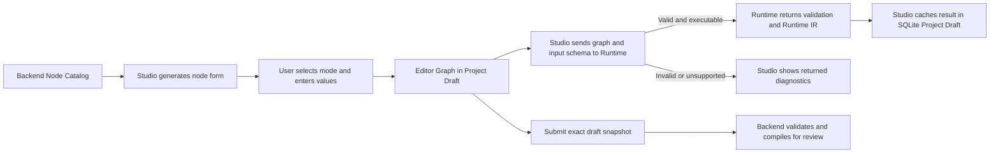

# Studio Node Definition to Project Draft Guide

## Overview

Studio treats the Backend Node Catalog as the authoring contract. It uses a
Node Definition to build the palette and inspector and saves only instance
values in the Editor Graph. Studio must never copy Node Definition schemas into
a Project Draft and never compiles Runtime IR. Runtime Agent compiles local Test
Run IR, while Backend compiles authoritative IR from the frozen Submission snapshot.



## 1. Load and identify nodes

Fetch `GET /node-catalog?runtimeVersion=X.Y.Z` and cache the response by
`catalogHash`. Match a Project Draft node to its definition through `node.type`.
Do not persist the definition, icon, schemas, runtime handler, or capability
metadata in that Editor Graph node.

Use the definition as follows:

- `name`, `description`, and `category`: palette and inspector;
- `configSchema`: static configuration fields;
- `inputSchema`: binding fields and their field-specific source contracts;
- `outputPorts`: connection handles;
- `editorHints.targeting`: mode-dependent targeting form, when present.

Studio owns icons, colors, field layout, port labels, and target-mode labels.
Render one static connector per `outputPorts.ports` entry in array order. `STOP`
is always available; expose `ERROR_BRANCH` only when the list contains `error`.

## 2. Ordinary node conversion

For a node without `editorHints.targeting`, generate controls from
`configSchema` and `inputSchema`. Save static config values in `node.config`.
Save input values as binding-source objects in `node.bindings`; a direct value
uses `{ "kind": "LITERAL", "value": ... }`.

Every node may also save optional execution settings:

```json
{
  "timeoutMs": 30000,
  "retryPolicy": {
    "maxAttempts": 3,
    "delayMs": 1000
  }
}
```

Studio may explain the defaults in its UI, but does not resolve them. Runtime and
Backend compilers use `NodeDefinition.defaultTimeoutMs` when `timeoutMs` is omitted
and resolve missing retry fields to `maxAttempts: 1` and `delayMs: 0`.

The Project Draft node keeps only instance data:

```json
{
  "id": "delay_01",
  "type": "flow.delay",
  "config": {},
  "bindings": {
    "durationMs": { "kind": "LITERAL", "value": 1000 }
  },
  "errorPolicy": "STOP",
  "editor": { "x": 420, "y": 180 }
}
```

## 3. Binding-kind use guide

For each bindable field, Studio must offer only the sources listed in that field's
`inputSchema.properties.<field>.bindingKinds`. The selected entry declares the fields saved beside
`kind`. Changing the source replaces the whole binding object; fields belonging to the previous
kind must not remain in the saved object.

### `LITERAL`

Render a direct value control. For an ordinary input, derive its type and constraints from that
field in `inputSchema`. Set Variable publishes the allowed literal types under
`bindingKinds.LITERAL.fields.value.types`: string, finite number, and boolean.

```json
{ "kind": "LITERAL", "value": 50 }
```

### `WORKFLOW_INPUT`

Render a selector from `ProjectDraft.inputSchema.properties` and save the selected property name.
For an ordinary input, show only compatible property types. A required node input cannot use an
optional workflow input because the value could be absent at execution. Set Variable accepts any
declared supported scalar input.

```json
{ "kind": "WORKFLOW_INPUT", "inputName": "message" }
```

### `NODE_OUTPUT`

Render a two-stage selector: producer node, then output field. Build the choices from other graph
nodes and their catalog `outputSchema`. Only required output fields are bindable. For an ordinary
input, the output type must equal the destination input type. Set Variable accepts any supported
scalar output.

Only offer a producer when every route to the consumer passes through that producer's `success`
edge. Do not allow a node to reference itself or a node that can execute after the consumer. Save
the producer's stable Editor Graph node ID, not its label or catalog type.

```json
{
  "kind": "NODE_OUTPUT",
  "nodeId": "capture",
  "field": "artifactId"
}
```

### `FLOW_VARIABLE`

Render a variable-name field. Studio should suggest names written by preceding
`flow.set_variable` nodes whose `config.scope` is `FLOW`, while still allowing a valid manual name.
The value belongs to the current device workflow execution. Its existence and runtime value type
are checked when the workflow executes.

```json
{ "kind": "FLOW_VARIABLE", "name": "lastScreenshotArtifactId" }
```

### `GLOBAL_VARIABLE`

Render a variable-name field. Studio should suggest names written by `flow.set_variable` nodes
whose `config.scope` is `RUN_GROUP`, while still allowing a valid manual name because another
execution in the run group may produce it. Despite the binding name `GLOBAL_VARIABLE`, its scope is
the current run group, not all users or all workflow runs. Its existence and runtime value type are
checked when the workflow executes.

```json
{ "kind": "GLOBAL_VARIABLE", "name": "bestScore" }
```

Variable names are case-sensitive and must match `^[A-Za-z_][A-Za-z0-9_]{0,99}$`. Studio saves the
selected object unchanged under the destination key in `node.bindings`. The same Editor Graph is
stored in local SQLite and sent in the Cloud Draft payload; the selector UI state and catalog hints
are not persisted separately. Runtime compilation changes `kind` to `source` but preserves the
remaining fields. See the authoritative
[workflow binding contract](../a2matex-runtime/contracts/workflow_bindings.md) for compiler and
execution behavior.

## 4. Set Variable conversion

For `flow.set_variable`, render the ordinary schemas without a dedicated special hint:

1. `config.name` as a required variable-name field using the definition's schema.
2. `config.scope` from its schema enum, initially selecting its schema default of `FLOW`.
3. One required `value` source selector from `inputSchema.properties.value.bindingKinds`.
4. The fields declared by the selected binding kind.

Save the selected scope explicitly. The required input property name is `value`, so save the
selected binding under `bindings.value`:

```json
{
  "id": "set_score",
  "type": "flow.set_variable",
  "config": {
    "name": "score",
    "scope": "FLOW"
  },
  "bindings": {
    "value": {
      "kind": "LITERAL",
      "value": 50
    }
  },
  "errorPolicy": "STOP",
  "editor": {
    "x": 300,
    "y": 200
  }
}
```

The value may instead use `WORKFLOW_INPUT`, `NODE_OUTPUT`, `FLOW_VARIABLE`, or
`GLOBAL_VARIABLE` with their standard binding shapes. Set Variable accepts any supported scalar;
Studio must not invent a fixed value type. It has no bindable output field. Later nodes read a
`FLOW` write through `FLOW_VARIABLE` and a `RUN_GROUP` write through `GLOBAL_VARIABLE`.

Use the definition's static `success` and `error` ports. Show `error` only when the publisher selects
`ERROR_BRANCH`, following the common error-policy rule. Saving this node changes `editorGraph`, so
the cached Runtime IR becomes stale under the normal source-revision rules.

The schemas are not saved in SQLite or sent in the Cloud Draft. Only the node instance above is
stored inside `editorGraph.nodes`. Studio may author and Sync the node before execution support
exists, but it must block Test Run when the connected Runtime does not advertise the handler.

## 5. Switch conversion

`flow.switch` combines static ordered rule configuration with runtime-resolved bindings. Studio
renders them together in each rule row, although the Project Draft stores operators in `config` and
resolved value sources in `bindings`.

### 5.1 Read the definition

Use these definition paths:

| Definition path | Studio responsibility | Project Draft destination |
|---|---|---|
| `configSchema.properties.rules` | ordered rule editor and rule limits | `node.config.rules` |
| `rules.items.properties.id` | generate a UUID; never render an editable field | `rule.id` |
| `rules.items.properties.operator.options` | operator selector and operand count | `rule.operator` |
| `inputSchema.properties.value.bindingKinds` | shared left-value source editor | `node.bindings.value` |
| `inputSchema.dynamicInputs.ruleOperand` | binary-rule operand source editor | `node.bindings[rule.id]` |
| `outputPorts.dynamicPorts.keysFrom` | one branch handle for each rule UUID | `edge.sourcePort` |
| `outputPorts.ports` | `default`, plus `error` when selected | `edge.sourcePort` |

`dynamicInputs` is definition metadata and is never persisted. Its `bindingKeyFrom` tells Studio to
use each rule UUID as the corresponding operand key. Its `operandCountFrom` tells Studio to read the
selected operator option and render an operand only when `operandCount` is `1`.

### 5.2 Render the editor

Render one shared value-source editor followed by an ordered rule list:

```text
Value: [source kind] [source fields]

1. [operator] [operand source kind] [operand fields] -> branch handle
2. [operator] [operand source kind] [operand fields] -> branch handle
Default -> branch handle
```

Studio owns labels and layout. Use the definition's operator order. Filter operators by a known
left-value type when possible; when a Flow or Global variable type is unknown, show all operators
and let authoritative validation and Runtime admission check the resolved type.

Operator behavior:

| Operators | Operand UI | Required values |
|---|---|---|
| `EQ`, `NE` | one binding editor | matching string, number, or boolean values |
| `LT`, `LTE`, `GT`, `GTE` | one binding editor | numbers; Runtime compares them as floating-point values |
| `CONTAINS`, `NOT_CONTAINS`, `STARTS_WITH`, `ENDS_WITH` | one binding editor | strings |
| `IS_EMPTY`, `IS_NOT_EMPTY` | none | string left value |
| `IS_TRUE`, `IS_FALSE` | none | boolean left value |

### 5.3 Create and edit rules

When the publisher adds a rule:

1. Generate a new UUID with the platform UUID generator.
2. Insert `{ "id": uuid, "operator": selectedOperator }` into `config.rules`.
3. If the operator has `operandCount: 1`, initialize its binding editor and save the completed
   binding as `bindings[uuid]`.
4. Render a branch handle internally keyed by the same UUID. The visible label may use its row
   number or operator summary.

Editing rules must preserve referential stability:

- reorder: move the rule record only; preserve UUID, binding, and edge;
- change binding kind: replace the entire `bindings[uuid]` object;
- binary to unary operator: remove `bindings[uuid]`;
- unary to binary operator: require a new `bindings[uuid]` before compile or execution;
- duplicate: copy operator and operand content but generate a new rule UUID and no edge;
- delete: remove the rule, `bindings[uuid]`, and every edge whose `sourcePort` equals the UUID.

### 5.4 Persist the Project Draft

```json
{
  "id": "22ce015f-5296-4f95-825c-fd5e9845eb06",
  "type": "flow.switch",
  "config": {
    "rules": [
      {
        "id": "bfbb31bc-d4b5-44ec-b9eb-a09d68e74083",
        "operator": "LTE"
      },
      {
        "id": "75ea8184-b5bb-4ea9-a18f-10043003735f",
        "operator": "IS_EMPTY"
      }
    ]
  },
  "bindings": {
    "value": {
      "kind": "NODE_OUTPUT",
      "nodeId": "read_price",
      "field": "price"
    },
    "bfbb31bc-d4b5-44ec-b9eb-a09d68e74083": {
      "kind": "GLOBAL_VARIABLE",
      "name": "maximumPrice"
    }
  },
  "errorPolicy": "STOP",
  "editor": { "x": 600, "y": 200 }
}
```

`IS_EMPTY` has no UUID-keyed operand binding. Each rule UUID and `default` must have exactly one
outgoing edge. Add an `error` edge only when `errorPolicy` is `ERROR_BRANCH`.

When loading a draft, iterate `config.rules` in order and hydrate each row from
`bindings[rule.id]`. Do not infer rule order from binding-object key order or edge order.

## 6. Targeting node conversion

When `editorHints.targeting` exists:

1. Render the selector from `targeting.modes` in array order.
2. Save the selected `mode` as `config.targetMode`.
3. Render only that mode's `bindingSchema`; Studio owns the visual field order.
4. Save only the selected mode's values in `bindings`.
5. Require strict literal bindings for the current targeting contract.
6. On a mode change, remove every binding owned by the previous mode before
   writing the new values.

Example selected percentage Tap:

```json
{
  "id": "tap_login",
  "type": "android.tap",
  "config": { "targetMode": "SCREEN_PERCENT" },
  "bindings": {
    "xPercent": { "kind": "LITERAL", "value": 50 },
    "yPercent": { "kind": "LITERAL", "value": 75 }
  },
  "errorPolicy": "STOP",
  "editor": { "x": 660, "y": 180 }
}
```

This record must not also contain `x`, `y`, or `selector_id`. The mode schemas
remain in the Node Catalog and are not copied into the draft.

## 7. Mode switching

Before changing a targeting mode, collect the union of binding names from all
`targeting.modes`. Remove those names from the node bindings, set the new
`config.targetMode`, and initialize only the new mode's form state. Keep future
non-target bindings untouched if a targeting node later defines any.

A targeting edit makes cached `runtimeIr`, validation results, and test results
stale. Studio does not regenerate or have to clear that cache on every autosave.
It records which local draft revision produced the cache and must call Runtime
again before executing a null or stale cache. Submission ignores cached Project
Draft Runtime IR and compiles the frozen server snapshot independently.

## 8. Runtime compile API boundary

Studio sends an immutable content snapshot:

```json
{
  "editorGraph": {},
  "inputSchema": {}
}
```

Runtime owns Node Definition resolution, validation, binding conversion, policy
defaults, capability derivation, and Runtime IR construction. A successful
response contains the validation output and complete Runtime IR; a failed
compilation contains diagnostics and no partial Runtime IR.

Studio may use a successful response immediately or save it into the same
Project Draft shape used by Backend:

```json
{
  "editorGraph": {},
  "inputSchema": {},
  "runtimeIr": {},
  "validationSummary": {}
}
```

SQLite stores compile-cache provenance in local coordination state rather than
adding a field to the shared Project Draft content. Studio may execute cached IR
only when `runtime_ir_source_revision` matches the current `source_revision`.
Cloud Sync
can extract the four content fields directly; Backend may store the cache but
does not trust it for Submission.

## 9. Validation boundary

Studio validation improves authoring feedback but is not authoritative and does
not produce Runtime IR. Runtime compiles the local snapshot and validates the
compiled IR again before execution. Backend independently validates and compiles
the frozen Submission snapshot. Studio blocks a local test when Runtime returns
diagnostics or cannot execute a selected handler, but may still save or submit
unfinished content. Submission findings remain private for Admin review.

The complete Backend contracts are documented in
[Node Catalog](../a2matex-backend/studio_project_workflow/node_catalog.md),
[Workflow Validation](../a2matex-backend/studio_project_workflow/workflow_validation.md),
and [Project Draft](../a2matex-backend/studio_project_workflow/project_draft.md).
