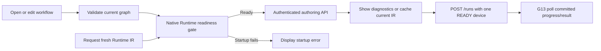

# Studio Runtime integration

## Overview

One native Runtime client serves Studio validation and compilation. The first
authoring request can start Runtime. Subsequent requests reuse the owned
process and check readiness before sending HTTP. This guide covers the current
authoring, single-device Test Run, and saved-run snapshot APIs. Multi-device
selection and scheduling remain Phase H.



## Validate and compile

Use the [managed lifecycle guide](managed_runtime.md) for launch and per-request
readiness. Opening the project list can leave Runtime stopped. Debounce
automatic editor validation and discard a response for a draft revision that
is no longer current.

| Operation | Request body | How to use the response |
|---|---|---|
| `POST {apiBaseUrl}/workflow-validation` | Object with `editorGraph` | Render the returned validation status and diagnostics for that graph revision. |
| `POST {apiBaseUrl}/workflow-compilation` | Object with `editorGraph` and `inputSchema` | Render `validation`. Cache a complete `runtimeIr` only if the same graph and schema revision is still current. Invalid source returns `runtimeIr: null`. |

Both requests use `Content-Type: application/json` and the current bearer
token. Capture the graph and schema as one source snapshot before compiling.
For Test Run, send the exact successfully compiled IR through
the run API and let admission validate it. Studio owns the draft and cache.

## Shutdown

Keep **Shut down Runtime** available while Studio owns the process. Suspend
automatic validation after explicit shutdown. The user can explicitly request
a Runtime operation to start it again. During an active single-device run, closing
Studio should offer **Stop and exit** or **Stay open**. Stop and exit sends the
private shutdown command and waits for G11 cancellation/child exit; it does not
require the later HTTP run-action API.

## Current API inventory and examples

Use [shared health and Runtime Info](managed_runtime.md#shared-api-reference)
for process diagnostics and readiness. The two routes below belong to Studio
authoring. Studio should send them from its native client using the current
child's URL and token. Studio also uses the [shared device routes](#android-device-picker).

### POST /api/v1/workflow-validation

Validate an Editor Graph as the publisher edits. Send exactly one
`editorGraph` object in a UTF-8 JSON request. Do not send query parameters,
compressed bodies, or extra envelope fields. The graph has a 1,048,576-byte
limit and the full validation body has a 1,052,672-byte limit.

Example request body for a valid Start → End graph:

```json
{
  "editorGraph": {
    "schemaVersion": 1,
    "entryNodeId": "start",
    "nodes": [
      {"id":"start","type":"flow.start","config":{},"bindings":{},"errorPolicy":"STOP","editor":{"x":0,"y":0}},
      {"id":"end","type":"flow.end","config":{},"bindings":{},"errorPolicy":"STOP","editor":{"x":160,"y":0}}
    ],
    "edges": [
      {"id":"e1","sourceNodeId":"start","sourcePort":"success","targetNodeId":"end"}
    ]
  }
}
```

HTTP 200 returns `status`, `errors`, `warnings`, and `truncated`.

```json
{"status":"VALID","errors":[],"warnings":[],"truncated":false}
```

The status can also be `VALID_WITH_WARNINGS` or `INVALID`. Render diagnostics
using `code`, `message`, and the `path` array, with `nodeId` or `edgeId` when
present. A valid JSON envelope with invalid graph content returns HTTP 200
with diagnostics. A malformed envelope returns HTTP 400, invalid credentials
return HTTP 401, and an oversized body or graph returns HTTP 413. Use the
[shared error envelope](managed_runtime.md#http-error-envelope) for HTTP
failures. Validation does not modify the draft or execute it.

### POST /api/v1/workflow-compilation

Request fresh IR for a captured Editor Graph and Input Schema. Send exactly
the `editorGraph` from the example above plus the `inputSchema` object below
in the same JSON envelope. This route uses the same headers and transport rules
as validation. The graph limit is 1,048,576 bytes and the full request limit
is 2,097,152 bytes.

```json
{"type":"object","properties":{},"required":[],"additionalProperties":false}
```

A completed request returns HTTP 200 with the validation result under
`validation` and a complete Runtime IR object under `runtimeIr` on success.
Use the [Runtime IR contract](../contracts/runtime_ir_v1.md) to decode it. A
success with warnings can still supply complete IR. Cache that IR only for
the same source revision. An invalid source response includes diagnostics
and `runtimeIr: null`. For example, an empty Input Schema object produces
diagnostics for the missing schema fields. Do not use an old or partial IR
as the result of a failed compilation.

This call has no draft, execution, or device side effects. It uses the same
400, 401, 413, and 500 envelope semantics as validation. Both authoring calls
can be retried after restoring readiness. Recheck the current draft revision
before applying a retry result.

For a native development smoke test with credentials from the owned child,
save the validation body above as `validation.json`. Make the authenticated
readiness probe first, then send the operation with the same session.

```sh
curl --noproxy '*' -fsS -H "Authorization: Bearer ${SESSION_TOKEN}" \
  "${API_BASE_URL}/runtime-info" >/dev/null &&
curl --noproxy '*' -sS -H "Authorization: Bearer ${SESSION_TOKEN}" \
  -H 'Content-Type: application/json' --data-binary @validation.json \
  "${API_BASE_URL}/workflow-validation"
```

For the compilation smoke test, use the same session and create the request
with `jq` from the saved validation body. The probe must succeed before the
compilation call.

```sh
jq '. + {inputSchema: {type: "object", properties: {}, required: [], additionalProperties: false}}' \
  validation.json > compilation.json
curl --noproxy '*' -fsS -H "Authorization: Bearer ${SESSION_TOKEN}" \
  "${API_BASE_URL}/runtime-info" >/dev/null &&
curl --noproxy '*' -sS -H "Authorization: Bearer ${SESSION_TOKEN}" \
  -H 'Content-Type: application/json' --data-binary @compilation.json \
  "${API_BASE_URL}/workflow-compilation"
```

Keep the token local and avoid shell tracing.

## Android device picker

When the publisher opens the picker to prepare a draft test run, use the
native client's per-request readiness check and refresh the device list.
Use the cached read to render a snapshot already obtained in the same
session. Provide a **Refresh devices** action for after the publisher
connects or authorizes a device. See the [shared E7 requests and responses](managed_runtime.md#device-inventory-api).

Use `adbSerial` as the selection key. Enable selection for `READY` entries and
show the reason for unavailable ones. After a successful refresh, retain
selections that are still ready and flag any that disappeared or became
unavailable. If refresh fails, an already displayed list can remain visible
with its refresh failure. The draft run API invokes E6 to recheck live readiness at admission.
Allow exactly one selected device for the current MVP.

## Start a single-device Test Run

### POST /api/v1/runs

This is the implemented Development execution endpoint for Studio's **Test Run**
button. Send an authenticated JSON POST to `{apiBaseUrl}/runs` after compiling
and selecting one READY device. The shared [POST /runs reference](managed_runtime.md#single-device-start-api)
contains the complete runnable request, full responses, limits, errors, and
Postman steps together in one section. The request mapping is:

| Start field | Studio value |
|---|---|
| requestId | A fresh lowercase UUID v4 for this new Run button intent. Keep it outside any retry function. |
| runtimeIr | The successful compilation response's runtimeIr object for the captured graph/schema revision. |
| devices | One-item array; the picker currently permits exactly one READY device. |
| devices[0].adbSerial | The exact selected serial returned by device refresh. |
| devices[0].inputs | Captured workflow-input form values matching that compiled input schema; {} when empty. |

Send the compiled object itself, without stringifying it separately or wrapping
it in the compilation response. Use `Content-Type: application/json`, the
current native-owned Bearer token, and no query parameters. The entire request
is limited to 4 MiB, and runtimeIr to 1 MiB. Validation/compilation do not execute
Android commands; a newly admitted POST /runs does.

### Expected native/UI sequence

1. Guard against duplicate Run clicks before the first asynchronous operation.
   Capture graph, Input Schema, workflow-input values, and selected serial as
   one intended test. Debounced authoring responses must not replace this capture.
2. Through the native readiness/auth gate, compile that graph/schema. Accept
   VALID or VALID_WITH_WARNINGS with non-null IR; show diagnostics otherwise.
3. Refresh devices and require the captured serial to be READY. Runtime still
   rechecks it at admission.
4. Create the requestId once and retain the prepared body in Studio state
   **before** calling POST. Keep the Run button disabled during preparation,
   submission, and while an unresolved/active run exists.
5. POST the retained body. On 201 or 200, immediately retain runGroup.id and
   render the returned snapshot. They use the same JSON shape; 201 means new
   admission, while 200 means an existing run with no new action dispatch.
6. Poll GET /runs/{runGroupId}, with readiness/auth checked for each request.
   Keep one poll outstanding, discard obsolete view responses, and stop on a
   terminal status. Do not wait for POST to hold the connection until completion.
7. If the start response is lost, retain the original body/requestId. Once
   readiness/current credentials are restored, submit that same body to resolve
   the run. Do not generate a new UUID inside a network retry handler.

### Framework-neutral TypeScript example

This is an integration example, not an installed SDK or existing Studio code.
Implement `NativeRuntime.request` in Studio's trusted native process/bridge
using the [managed lifecycle guide](managed_runtime.md). Before **each** call,
that adapter ensures actual readiness, uses the published base URL/current
token, and applies bounded transport timeouts. Its return value contains local
HTTP status plus parsed JSON; this is not an extra wire-response wrapper.
Non-2xx HTTP responses remain available for code-based handling; transport
failures reject the promise. Do not implement it as arbitrary browser-page
fetch with a token exposed to page code.

Paths passed to this adapter are relative to apiBaseUrl, such as `/runs`.
When body is undefined, omit the HTTP body entirely: GET snapshots and
POST /devices/refresh reject `{}`, `null`, and other nonempty bodies. The
adapter serializes a provided start/compilation object exactly once.

The snapshot type below lists only fields used by this flow. Studio's complete
wire DTO must also include the summary, device states, timestamps, and errors
shown in the shared full-response examples; preserve the complete response.

```typescript
type JsonObject = Record<string, unknown>;
type HttpReply<T> = { status: number; body: T };
interface NativeRuntime {
  request<T>(
    method: "GET" | "POST",
    path: string,
    body?: unknown,
  ): Promise<HttpReply<T>>;
}

type CompilationReply = {
  validation: { status: "VALID" | "VALID_WITH_WARNINGS" | "INVALID" };
  runtimeIr: JsonObject | null;
};
type InventoryReply = {
  devices: Array<{ adbSerial: string; status: "READY" | "UNAVAILABLE" }>;
};
type StartRequest = {
  requestId: string;
  runtimeIr: JsonObject;
  devices: [{ adbSerial: string; inputs: JsonObject }];
};
type RunSnapshot = {
  cursor: string;
  runGroup: { id: string; requestId: string; status: string };
};
const TERMINAL_RUN_STATES = new Set([
  "SUCCEEDED", "FAILED", "CANCELLED", "INTERRUPTED",
]);
const POLL_INTERVAL_MS = 1000;

async function prepareTestRun(
  runtime: NativeRuntime,
  editorGraph: JsonObject,
  inputSchema: JsonObject,
  adbSerial: string,
  inputs: JsonObject,
): Promise<StartRequest> {
  const captured = structuredClone({ editorGraph, inputSchema, inputs });
  const compiled = await runtime.request<CompilationReply>(
    "POST", "/workflow-compilation",
    { editorGraph: captured.editorGraph, inputSchema: captured.inputSchema },
  );
  if (compiled.status !== 200) throw compiled;
  if (
    !["VALID", "VALID_WITH_WARNINGS"].includes(compiled.body.validation.status) ||
    compiled.body.runtimeIr === null
  ) {
    throw { operation: "compile", validation: compiled.body.validation };
  }

  const inventory = await runtime.request<InventoryReply>(
    "POST", "/devices/refresh",
  );
  if (inventory.status !== 200) throw inventory;
  if (!inventory.body.devices.some(
    (device) => device.adbSerial === adbSerial && device.status === "READY",
  )) {
    throw new Error("Select one READY Android device");
  }

  return {
    requestId: crypto.randomUUID(),
    runtimeIr: compiled.body.runtimeIr,
    devices: [{ adbSerial, inputs: captured.inputs }],
  };
}

async function submitPreparedRun(
  runtime: NativeRuntime,
  pending: StartRequest,
): Promise<RunSnapshot> {
  // Retry this function with the same pending object after an uncertain result.
  const reply = await runtime.request<RunSnapshot>("POST", "/runs", pending);
  if (reply.status !== 201 && reply.status !== 200) throw reply;
  return reply.body;
}

async function pollRun(
  runtime: NativeRuntime,
  runGroupId: string,
  signal: AbortSignal,
  showSnapshot: (snapshot: RunSnapshot) => void,
): Promise<void> {
  while (!signal.aborted) {
    let reply: HttpReply<RunSnapshot>;
    try {
      reply = await runtime.request<RunSnapshot>(
        "GET", `/runs/${encodeURIComponent(runGroupId)}`,
      );
    } catch (error) {
      if (signal.aborted) return;
      throw error;
    }
    if (signal.aborted) return; // Ignore responses for a closed/obsolete view.
    if (reply.status !== 200) throw reply;
    showSnapshot(reply.body);
    if (TERMINAL_RUN_STATES.has(reply.body.runGroup.status)) return;
    await new Promise<void>((resolve) => setTimeout(resolve, POLL_INTERVAL_MS));
  }
}
```

Studio's controller owns the variables and calls these functions in order:

| Controller step | State to retain |
|---|---|
| `pending = await prepareTestRun(...)` | Keep the returned body in the current Test Run intent before submission. Do not mutate it when the editor changes. |
| `initial = await submitPreparedRun(runtime, pending)` | Store initial.runGroup.id immediately and render initial. Keep requestId linked to this result. |
| `await pollRun(runtime, initial.runGroup.id, viewSignal, showSnapshot)` | Stop/replace the polling view safely. If initial is already terminal, skip polling. |
| Start response uncertain | Keep pending and call submitPreparedRun with that same object after readiness; do not call prepareTestRun to retry. |
| Publisher deliberately starts another test after settlement | Call prepareTestRun again to capture new intent and create a fresh UUID. |

Do not clear pending unconditionally in a finally block. A transport failure or
500 can leave an admitted run executing. The adapter's owner/readiness recovery
must preserve that identity. Keep credentials in the native adapter, not in
pending, Editor Graph, Runtime IR, persisted draft data, or UI logs.

### Handle POST results in the UI

| Result | UI behavior |
|---|---|
| 201 | A new run exists. Render and poll it; never equate admission with success. |
| 200 | Existing run returned. Render its state; no actions executed again. A SUCCEEDED replay is an old completed result. |
| 400 / 413 | Show the request/selection/size problem and fix it. Do not relaunch a healthy process. |
| 401 | Refresh actual owner/session readiness and credentials; retain pending run identity. |
| 409 RUNTIME_BUSY | Show the active run or wait for it to settle before retrying the same pending intent. |
| 422 with validation | Render diagnostic message/path/node fields. Fix/recompile or use a compatible Runtime build. |
| 422 device-availability code | Refresh selection and explain the unavailable device. No run was admitted. |
| 503 ADB_UNAVAILABLE | Show device-subsystem failure; retry after ADB is fixed. |
| 503 INTERNAL_ERROR | Runtime is stopping. Follow owner replacement rules and obtain fresh credentials. |
| 500 or lost response | Keep pending. Restore actual readiness and resolve with the original ID; do not automatically create another run. |

Errors have the shared error envelope and may include bounded validation.
Preserve HTTP status and parsed error code instead of relying only on messages.
The default 0.0.0-dev build can compile but fails execution version admission;
show RUNTIME_INCOMPATIBLE and use a compatible versioned build. Neither a
semantic rejection nor an ordinary saved-result 404 is process-death evidence.

For local testing, follow the [script-free Postman steps](managed_runtime.md#postman-check-without-scripts).
A new UUID should return 201; the exact same POST returns 200 and the same
RunGroup ID; a deliberate new intent after completion gets a new UUID/group.
Include intentional owner shutdown during a delay and reopening the saved
terminal result in Studio's integration acceptance.

SSE/log streaming, attempt history, run-control APIs, and multiple selected
devices remain later work. Phase H's [expansion checklist](../g_workflow_engine/g14_start_run_api.md#15-phase-h-expansion-checklist)
records the later picker/admission/scheduling changes.

## Run progress and saved results

The two [shared snapshot APIs](managed_runtime.md#run-snapshot-apis) are available:

| Studio action | Request | Result handling |
|---|---|---|
| Find the current run after opening the execution view | `GET {apiBaseUrl}/runs/active` | 200 supplies the active snapshot; 404 means the view has no active run. |
| Refresh a known run or inspect retained history | `GET {apiBaseUrl}/runs/{runGroupId}` | 200 supplies that saved run, including its terminal result; 404 means that ID is absent from this store. |

Keep the RunGroup ID separate from the request ID, graph node IDs, and selected
device IDs. Use one native per-request readiness check and current bearer token
for each read. No body or query is accepted. Use the shared Linux/Windows/Postman
examples and [saved-result demo](managed_runtime.md#optional-saved-result-fixture-without-android).
Use G14 POST /runs for the single-device start; do not send a workflow to
either GET.

Render group status and summary counts, then per-device status, saved next-node
position, timestamps, and terminal error. Preserve device order and the cursor
string. Replacing a displayed snapshot is a client refresh operation; it changes
no workflow data. Keep at most one snapshot poll outstanding per execution view,
cancel obsolete reads on navigation, and discard responses belonging to another
selected run. Once the known run is terminal, stop automatic live polling and
retain its result for inspection. After active returns 404, a saved ID can still
retrieve the completed result.

A snapshot 404 after successful readiness is a data result and does not request
Runtime relaunch. Handle read failures separately from the last displayed run
state; a 500 or broken connection is not evidence that the workflow succeeded,
failed, or disappeared. Use the shared owner/session replacement policy for an
actual readiness failure. SSE/logs, attempt history, and run-control requests
remain separate integration work. Shared snapshot tests and built-agent checks
pass on Linux; native Windows usage is documented but not executed here.
